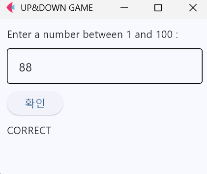
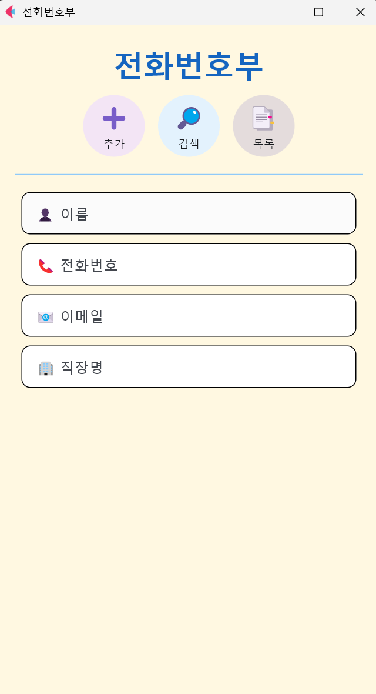
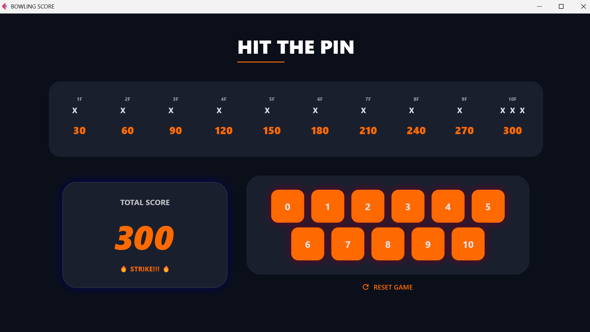

# 🐍 Python Learning

파이썬 학습 과정 전체를 기록하는 공간.

## 📌 목차

- [📚 study_archive](#study)
- [✏️ practice](#practice)
- [🖥️ flet_projects](#flet)
- [🪟 tkinter_examples](#tkinter)

---

## 📚 [study_archive](study_archive/)

파이썬 이론 노트와 자료구조 구현

- [theory](study_archive/theory/): 이론 노트 15편
  - 기초 문법: [파이썬 기초](study_archive/theory/01_python_basics.md), [변수·리터럴](study_archive/theory/02_variables_literals.md), [자료형](study_archive/theory/03_data_types.md), [형변환·입출력](study_archive/theory/04_type_casting_io.md), [연산자](study_archive/theory/05_operators.md), [import·네임스페이스](study_archive/theory/06_import_namespace.md)
  - 흐름 제어와 함수: [흐름 제어](study_archive/theory/07_flow_control.md), [함수](study_archive/theory/08_functions.md)
  - 문제 풀이와 실습: [가위바위보](study_archive/theory/09_rps_game.md), [연습문제](study_archive/theory/10_practice.md), [알고리즘 문제](study_archive/theory/11_algorithm_problems.md), [장바구니·매출 시스템](study_archive/theory/12_shopping_cart_sales_system.md)
  - 예외, 클래스, 파일: [예외 처리](study_archive/theory/13_exceptions.md), [클래스와 객체지향](study_archive/theory/14_classes_oop.md), [파일 입출력](study_archive/theory/15_file_io_csv_excel.md)
- [data_structures](study_archive/data_structures/): 자료구조 구현
  - 기본 자료구조: [백](study_archive/data_structures/00_bag.py), [리스트](study_archive/data_structures/01_list.py), [줄 편집기](study_archive/data_structures/02_line_editor.py), [집합](study_archive/data_structures/03_set.py)
  - 스택과 큐: [스택](study_archive/data_structures/04_stack.py), [큐](study_archive/data_structures/06_queue.py), [덱](study_archive/data_structures/08_deque.py), [우선순위 큐](study_archive/data_structures/09_priorityqueue.py)
  - 미로 탐색: [DFS](study_archive/data_structures/05_DFS.py), [BFS](study_archive/data_structures/07_BFS.py), [우선순위 큐 미로](study_archive/data_structures/10_maze.py)
  - 트리: [이진 트리](study_archive/data_structures/tree.ipynb)

---

## ✏️ [practice](practice/)

기초 문법 연습, 데이터 분석, 코딩테스트 풀이

- [python_basics](practice/python_basics/): 기초 문법 연습
  - [문자열 메서드 실습](practice/python_basics/20260322_strformat.ipynb)
  - [마트 상품 DB 구성](practice/python_basics/20260402_mart_db_TIL.ipynb): 중첩 딕셔너리로 상품 87개 생성
- [pandas](practice/pandas/): 에어코리아 대기오염 데이터를 pandas로 정리하고 matplotlib으로 시각화 (Colab)
  - [분석 노트북](practice/pandas/air_pollution_pandas.ipynb)
  - [분석 데이터](practice/pandas/data/): 에어코리아 측정 데이터(엑셀)
- [codingtest](practice/codingtest/): 프로그래머스 코딩테스트 풀이 (Python3)
  - [2026_04](practice/codingtest/2026_04/), [2026_05](practice/codingtest/2026_05/)

---

## 🖥️ [flet_projects](flet_projects/)

이론을 적용한 Flet 데스크탑 앱 6개

<table>
<tr>
<td align="center" valign="bottom"> UP-DOWN Game</td>
<td align="center" valign="bottom"> Phonenumber Book</td>
<td align="center" valign="bottom"> Rock Paper Scissors</td>
</tr>
<tr>
<td align="center" valign="bottom"> POS System</td>
<td align="center" valign="bottom"> Number Data Handler</td>
<td align="center" valign="bottom"> Bowling Score</td>
</tr>
</table>

- [UP-DOWN Game](flet_projects/up_down_game/): 숫자 맞추기 게임 (난수 비교, UP/DOWN 피드백)
- [Phonenumber Book](flet_projects/phonenumber_book/): 연락처 추가·검색·조회·삭제 앱
- [Rock Paper Scissors](flet_projects/RSP_game/): 5판 3승제 가위바위보 게임
- [POS System](flet_projects/POS_system/): 편의점 POS·관리자 시스템 (SQLite 연동)
- [Number Data Handler](flet_projects/Calculator/): 7종 연산·통계 계산 앱
- [Bowling Score](flet_projects/Bowling_score/): 스트라이크·스페어 반영 점수 계산 앱

---

## 🪟 [tkinter_examples](tkinter_examples/)

tkinter 기본 위젯과 이벤트 처리 방식 학습 (2026년 3월)

- [20260306_tkinter_basics.py](tkinter_examples/20260306_tkinter_basics.py): 빈 창, Label, Button 카운터, Entry + Enter 키
- [20260309_tkinter.py](tkinter_examples/20260309_tkinter.py): Label 스타일, Entry 검증, Text, Frame
- [20260320_tkinter.py](tkinter_examples/20260320_tkinter.py): Button 클릭 이벤트, `lambda` 콜백, `messagebox`