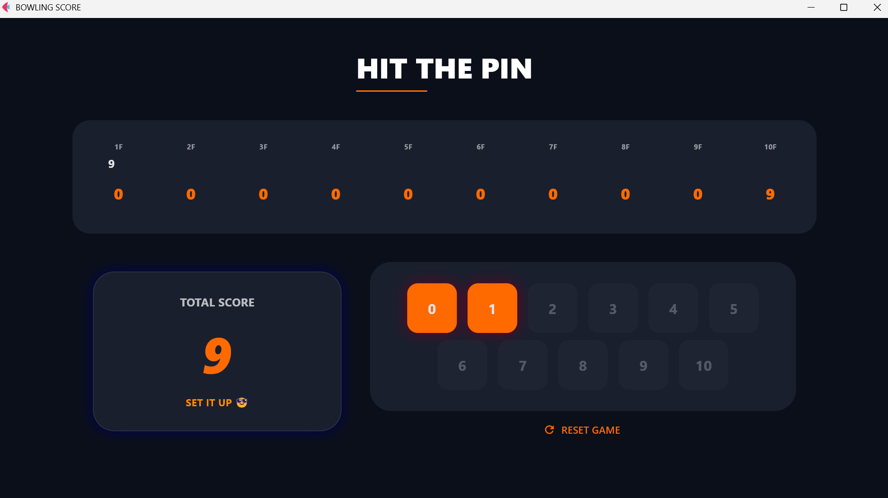
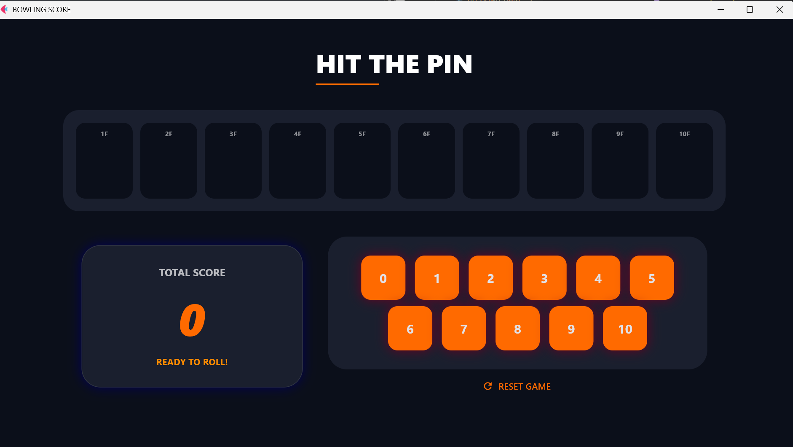
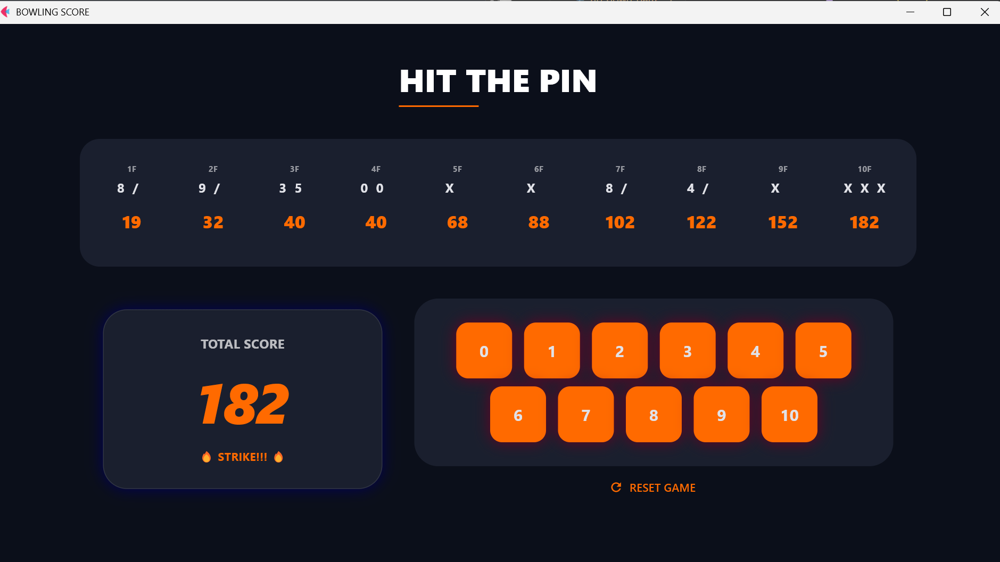

# Bowling Score (HIT THE PIN)

Flet 기반 볼링 점수 계산 앱 (스트라이크·스페어 보너스 반영)

## 프로젝트 소개

- 리스트·반복문·조건문 이론을 알고리즘 구현에, 클래스 이론을 UI 상태 관리에 적용하기 위해 개발
- 스트라이크·스페어 보너스 규칙을 반영한 점수 계산 알고리즘 구현

## 적용 이론 및 구현 내용

**핵심 역량**: 점수 계산 알고리즘, 클래스 설계, 상태 기반 UI 제어

| 역량 | 구현 내용 | 이론 |
|---|---|---|
| 점수 계산 알고리즘 | 롤 목록 기반 프레임별 점수 계산(`calculate_score`): 스트라이크는 다음 두 롤, 스페어는 다음 한 롤 보너스, 10프레임은 남은 롤 최대 3개 합산, 12연속 스트라이크 시 300점 | [11_algorithm_problems](../../study_archive/theory/11_algorithm_problems.md) |
| 클래스 설계 | `BowlingApp` 하나로 화면·상태·계산 관리 | [14_classes_oop](../../study_archive/theory/14_classes_oop.md) |
| 상태 기반 UI 제어 | 남은 핀 수에 따라 선택 가능한 점수 버튼만 활성화(`create_buttons`) | [07_flow_control](../../study_archive/theory/07_flow_control.md) |
| 점수판 렌더링 | 롤 목록을 X, /, 숫자로 표기(`render_scoreboard`) | [03_data_types](../../study_archive/theory/03_data_types.md) |
| 이벤트 처리 | 버튼 `data` 속성으로 점수 전달 | [08_functions](../../study_archive/theory/08_functions.md) |

## 구현 결과 및 실행

### 스크린샷

<table>
<tr><td align="center" valign="top"><br><sub>게임 시작 — 1프레임 첫 투구 9핀 입력, 남은 핀 수(1핀) 초과 버튼은 비활성화</sub></td><td align="center" valign="top"><br><sub>PERFECT GAME — 12연속 스트라이크, 프레임마다 30점씩 누적되어 300점</sub></td></tr>
</table>

<details>
<summary>스크린샷 더 보기</summary>

<table>
<tr><td align="center" valign="top"><br><sub>홈 화면 — 10프레임 점수판, TOTAL SCORE 0, 0~10 투구 버튼, RESET GAME</sub></td><td align="center" valign="top"><br><sub>경기 중 — 스페어(/)·스트라이크(X) 표기와 프레임별 누적 점수, 10프레임 X X X, 총점 182</sub></td></tr>
</table>

</details>

### 사용 기술

Python, Flet

### 개선 방향

- 10프레임 추가 롤 조건(스트라이크·스페어) 반영
- 게임 종료 처리와 최종 점수 화면

### 실행 방법

```bash
pip install flet
python flet_bowlingpoints.py
```

### 파일 구성

- `flet_bowlingpoints.py`: 전체 코드
- `images/`: 스크린샷