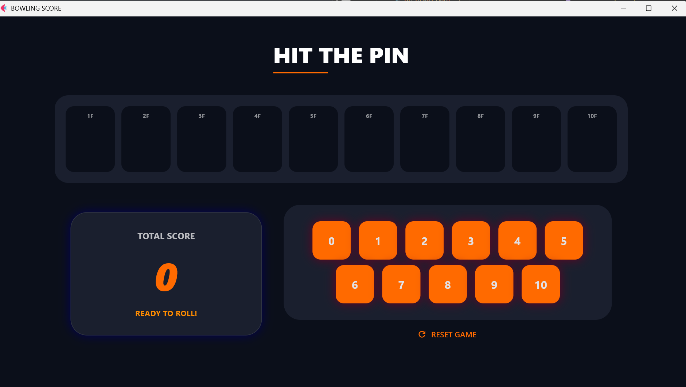
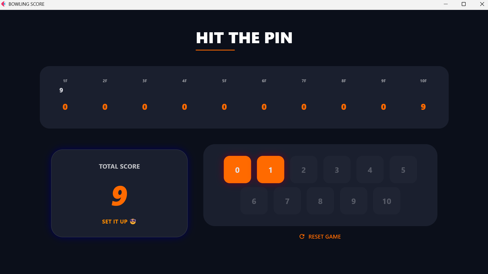
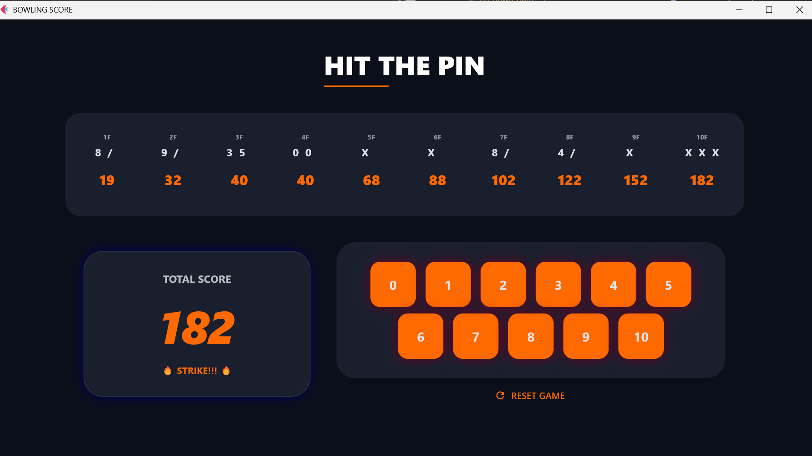

# Bowling Score (HIT THE PIN) &nbsp;&nbsp;&nbsp;&nbsp;&nbsp;<sup><sub>2026.04</sub></sup>

Flet으로 만든 볼링 점수 계산 앱.

투구마다 쓰러뜨린 핀 수를 누르면 스트라이크 · 스페어 보너스를 반영해 프레임별 점수와 총점을 계산.


## 핵심 코드

### 점수 계산

[flet_bowlingpoints.py](flet_bowlingpoints.py) · 이론 정리: [알고리즘 문제 (볼링 점수)](../../study_archive/theory/11_algorithm_problems.md) · [흐름 제어](../../study_archive/theory/07_flow_control.md) · [클래스](../../study_archive/theory/14_classes_oop.md)

투구 기록 리스트를 앞에서부터 읽으며, 스트라이크는 다음 두 투구, 스페어는 다음 한 투구를 보너스로 더함.

```python
def calculate_score(self):
    score = 0
    idx = 0
    self.frame_scores = []

    for frame in range(10):
        if idx >= len(self.rolls):
            break

        if frame == 9:                                    # 10프레임은 남은 투구(최대 3개) 합산
            score += sum(self.rolls[idx:idx+3])
            self.frame_scores.append(score)
            break

        if self.rolls[idx] == 10:                         # 스트라이크: 다음 두 투구 보너스
            bonus = 0
            if idx + 1 < len(self.rolls):
                bonus += self.rolls[idx + 1]
            if idx + 2 < len(self.rolls):
                bonus += self.rolls[idx + 2]
            score += 10 + bonus
            idx += 1

        elif idx + 1 < len(self.rolls):
            if self.rolls[idx] + self.rolls[idx + 1] == 10:   # 스페어: 다음 한 투구 보너스
                bonus = self.rolls[idx + 2] if idx + 2 < len(self.rolls) else 0
                score += 10 + bonus
            else:
                score += self.rolls[idx] + self.rolls[idx + 1]
            idx += 2

        self.frame_scores.append(score)

    return score
```

## 주요 기능

| 기능 | 설명 |
|---|---|
| 점수 계산 | 스트라이크 · 스페어 보너스 반영, 12연속 스트라이크 시 300점 |
| 버튼 제어 | 남은 핀 수를 넘는 점수 버튼 비활성화 |
| 점수판 | 투구 기록을 X, /, 숫자로 표기, 프레임별 누적 점수 |
| 상태 관리 | `BowlingApp` 클래스 하나로 화면 · 투구 기록 · 점수 관리 |

<details>
<summary>전체 화면 보기</summary>

| 시작 화면 | 1프레임 투구 | 경기 중 (182점) |
|---|---|---|
|  |  |  |

</details>

## 개선 방향

- 10프레임 추가 투구 조건(스트라이크 · 스페어) 반영
- 게임 종료 처리와 최종 점수 화면

## 파일 구조

```
Bowling_score/
├── flet_bowlingpoints.py   # 전체 코드
├── images/                 # README 스크린샷
└── README.md
```

## 실행 방법

```
pip install flet
python flet_bowlingpoints.py
```
