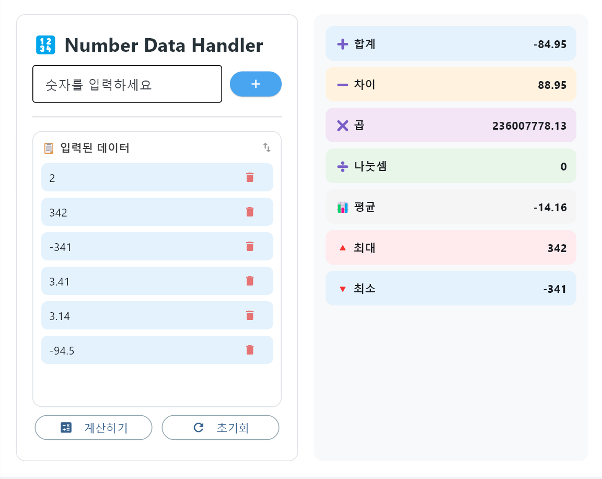
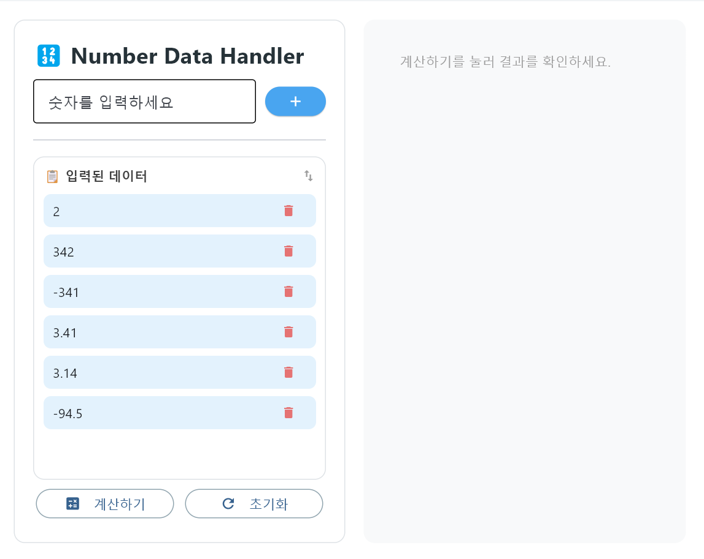

# Number Data Handler &nbsp;&nbsp;&nbsp;&nbsp;&nbsp;<sup><sub>2026.04</sub></sup>

Flet으로 만든 숫자 데이터 처리 앱.

숫자를 여러 개 입력하면 합계 · 차이 · 곱 · 나눗셈 · 평균 · 최대 · 최소 7가지를 한 번에 계산.




## 핵심 코드

### 입력 파싱

[flet_calculator_class.py](flet_calculator_class.py) · 이론 정리: [클래스](../../study_archive/theory/14_classes_oop.md) · [자료형](../../study_archive/theory/03_data_types.md) · [형 변환](../../study_archive/theory/04_type_casting_io.md)

괄호를 지우고 쉼표로 나눈 뒤 정규식으로 숫자만 골라내고, 숫자가 아닌 입력은 따로 분류.

```python
def _extract_numbers(self):
    numbers = []
    non_numbers = []
    pattern = r"^[-+]?\d*\.?\d+$"                    # 정수 · 음수 · 실수

    for item in self.raw_data:
        cleaned = re.sub(r"[()\[\]{}]", "", item)    # 괄호 제거
        parts = cleaned.split(",")                   # "(1, 2, 3)" 같은 묶음 입력 분리

        temp_numbers = []
        valid = True
        for p in parts:
            p = p.strip()
            if re.fullmatch(pattern, p):
                temp_numbers.append(float(p))
            else:
                valid = False

        if valid and temp_numbers:
            numbers.extend(temp_numbers)
        else:
            non_numbers.append(item)                  # 숫자가 아닌 입력은 따로 표시

    return numbers, non_numbers
```

## 주요 기능

| 기능 | 설명 |
|---|---|
| 7종 연산 | 합계, 차이, 곱, 나눗셈, 평균, 최대, 최소 |
| 입력 파싱 | 괄호 · 쉼표 입력 처리, 정규식 숫자 판별, 숫자가 아닌 입력 별도 표시 |
| 예외 처리 | 나눗셈에 0이 있으면 "계산불가" |
| 출력 형식 | 소수 둘째 자리 반올림, 정수는 정수로 표시 |
| 구조 비교 | 같은 기능을 함수형 · 클래스형으로 각각 구현 |

<details>
<summary>전체 화면 보기</summary>

| 시작 화면 | 데이터 입력 |
|---|---|
|  |  |

</details>

## 개선 방향

- 같은 값을 중복 입력한 경우 삭제 로직을 인덱스 기반으로 개선

## 파일 구조

```
Calculator/
├── flet_calculator_class.py   # 클래스 기반 버전
├── flet_calculator.py         # 함수 기반 버전 (여러 줄 입력 한 번에 계산)
├── images/                    # README 스크린샷
└── README.md
```

## 실행 방법

```
pip install flet
python flet_calculator_class.py
```
