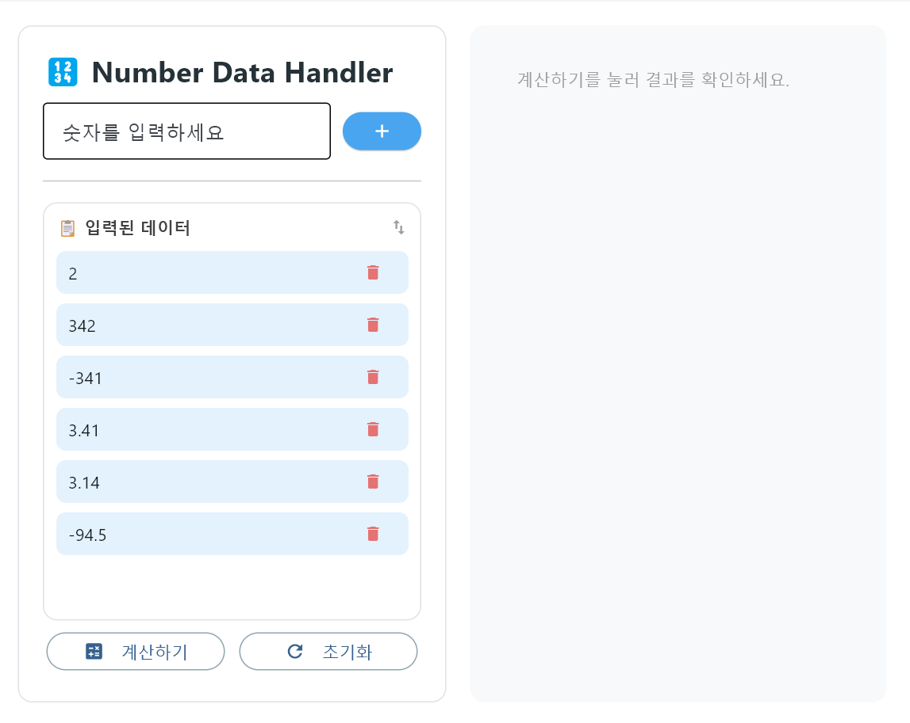

# Number Data Handler

Flet 기반 숫자 데이터 처리 앱 (7종 연산·통계 계산)

## 프로젝트 소개

- 클래스 상속과 입력 데이터 처리 이론을 적용하고 설계 방식에 따른 구조 차이를 비교하기 위해 개발
- 동일 기능을 함수형·클래스형으로 각각 구현

## 적용 이론 및 구현 내용

**핵심 역량**: 클래스 설계, 정규식 입력 파싱, 함수형·클래스형 구조 비교

| 역량 | 구현 내용 | 이론 |
|---|---|---|
| 클래스 설계 | `ft.Container`를 상속한 클래스(`CalculatorApp`)로 앱 구성 | [14_classes_oop](../../study_archive/theory/14_classes_oop.md) |
| 입력 파싱 | `re.fullmatch` 정규식으로 숫자 판별, 괄호·쉼표 입력 파싱(`_extract_numbers`) | - |
| 데이터 분류 | 숫자가 아닌 입력은 분류해 별도 표시 | [03_data_types](../../study_archive/theory/03_data_types.md) |
| 예외 상황 처리 | 나눗셈에 0이 포함되면 "계산불가" 표시 | [07_flow_control](../../study_archive/theory/07_flow_control.md) |
| 출력 형식 | 소수 둘째 자리 반올림, 정수는 정수로 표시(`_format_value`) | [04_type_casting_io](../../study_archive/theory/04_type_casting_io.md) |
| 이벤트 핸들러 | 삭제 버튼에 `lambda e, v=value:`로 항목별 이벤트 연결 | [08_functions](../../study_archive/theory/08_functions.md) |
| 구조 비교 | 같은 기능을 함수 기반(`flet_calculator.py`)과 클래스 기반으로 구현 | [08_functions](../../study_archive/theory/08_functions.md), [14_classes_oop](../../study_archive/theory/14_classes_oop.md) |

## 구현 결과 및 실행

### 스크린샷

<table>
<tr><td align="center" valign="top"><br><sub>데이터 입력 — 정수·음수·실수 6개(2, 342, -341, 3.41, 3.14, -94.5) 등록, 항목별 삭제 버튼</sub></td><td align="center" valign="top"><br><sub>계산 결과 — 합계 -84.95, 차이 88.95, 곱 236007778.13, 나눗셈, 평균 -14.16, 최대 342, 최소 -341</sub></td></tr>
</table>

<details>
<summary>스크린샷 더 보기</summary>

<table>
<tr><td align="center" valign="top"><br><sub>홈 화면 — 숫자 입력창과 + 버튼, 빈 입력 목록, 계산하기·초기화 버튼, 결과 안내 문구</sub></td></tr>
</table>

</details>

### 사용 기술

Python, Flet, `re`

### 개선 방향

- 같은 값을 중복 입력한 경우 삭제 로직을 인덱스 기반으로 개선

### 실행 방법

```bash
pip install flet
python flet_calculator_class.py
```

### 파일 구성

- `flet_calculator_class.py`: 클래스 기반 버전
- `flet_calculator.py`: 함수 기반 버전 (여러 줄 입력을 한 번에 계산)
- `images/`: 스크린샷