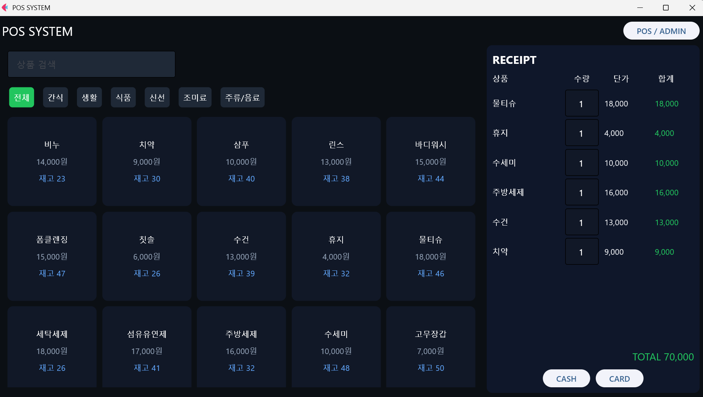
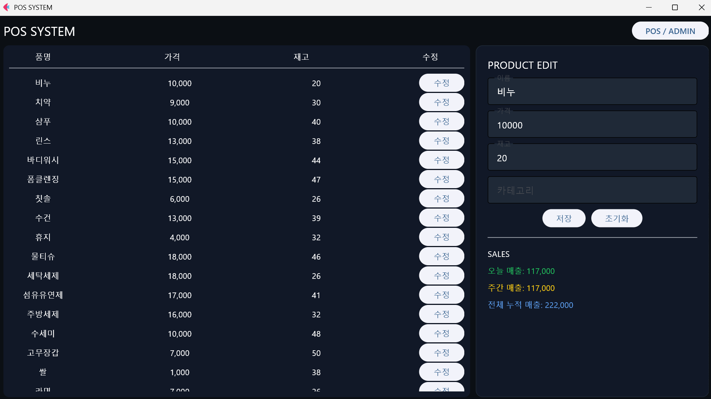
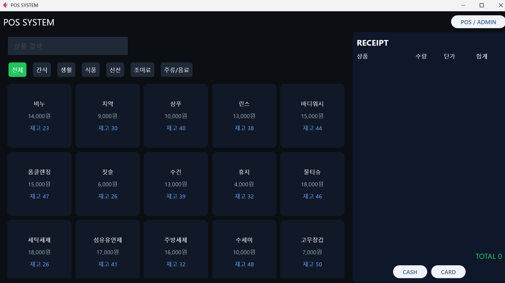
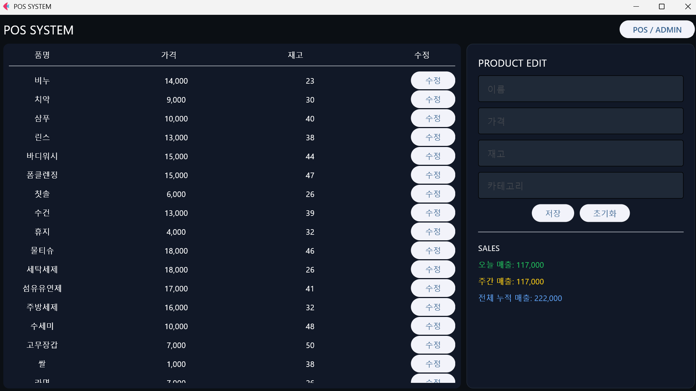

# POS System

Flet 기반 편의점 POS·관리자 시스템 (SQLite 연동)

## 프로젝트 소개

- 함수 단위 모듈화, 딕셔너리 자료구조, 예외 처리 이론을 적용하고 SQLite 저장 계층을 더하기 위해 개발
- 딕셔너리 기반으로 설계한 장바구니·매출 시스템을 DB 연동 애플리케이션으로 확장

## 적용 이론 및 구현 내용

**핵심 역량**: DB 계층 분리, SQLite 집계 쿼리, 파라미터 바인딩, 상태 관리

| 역량 | 구현 내용 | 이론 |
|---|---|---|
| DB 계층 분리 | `get_products()`, `get_sales()`, `pay()` 등 함수 단위로 구성 | [08_functions](../../study_archive/theory/08_functions.md) |
| SQLite CRUD | 매출 `INSERT`, 상품 `SELECT`, 가격·재고·카테고리 `UPDATE` | [12_shopping_cart_sales_system](../../study_archive/theory/12_shopping_cart_sales_system.md) |
| 집계 쿼리 | `SUM`, `LIKE`, `IFNULL`로 일일·주간·누적 매출 산출 | [12_shopping_cart_sales_system](../../study_archive/theory/12_shopping_cart_sales_system.md) |
| 파라미터 바인딩 | 값이 들어가는 모든 쿼리에 `?` 사용, SQL 인젝션 방지 | [12_shopping_cart_sales_system](../../study_archive/theory/12_shopping_cart_sales_system.md) |
| 상태 관리 | 딕셔너리 기반 장바구니, 수량 변경 시 영수증·총액 즉시 갱신 | [03_data_types](../../study_archive/theory/03_data_types.md) |
| 입력 검증 | `try/except`로 숫자가 아닌 수량 입력 무시 | [13_exceptions](../../study_archive/theory/13_exceptions.md) |
| 이벤트 핸들러 | 반복문 안에서 `lambda e, n=name:`으로 상품별 이벤트 연결 | [08_functions](../../study_archive/theory/08_functions.md) |
| 동적 렌더링 | 상품 검색·카테고리 필터로 상품 그리드 갱신 | [07_flow_control](../../study_archive/theory/07_flow_control.md) |

## 구현 결과 및 실행

### 스크린샷

<table>
<tr><td align="center" valign="top"><br><sub>POS 모드 — 상품 선택 시 영수증에 수량·단가·합계 반영, TOTAL 70,000 (6개 상품)</sub></td><td align="center" valign="top"><br><sub>ADMIN 모드 수정 후 — 비누 14,000→10,000원, 재고 23→20 저장이 상품 표에 반영</sub></td></tr>
</table>

<details>
<summary>스크린샷 더 보기</summary>

<table>
<tr><td align="center" valign="top"><br><sub>POS 모드 초기 화면 — 상품 검색, 카테고리 필터 7종, 상품 카드(가격·재고), 빈 영수증, CASH/CARD 버튼</sub></td><td align="center" valign="top"><br><sub>ADMIN 모드 수정 전 — 상품 표(품명·가격·재고·수정 버튼), 빈 PRODUCT EDIT 폼, SALES(오늘·주간·누적 매출)</sub></td></tr>
</table>

</details>

### 사용 기술

Python, Flet, SQLite(`sqlite3`)

### 개선 방향

- 결제 시 재고 차감 로직 추가
- 결제 수단별(CASH/CARD) 매출 구분 기록
- 상품 추가·삭제 기능으로 CRUD 완성

### 실행 방법

```bash
pip install flet
python flet_pos_system.py
```

### 파일 구성

- `flet_pos_system.py`: 전체 코드
- `mart.db`: 상품 87개, 매출 데이터
- `images/`: 스크린샷