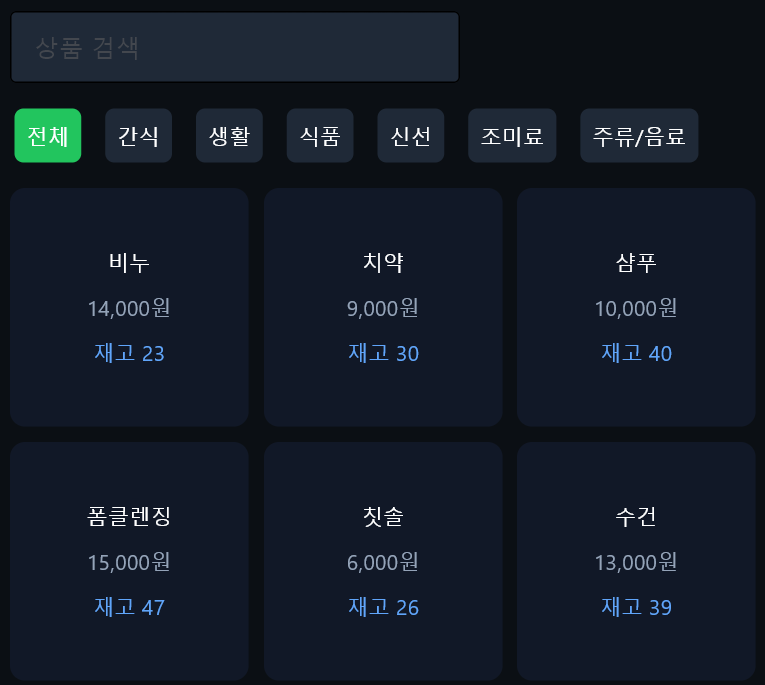
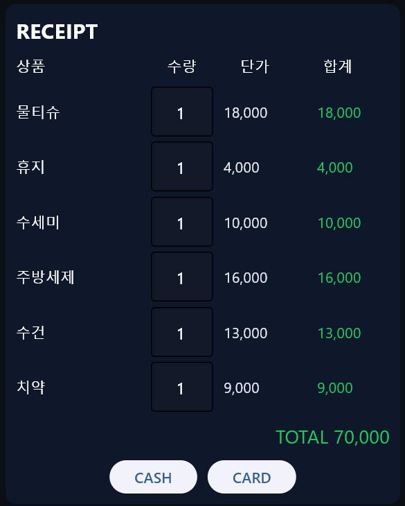
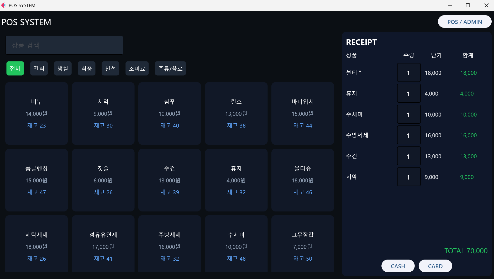
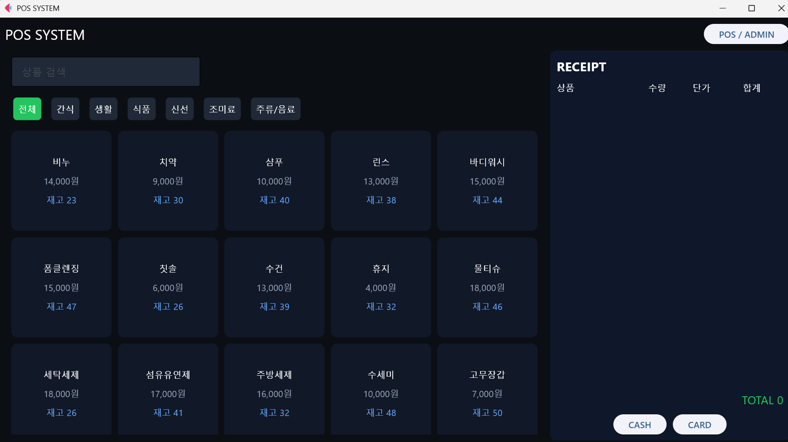
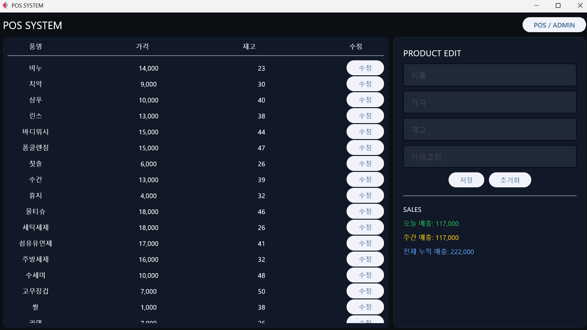
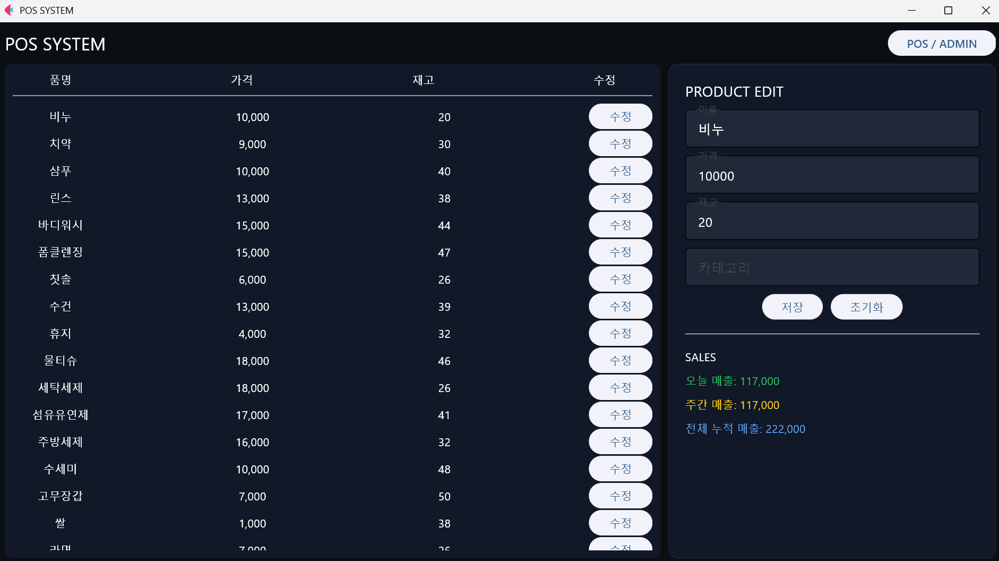

# POS System &nbsp;&nbsp;&nbsp;&nbsp;&nbsp;<sup><sub>2026.04</sub></sup>

Flet과 SQLite로 만든 편의점 POS · 관리자 시스템.

POS 모드에서 상품을 담아 결제하고, ADMIN 모드에서 상품 가격 · 재고를 수정하고 매출을 확인.


| 상품 목록 | 영수증 |
|---|---|
|  |  |

## 핵심 코드

### 매출 집계

[flet_pos_system.py](flet_pos_system.py) · 이론 정리: [장바구니 · 매출 시스템](../../study_archive/theory/12_shopping_cart_sales_system.md) · [함수](../../study_archive/theory/08_functions.md)

매출 테이블에서 오늘 · 최근 7일 · 누적 매출을 `SUM`으로 집계하고, 값은 모두 `?` 파라미터로 전달.

```python
def get_sales():
    con = db()
    cur = con.cursor()

    today = datetime.now().strftime("%Y-%m-%d")
    week_ago = (datetime.now() - timedelta(days=7)).strftime("%Y-%m-%d")

    # 매출이 없으면 IFNULL로 0 반환, 값은 ? 바인딩으로 전달
    cur.execute("SELECT IFNULL(SUM(amount),0) FROM sales WHERE date LIKE ?", (today + "%",))
    today_sales = cur.fetchone()[0]

    cur.execute("SELECT IFNULL(SUM(amount),0) FROM sales WHERE date >= ?", (week_ago,))
    week_sales = cur.fetchone()[0]

    cur.execute("SELECT IFNULL(SUM(amount),0) FROM sales")
    total_sales = cur.fetchone()[0]

    con.close()
    return today_sales, week_sales, total_sales
```

## 주요 기능

| 기능 | 설명 |
|---|---|
| POS 모드 | 상품 검색, 카테고리 필터 7종, 수량 변경 시 영수증 · 총액 즉시 갱신 |
| 결제 | 장바구니 총액을 매출 테이블에 `INSERT` |
| ADMIN 모드 | 상품 가격 · 재고 · 카테고리 `UPDATE`, 오늘 · 주간 · 누적 매출 표시 |
| DB 계층 분리 | `get_products()`, `get_sales()`, `pay()` 등 함수 단위 구성, 모든 쿼리 `?` 바인딩 |
| 입력 검증 | `try/except`로 숫자가 아닌 수량 입력 무시 |

<details>
<summary>전체 화면 보기</summary>

| POS 전체 화면 | POS 초기 화면 |
|---|---|
|  |  |

| ADMIN 수정 전 | ADMIN 수정 후 |
|---|---|
|  |  |

</details>

## 개선 방향

- 결제 시 재고 차감, 결제 수단별(CASH/CARD) 매출 구분
- 상품 추가 · 삭제 기능

## 파일 구조

```
POS_system/
├── flet_pos_system.py   # 전체 코드
├── mart.db              # 상품 87개, 매출 데이터
├── images/              # README 스크린샷
└── README.md
```

## 실행 방법

```
pip install flet
python flet_pos_system.py
```
