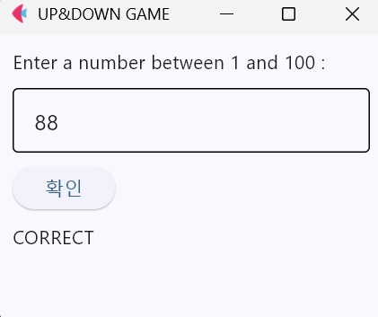
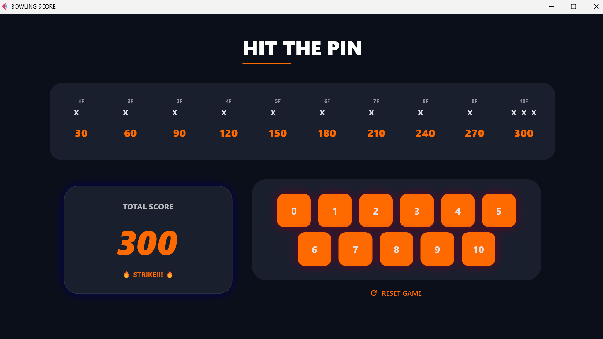
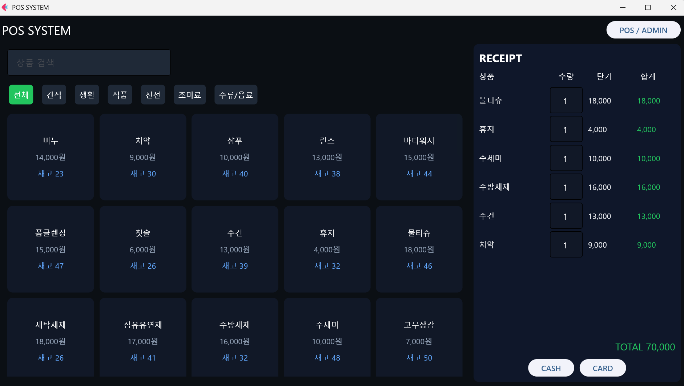

# Flet Projects

파이썬 이론으로 배운 내용을 Flet 데스크톱 앱으로 만들어 본 프로젝트 모음입니다.<br>
이벤트 처리 → 상태 관리 → 클래스 → DB 연동 순서로 규모를 키우며 연습했습니다.

---

## 📁 1단계 이벤트 · 상태 관리

### 1. 🔢 UP-DOWN Game

> 컴퓨터가 고른 숫자를 UP / DOWN 힌트로 맞히는 게임 *(이벤트 처리 · 난수)*
>
> - 핵심: 입력 → 판정 → 출력 흐름을 30줄 단일 파일로 구현
> - 관련 이론: [약수 구하기, 업다운 게임](../study_archive/theory/10_practice.md)
>
> <details>
> <summary>실행 화면</summary>
>
> 
>
> </details>
>
>  
>
> [상세보기 →](./up_down_game/)

### 2. ✊ Rock Paper Scissors

> 5판 3승제 가위바위보 게임 *(상태 관리 · `nonlocal`)*
>
> - 핵심: 라운드 진행과 승패 판정 로직을 GUI로 구현
> - 관련 이론: [가위바위보 게임](../study_archive/theory/09_rps_game.md)
>
> <details>
> <summary>실행 화면</summary>
>
> 
>
> </details>
>
>  
>
> [상세보기 →](./RSP_game/)

<br>

## 📁 2단계 클래스 · 자료구조

### 3. 📒 Phonenumber Book

> 연락처를 추가 · 검색 · 조회 · 삭제하는 앱 *(클래스 · 딕셔너리)*
>
> - 핵심: 연락처 추가 · 조회 · 삭제(CRUD) 구조를 클래스로 구현
> - 관련 이론: [클래스와 객체지향](../study_archive/theory/14_classes_oop.md)
>
> <details>
> <summary>실행 화면</summary>
>
> 
>
> </details>
>
>  
>
> [상세보기 →](./phonenumber_book/)

### 4. 🧮 Number Data Handler

> 7종 연산 · 통계를 계산하는 앱 *(정규식 · 함수형과 클래스형 비교)*
>
> - 핵심: 같은 기능을 함수형과 클래스형으로 각각 구현해 구조 비교
> - 관련 이론: [클래스와 객체지향](../study_archive/theory/14_classes_oop.md), [예외 처리](../study_archive/theory/13_exceptions.md)
>
> <details>
> <summary>실행 화면</summary>
>
> 
>
> </details>
>
>  
>
> [상세보기 →](./Calculator/)

### 5. 🎳 Bowling Score

> 스트라이크 · 스페어를 반영해 점수를 계산하는 앱 *(점수 계산 알고리즘)*
>
> - 핵심: 프레임별 보너스 규칙을 반영한 점수 계산, 버튼 상태 제어
> - 관련 이론: [알고리즘 문제 — 볼링 점수 계산기](../study_archive/theory/11_algorithm_problems.md#5-볼링-점수-계산기)
>
> <details>
> <summary>실행 화면</summary>
>
> 
>
> </details>
>
>  
>
> [상세보기 →](./Bowling_score/)

<br>

## 📁 3단계 DB 연동

### 6. 🛒 POS System

> 편의점 POS와 관리자 화면을 갖춘 판매 시스템 *(SQLite · 집계 쿼리)*
>
> - 핵심: 딕셔너리로 설계한 장바구니 · 매출 시스템을 SQLite DB 연동 앱으로 확장
> - 관련 이론: [장바구니 · 매출 시스템](../study_archive/theory/12_shopping_cart_sales_system.md), [예외 처리](../study_archive/theory/13_exceptions.md)
>
> <details>
> <summary>실행 화면</summary>
>
> 
>
> </details>
>
>   
>
> [상세보기 →](./POS_system/)

---

## 실행 방법

```bash
pip install flet
cd <프로젝트 폴더>
python <실행 파일>
```

Flet은 버전에 따라 API 이름이 달라서, 실행이 안 되면 `pip install flet==<버전>`으로 버전을 맞춰 설치해야 합니다.
