# Flet Projects

파이썬 이론으로 배운 내용을 Flet 데스크톱 앱 6개로 만들어 본 프로젝트 모음입니다.<br>
이벤트 처리 → 상태 관리 → 클래스 → DB 연동 순서로 연습했습니다.

---

## 🔢 UP-DOWN Game

> 컴퓨터가 고른 숫자를 UP / DOWN 힌트로 맞히는 게임 *(이벤트 처리 · 난수)*
>
> - 핵심: 입력 → 판정 → 출력 흐름을 30줄 단일 파일로 구현
>
> <details>
> <summary>실행 화면</summary>
>
> 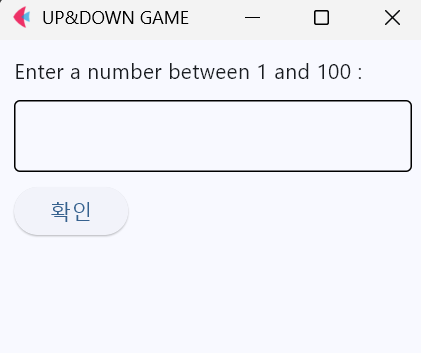 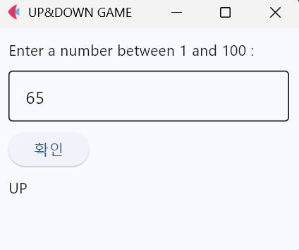 
>
> </details>
>
>  
>
> [상세보기 →](./up_down_game/)

## ✊ Rock Paper Scissors

> 5판 3승제 가위바위보 게임 *(상태 관리 · `nonlocal`)*
>
> - 핵심: 라운드 진행과 승패 판정 로직을 GUI로 구현
>
> <details>
> <summary>실행 화면</summary>
>
> 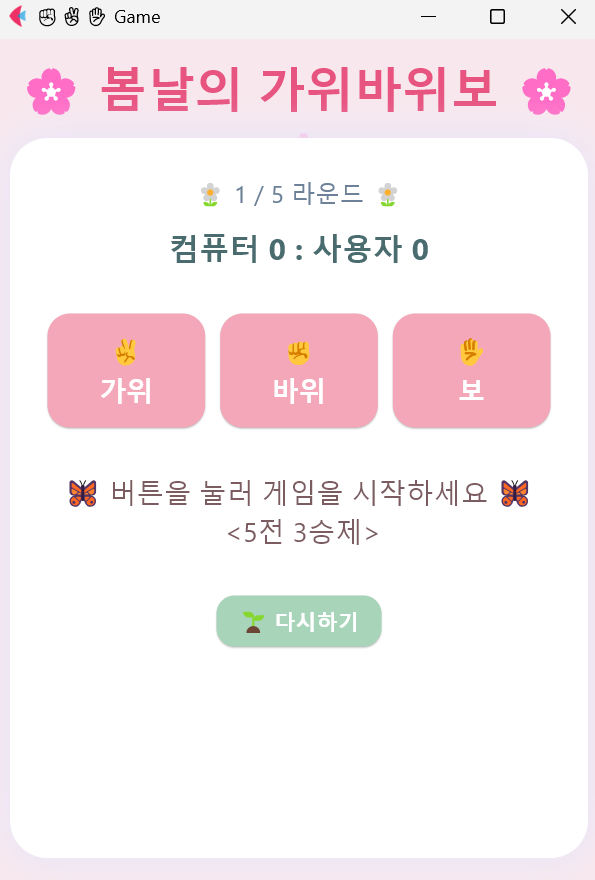 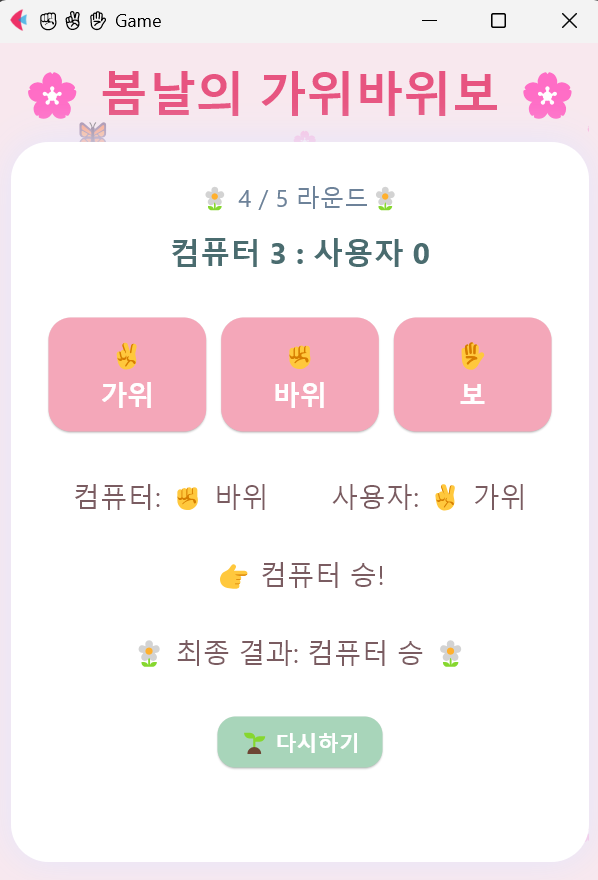 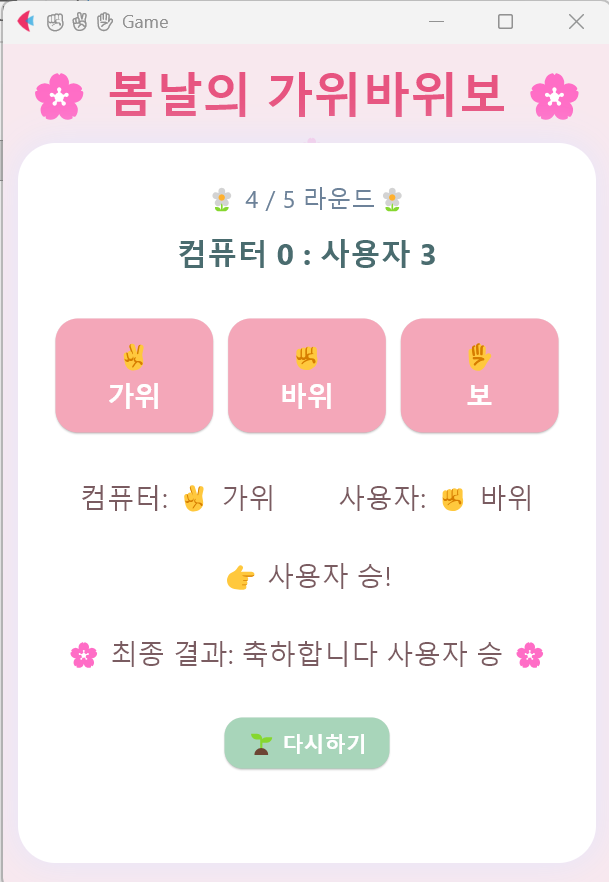
>
> </details>
>
>  
>
> [상세보기 →](./RSP_game/)

## 📒 Phonenumber Book

> 연락처를 추가 · 검색 · 조회 · 삭제하는 앱 *(클래스 · 딕셔너리)*
>
> - 핵심: 연락처 추가 · 조회 · 삭제(CRUD) 구조를 클래스로 구현
>
> <details>
> <summary>실행 화면</summary>
>
> 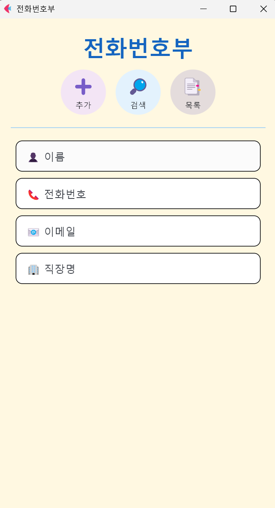 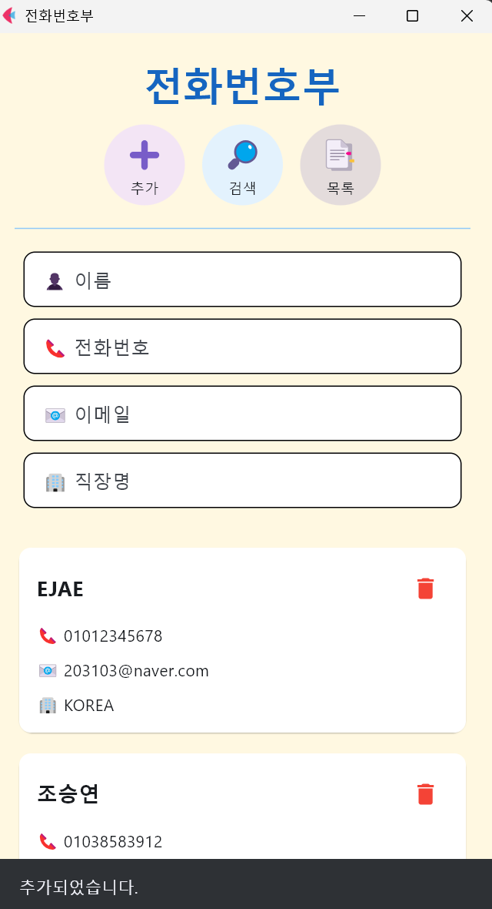 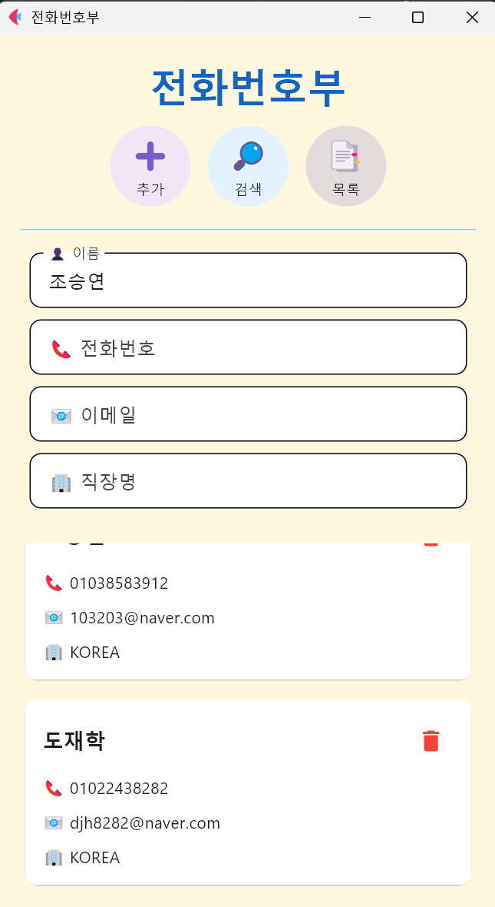
>
> </details>
>
>  
>
> [상세보기 →](./phonenumber_book/)

## 🧮 Number Data Handler

> 7종 연산 · 통계를 계산하는 앱 *(정규식 · 함수형과 클래스형 비교)*
>
> - 핵심: 같은 기능을 함수형과 클래스형으로 각각 구현해 구조 비교
>
> <details>
> <summary>실행 화면</summary>
>
> 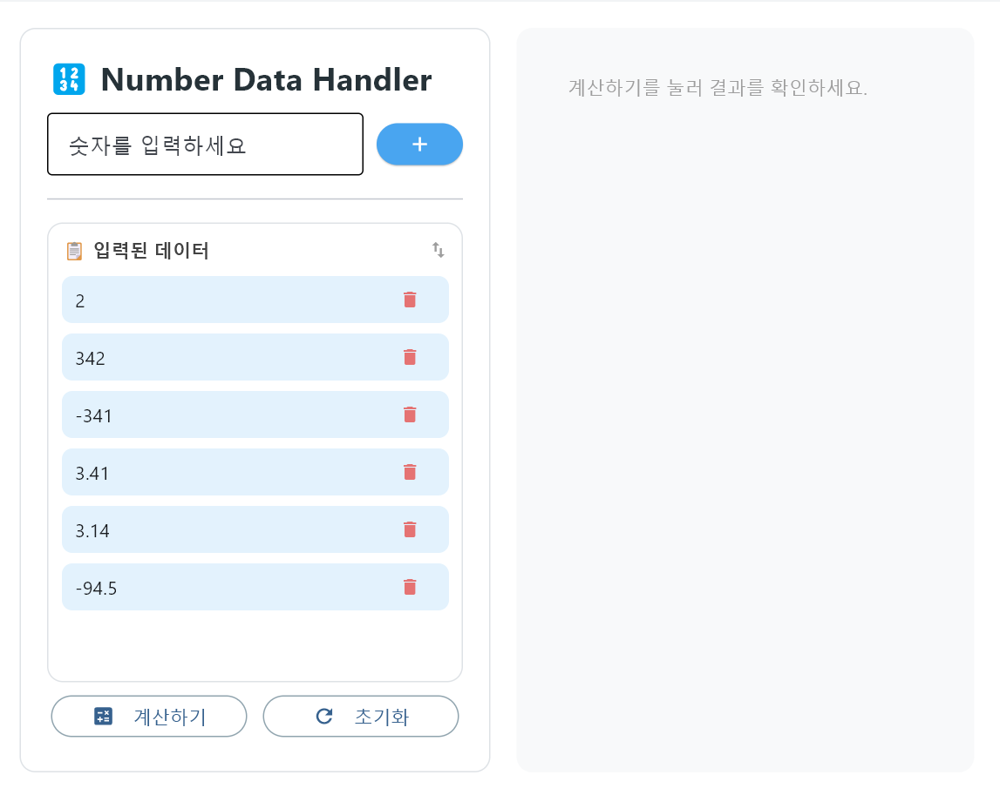 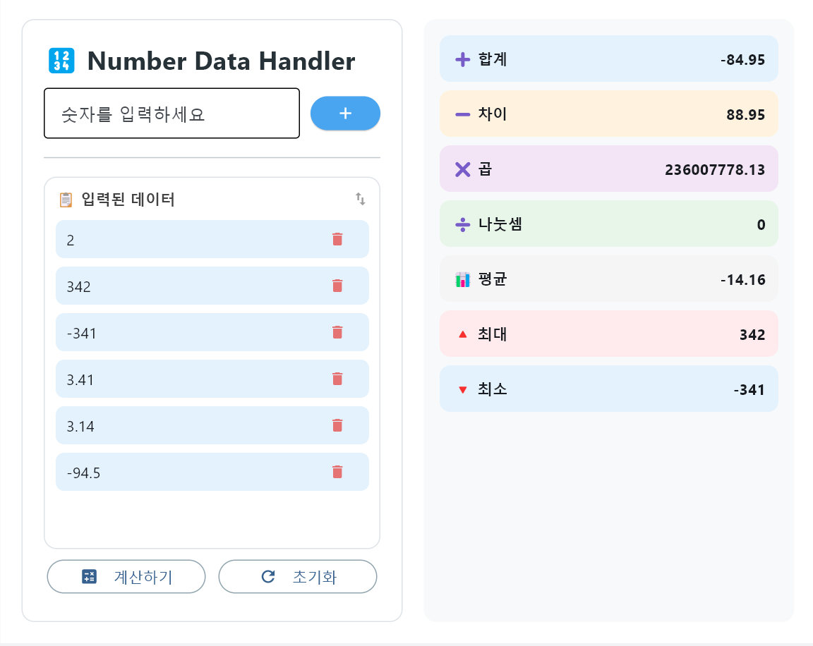
>
> </details>
>
>  
>
> [상세보기 →](./Calculator/)

## 🎳 Bowling Score

> 스트라이크 · 스페어를 반영해 점수를 계산하는 앱 *(점수 계산 알고리즘)*
>
> - 핵심: 프레임별 보너스 규칙을 반영한 점수 계산, 버튼 상태 제어
>
> <details>
> <summary>실행 화면</summary>
>
> 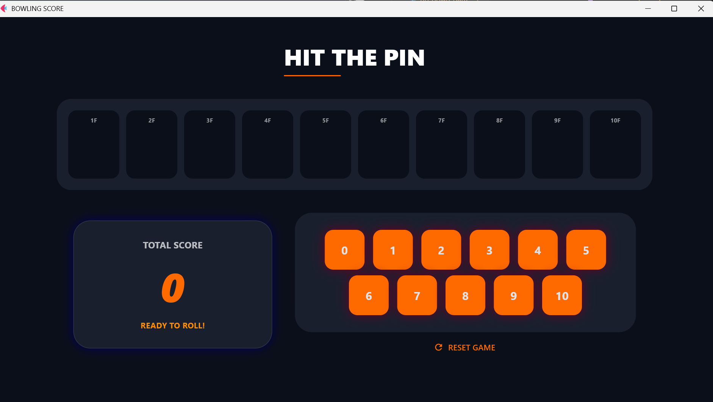 
>
> </details>
>
>  
>
> [상세보기 →](./Bowling_score/)

## 🛒 POS System

> 편의점 POS와 관리자 화면을 갖춘 판매 시스템 *(SQLite · 집계 쿼리)*
>
> - 핵심: 딕셔너리로 설계한 장바구니 · 매출 시스템을 SQLite DB 연동 앱으로 확장
>
> <details>
> <summary>실행 화면</summary>
>
>  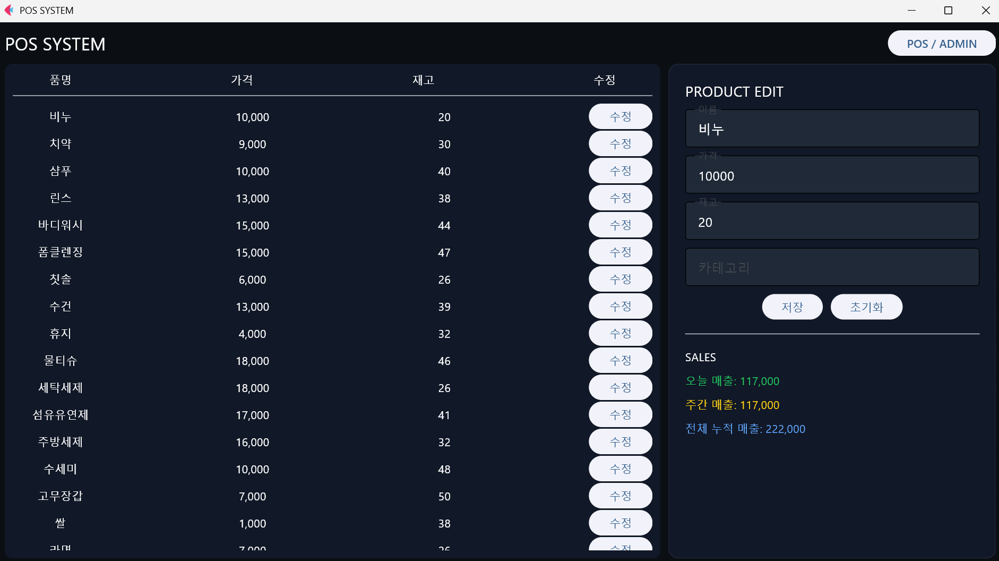
>
> </details>
>
>   
>
> [상세보기 →](./POS_system/)

---

## 실행 방법

```bash
pip install flet
cd <프로젝트 폴더>
python <실행 파일>
```

Flet은 버전에 따라 API 이름이 달라서, 실행이 안 되면 `pip install flet==<버전>`으로 버전을 맞춰 설치해야 합니다.
