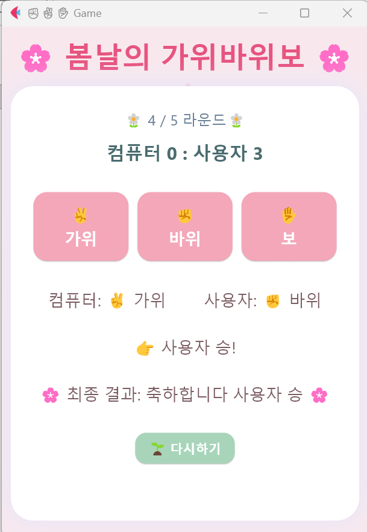
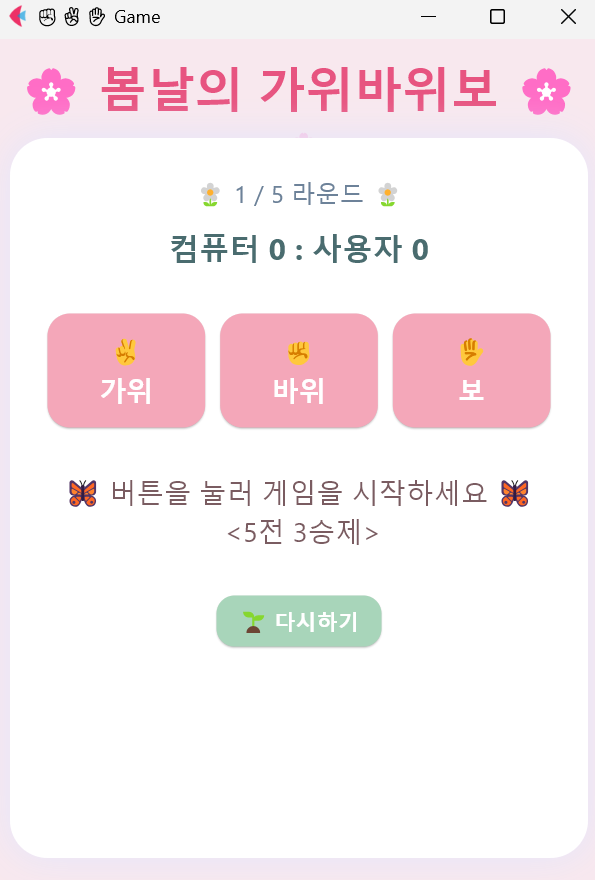
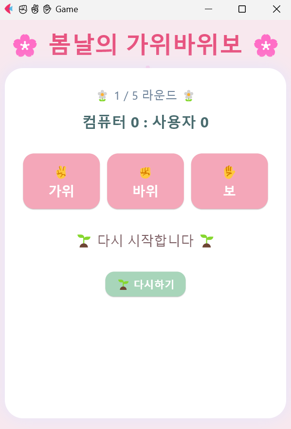
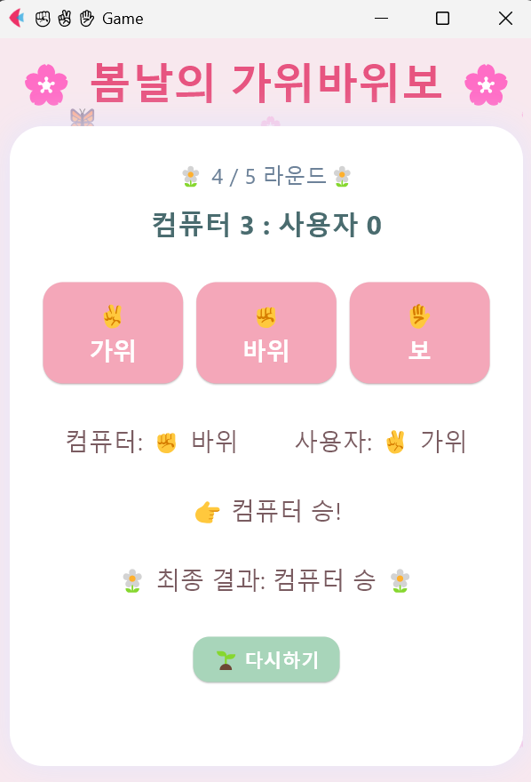
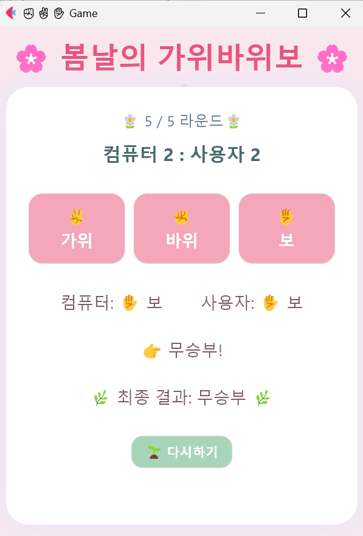
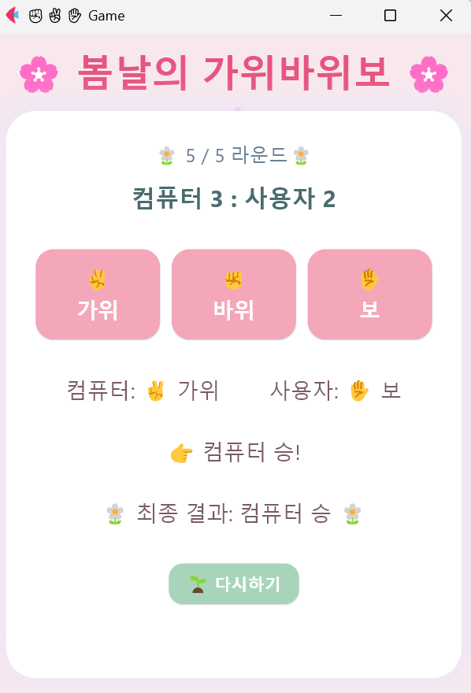

# Rock Paper Scissors &nbsp;&nbsp;&nbsp;&nbsp;&nbsp;<sup><sub>2026.03</sub></sup>

Flet으로 만든 가위바위보 게임.

컴퓨터와 5판 3승제로 겨루고, 라운드마다 양쪽 선택과 결과, 점수를 보여 줌.




## 핵심 코드

### 승패 판정과 라운드 진행

[flet_RSP_game.py](flet_RSP_game.py) · 이론 정리: [가위바위보](../../study_archive/theory/09_rps_game.md) · [네임스페이스](../../study_archive/theory/06_import_namespace.md) · [흐름 제어](../../study_archive/theory/07_flow_control.md) · [함수](../../study_archive/theory/08_functions.md)

점수와 라운드를 `nonlocal`로 바깥 함수에 두고, 버튼을 누를 때마다 판정 후 상태 갱신.

```python
def play(user_choice):
    nonlocal user_score, computer_score, round_count   # 바깥 함수의 점수·라운드 변경

    if round_count >= 5:
        return

    computer_choice = random.choice(choices)

    if user_choice == computer_choice:
        result = "무승부!"
    elif (
        (user_choice == "가위" and computer_choice == "보") or
        (user_choice == "바위" and computer_choice == "가위") or
        (user_choice == "보" and computer_choice == "바위")
    ):
        result = "사용자 승!"
        user_score += 1
    else:
        result = "컴퓨터 승!"
        computer_score += 1

    round_count += 1
    # (결과·점수·라운드 텍스트 갱신은 생략)

    if user_score == 3 or computer_score == 3 or round_count == 5:   # 3승 또는 5라운드면 최종 결과
        ...
```

## 주요 기능

| 기능 | 설명 |
|---|---|
| 5판 3승제 | 3승 도달 또는 5라운드 종료 시 최종 결과 표시 |
| 승패 판정 | `random.choice`로 컴퓨터 선택, 조건문으로 판정 |
| 버튼 생성 | `make_button()`으로 가위·바위·보 버튼 생성, `data`로 선택값 전달 |
| 다시하기 | 점수·라운드 초기화 |
| 화면 구성 | `Stack`으로 꽃·나비 배경 위에 게임 카드 배치 |

<details>
<summary>전체 화면 보기</summary>

| 시작 화면 | 다시하기 | 컴퓨터 승리 (4라운드) |
|---|---|---|
|  |  |  |

| 무승부 (2:2) | 컴퓨터 승리 (3:2) | |
|---|---|---|
|  |  | |

</details>

## 개선 방향

- 3승 도달 후 5라운드 전이면 버튼 입력 잠금

## 파일 구조

```
RSP_game/
├── flet_RSP_game.py   # 전체 코드
├── images/            # README 스크린샷
└── README.md
```

## 실행 방법

```
pip install flet
python flet_RSP_game.py
```
