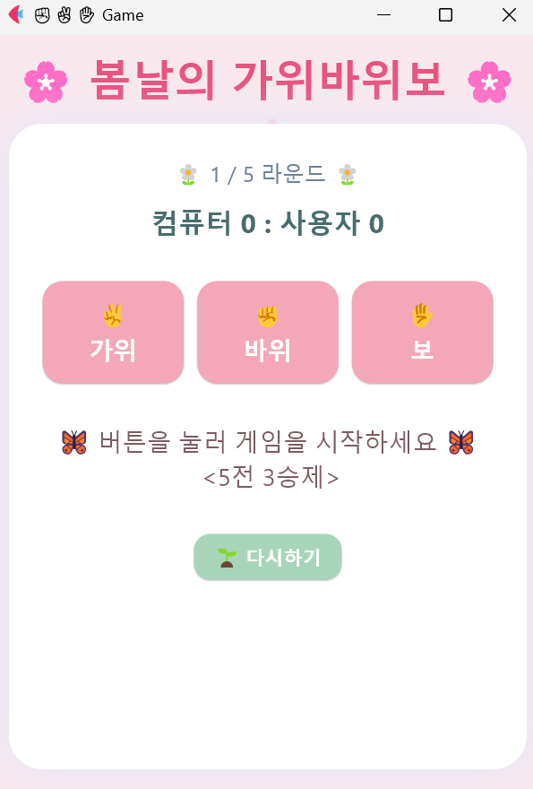
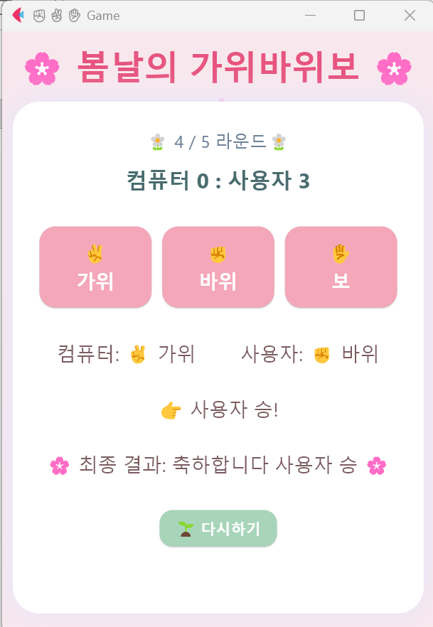
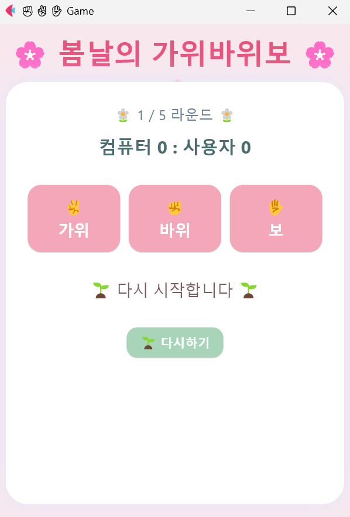
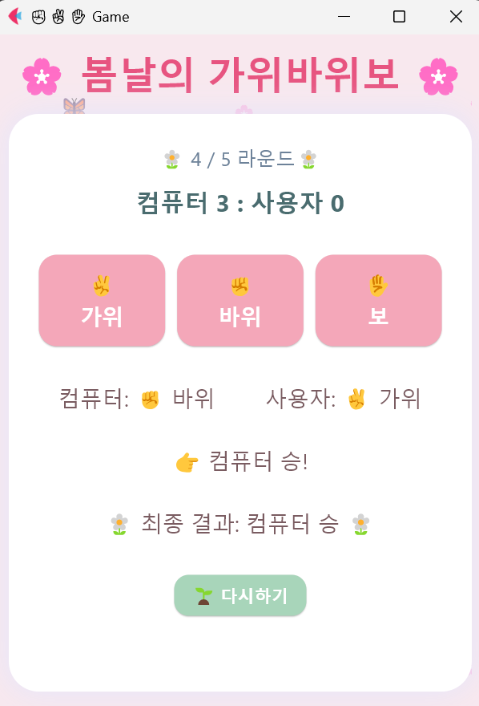
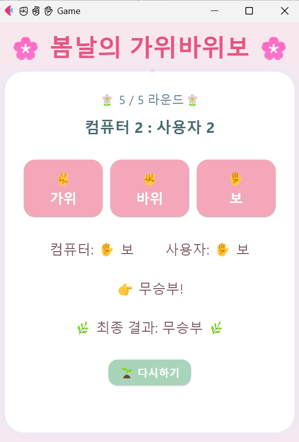
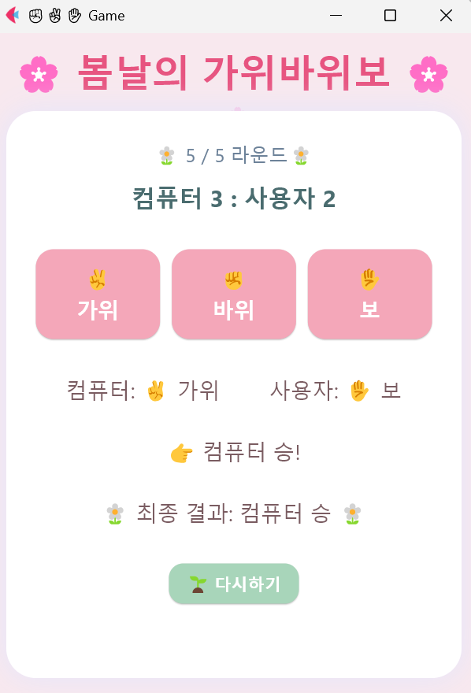

# Rock Paper Scissors

Flet 기반 가위바위보 게임 (5판 3승제)

## 프로젝트 소개

- 조건 분기, 변수 스코프(`nonlocal`), 리스트·딕셔너리 이론을 상태 기반 게임 로직에 적용하기 위해 개발
- 5판 3승제 승패 판정과 라운드 진행 로직을 GUI로 구현

## 적용 이론 및 구현 내용

**핵심 역량**: 상태 관리(`nonlocal`), 승패 판정 로직, 이벤트 처리

| 역량 | 구현 내용 | 이론 |
|---|---|---|
| 상태 관리 | 점수·라운드를 `nonlocal`로 관리 | [06_import_namespace](../../study_archive/theory/06_import_namespace.md) |
| 승패 판정 | `random.choice`와 조건문으로 판정 | [09_rps_game](../../study_archive/theory/09_rps_game.md), [07_flow_control](../../study_archive/theory/07_flow_control.md) |
| 데이터 구성 | 선택지 리스트, 이모지 딕셔너리 | [03_data_types](../../study_archive/theory/03_data_types.md) |
| 이벤트 처리 | 버튼 `data` 속성과 `e.control.data`로 선택값 전달 | [08_functions](../../study_archive/theory/08_functions.md) |
| 코드 재사용 | `make_button()`으로 가위·바위·보 버튼 3개 생성 | [08_functions](../../study_archive/theory/08_functions.md) |
| 진행 제어 | 3승 또는 5라운드 도달 시 최종 결과 표시, 다시하기로 상태 초기화 | [07_flow_control](../../study_archive/theory/07_flow_control.md) |
| 레이아웃 | `Stack`으로 배경 위에 게임 카드 배치 | - |

## 구현 결과 및 실행

### 스크린샷

<table>
<tr><td align="center" valign="top"><br><sub>홈 화면 — 1/5 라운드, 점수 0:0, 가위·바위·보 버튼, 5전 3승제 안내</sub></td><td align="center" valign="top"><br><sub>사용자 승리 — 3승 도달 시 5라운드 전(4/5) 조기 종료, 최종 결과 표시</sub></td></tr>
</table>

<details>
<summary>스크린샷 더 보기</summary>

<table>
<tr><td align="center" valign="top"><br><sub>다시하기 — 라운드·점수 초기화 후 "다시 시작합니다" 표시</sub></td><td align="center" valign="top"><br><sub>컴퓨터 승리(조기 종료) — 4/5 라운드에서 컴퓨터 3승 도달, 양측 선택·라운드 결과 표시</sub></td></tr>
<tr><td align="center" valign="top"><br><sub>무승부 — 5/5 라운드 종료 시 2:2</sub></td><td align="center" valign="top"><br><sub>컴퓨터 승리 — 5/5 라운드 종료 시 3:2</sub></td></tr>
</table>

</details>

### 사용 기술

Python, Flet, `random`

### 개선 방향

- 3승 도달 시 입력 잠금

### 실행 방법

```bash
pip install flet
python flet_RSP_game.py
```

### 파일 구성

- `flet_RSP_game.py`: 전체 코드
- `images/`: 스크린샷