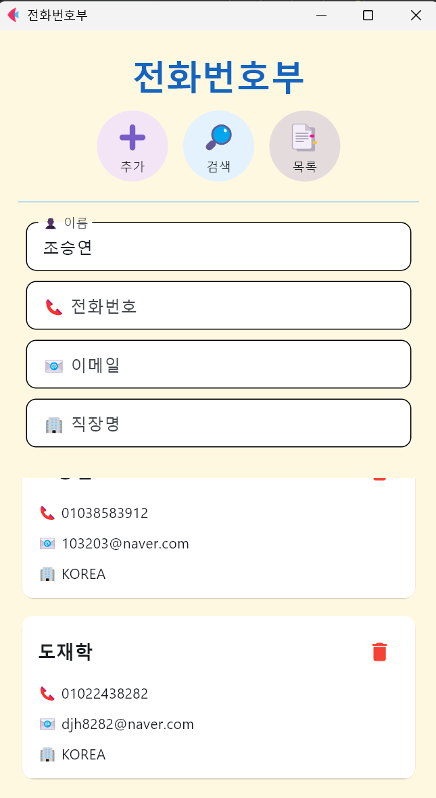
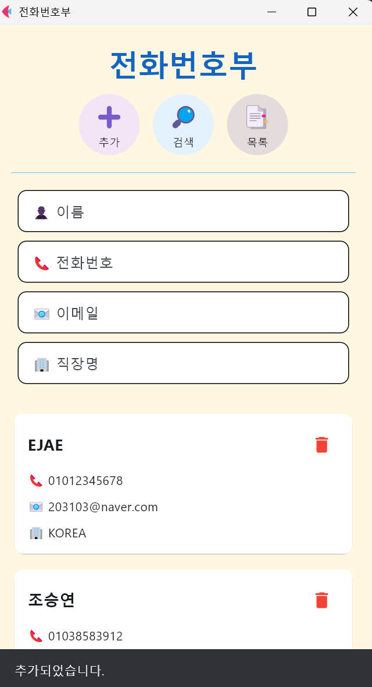
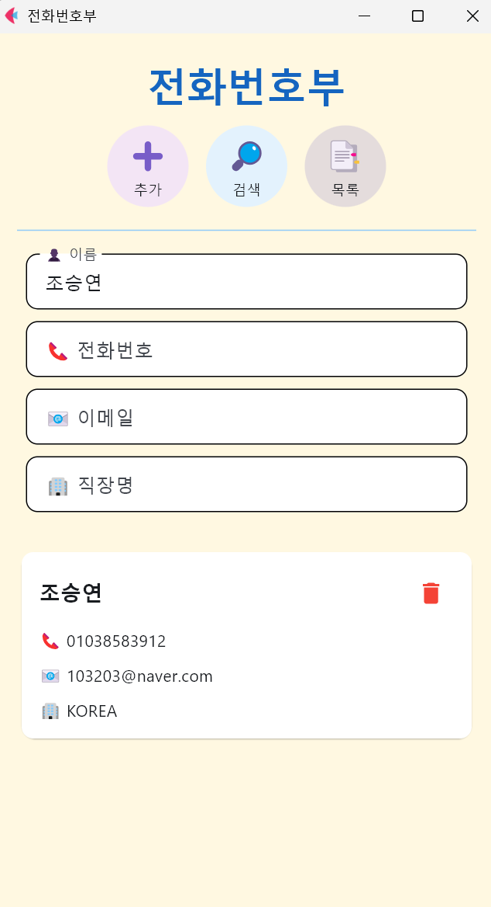

# Phonenumber Book

Flet 기반 전화번호부 앱 (연락처 추가·검색·조회·삭제)

## 프로젝트 소개

- 클래스 설계와 딕셔너리 자료구조 이론을 GUI 앱에 적용하기 위해 개발
- 연락처 추가·조회·삭제(CRUD) 구조를 구현

## 적용 이론 및 구현 내용

**핵심 역량**: 클래스 설계, 딕셔너리 기반 CRUD, 입력 검증, 이벤트 핸들러

| 역량 | 구현 내용 | 이론 |
|---|---|---|
| 클래스 설계 | `PhoneBookApp`: 컨트롤 생성(`__init__`)과 배치(`setup_ui`) 분리 | [14_classes_oop](../../study_archive/theory/14_classes_oop.md) |
| 자료구조 | 이름을 키로 하는 딕셔너리로 연락처 관리 | [03_data_types](../../study_archive/theory/03_data_types.md) |
| CRUD | 추가·조회·삭제 구현 | [14_classes_oop](../../study_archive/theory/14_classes_oop.md) (전화번호부 예제) |
| 입력 검증 | 빈 이름, 중복 이름 검증 | [07_flow_control](../../study_archive/theory/07_flow_control.md) |
| 이벤트 핸들러 | `lambda e, n=name:`으로 카드별 삭제 이벤트 연결 | [08_functions](../../study_archive/theory/08_functions.md) |
| 코드 재사용 | `create_menu_button()`, `create_card()`로 반복 UI를 함수화 | [08_functions](../../study_archive/theory/08_functions.md) |
| 사용자 안내 | `SnackBar`로 처리 결과 표시 | - |

## 구현 결과 및 실행

### 스크린샷

<table>
<tr><td align="center" valign="top"><br><sub>홈 화면 — 추가·검색·목록 메뉴, 이름·전화번호·이메일·직장명 입력 필드</sub></td><td align="center" valign="top"><br><sub>목록 — 저장된 연락처를 카드(`ft.Card`)로 나열, 항목별 삭제 버튼</sub></td></tr>
</table>

<details>
<summary>스크린샷 더 보기</summary>

<table>
<tr><td align="center" valign="top"><br><sub>추가 — 저장 후 입력창 초기화·목록 갱신, `SnackBar`로 "추가되었습니다." 안내</sub></td><td align="center" valign="top"><br><sub>검색 — 이름 입력 시 해당 연락처 1건만 표시</sub></td></tr>
</table>

</details>

### 사용 기술

Python, Flet

### 개선 방향

- 수정 기능 추가로 CRUD 완성
- SQLite 연동으로 데이터 영속화
- 전화번호·이메일 형식 검증

### 실행 방법

```bash
pip install flet
python flet_phonenumber_class.py
```

### 파일 구성

- `flet_phonenumber_class.py`: 전체 코드
- `images/`: 스크린샷