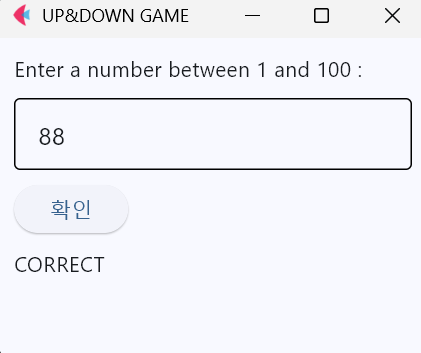
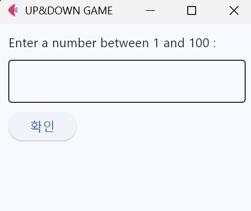
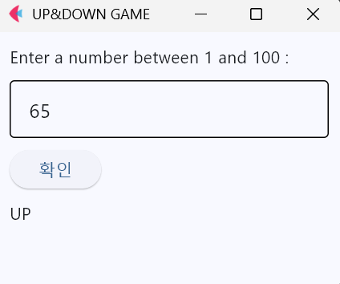
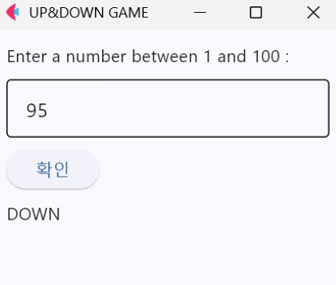

# UP-DOWN Game &nbsp;&nbsp;&nbsp;&nbsp;&nbsp;<sup><sub>2026.03</sub></sup>

Flet으로 만든 숫자 맞추기 게임.

1~100 사이 숫자를 입력하면 정답과 비교해 UP · DOWN · CORRECT로 알려 줌.




## 핵심 코드

### 입력 판정

[up_down_game.py](up_down_game.py) · 이론 정리: [import](../../study_archive/theory/06_import_namespace.md) · [형 변환](../../study_archive/theory/04_type_casting_io.md) · [흐름 제어](../../study_archive/theory/07_flow_control.md) · [함수](../../study_archive/theory/08_functions.md)

입력값을 정수로 바꿔 정답과 비교하고, 결과 메시지만 화면에 갱신.

```python
answer = random.randint(1, 100)       # 실행할 때마다 1~100 정답 생성

def check(e):                         # 확인 버튼 on_click 핸들러
    n = int(input_num.value)          # TextField 문자열 → 정수
    if n > answer:
        msg.value = "DOWN"
    elif n < answer:
        msg.value = "UP"
    else:
        msg.value = "CORRECT"
    page.update()                     # 바뀐 메시지를 화면에 반영
```

## 주요 기능

| 기능 | 설명 |
|---|---|
| 정답 생성 | 실행할 때마다 1~100 난수 |
| 입력 판정 | 정답보다 크면 DOWN, 작으면 UP, 같으면 CORRECT |
| 화면 갱신 | 확인 버튼 클릭 시 결과 메시지만 갱신 |

<details>
<summary>전체 화면 보기</summary>

| 시작 화면 | UP | DOWN |
|---|---|---|
|  |  |  |

</details>

## 개선 방향

- 숫자가 아닌 입력 예외 처리(`try/except`), 1~100 범위 검증
- 시도 횟수 표시, 새 게임 버튼

## 파일 구조

```
up_down_game/
├── up_down_game.py   # 전체 코드
├── images/           # README 스크린샷
└── README.md
```

## 실행 방법

```
pip install flet
python up_down_game.py
```
