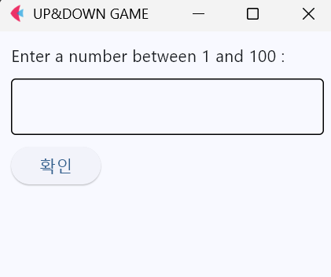
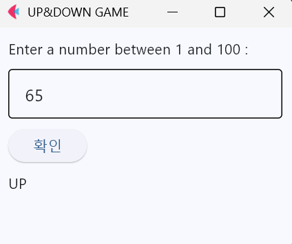
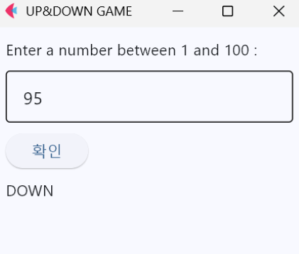

# UP-DOWN Game

Flet 기반 숫자 맞추기 게임 (난수 비교, UP/DOWN 피드백)

## 프로젝트 소개

- 난수 생성, 조건 분기, 형 변환 이론을 GUI 이벤트 처리와 결합해 실습하기 위해 개발
- 입력 → 판정 → 출력 흐름을 30줄 단일 파일로 구현

## 적용 이론 및 구현 내용

**핵심 역량**: 난수 생성, 조건 분기, 입력 처리, 이벤트 핸들러

| 역량 | 구현 내용 | 이론 |
|---|---|---|
| 난수 생성 | `random.randint`로 정답 생성 | [06_import_namespace](../../study_archive/theory/06_import_namespace.md) |
| 입력 처리 | `TextField` 입력값을 `int()`로 변환 | [04_type_casting_io](../../study_archive/theory/04_type_casting_io.md) |
| 조건 분기 | `if / elif / else`로 UP·DOWN·CORRECT 판정 | [07_flow_control](../../study_archive/theory/07_flow_control.md), [10_practice](../../study_archive/theory/10_practice.md) |
| 이벤트 핸들러 | 버튼 `on_click`에 `check` 함수 연결, `page.update()`로 화면 갱신 | [08_functions](../../study_archive/theory/08_functions.md) |

## 구현 결과 및 실행

### 스크린샷

<table>
<tr><td align="center" valign="top"><br><sub>초기 화면 — 1~100 입력 안내, 입력창, 확인 버튼</sub></td><td align="center" valign="top"><br><sub>88 입력 → `CORRECT` 출력 (정답)</sub></td></tr>
</table>

<details>
<summary>스크린샷 더 보기</summary>

<table>
<tr><td align="center" valign="top"><br><sub>65 입력 → `UP` 출력 (정답이 입력값보다 큼)</sub></td><td align="center" valign="top"><br><sub>95 입력 → `DOWN` 출력 (정답이 입력값보다 작음)</sub></td></tr>
</table>

</details>

### 사용 기술

Python, Flet, `random`

### 개선 방향

- `try/except`로 숫자가 아닌 입력 처리
- 1~100 범위 검증
- 시도 횟수 표시, 새 게임 기능

### 실행 방법

```bash
pip install flet
python up_down_game.py
```

### 파일 구성

- `up_down_game.py`: 전체 코드
- `images/`: 스크린샷