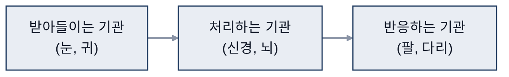
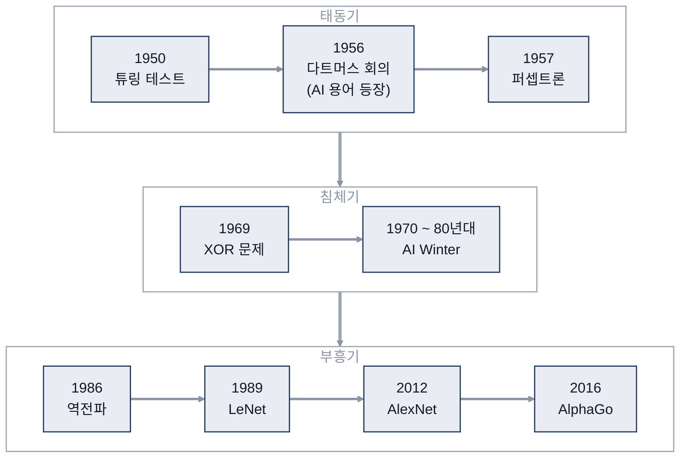
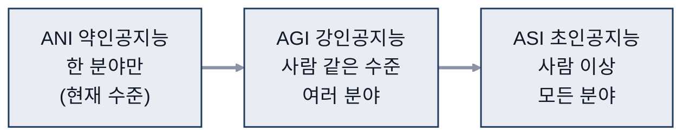
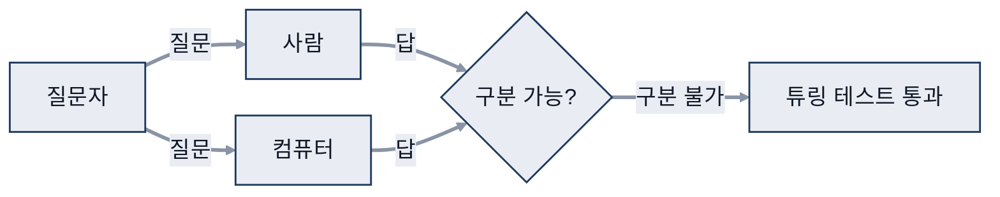
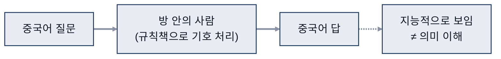

# 01. AI 개요

> 참고: 인공지능개론 강의 자료 p.16 ~ 34 + 수업 필기

## 1. AI + x (p.16 ~ 17)
- AI(Artificial Intelligence, 인공지능) + x: x = 무엇 (AI를 적용하는 분야)
- AI = **인공(Artificial)** + **지능(Intelligence)**
  - 인공 = 인위적인
  - 지능 = 무엇인가?

## 2. 지능 (p.18 ~ 21)
- 자연 지능: 사람을 포함한 동물이 타고난 지적 능력
  - 받아들이는 기관(눈, 귀) / 처리하는 기관(신경, 뇌) / 반응하는 기관(팔, 다리)

- 지능의 정의: 경험으로 배우기, 문제 인식, 문제 해결
- 지능의 **중요 능력**
  - Thurstone: 연관 기억, 수치 능력, 지각 속도, 추론, 공간 시각화, 언어 이해, 단어 유창성
  - **Gardner**의 다중 지능: 신체-운동, 대인, 자아, 논리-수학, 음악, 자연주의, 언어, 시각-공간

## 3. AI의 정의 (p.22)
- Nilsson: 기계를 지능적으로 만드는 **활동(activity)**
- Gardner: 문화 안에서 **가치 있는(valued)** 문제를 풀거나 결과물을 만드는 **능력(ability)**
- Wikipedia
  - 기계가 보여 주는 지능
  - 목표 달성을 위해 환경을 인식하고 행동하는 지능형 에이전트(intelligent agent) 연구

## 4. AI 역사 (p.23 ~ 25)
- 1950 튜링 테스트, 1956 다트머스 회의(AI 용어 등장)
- 1957 **퍼셉트론**
- 1969 XOR(Exclusive OR, 배타적 논리합) 문제 → 퍼셉트론의 한계 (비선형 문제)
- 1970 ~ 80년대 **AI Winter**
- 1986 **역전파(Backpropagation)** → 비선형 문제 해결의 실마리
- 1989 LeNet(CNN: Convolutional Neural Network, 합성곱 신경망), 2012 AlexNet, 2016 AlphaGo

## 5. AI 접근법 (p.26)
| 접근법 | 핵심 | 예시 · 특징 |
|---|---|---|
| **Symbolic AI** | 기호로 객체와 관계를 표현 | 전문가 시스템, 관련 있는 것들의 관계를 수학적으로 표현 |
| **Connectionist AI** (인공신경망) | 뇌의 뉴런처럼 연결된 노드로 신호 처리 | 블랙 스완 (아래 보충) |
| **Hybrid AI** | 두 방식을 결합 | |
- 보충: 블랙 스완(Black Swan)
  - 예측하기 어렵지만 일어나면 큰 영향을 주는 사건
  - 기호 AI의 한계 이후 연결주의 AI(딥러닝)가 예상 밖으로 급부상한 흐름에 빗댄 표현

## 6. AI 종류 (p.27 ~ 28)
| 종류 | 의미 | 특징 |
|---|---|---|
| **ANI**(Artificial Narrow Intelligence) 약인공지능 | 한 분야만 담당 (부분 쪼개) | **현재 수준**, 특정 반복 작업에서 사람보다 우수 |
| **AGI**(Artificial General Intelligence) 강인공지능 | 마치 사람 같은 수준의 지능 | 여러 분야에서 사람과 같은 효율 |
| **ASI**(Artificial Super Intelligence) 초인공지능 | 사람 수준 이상 | 모든 분야에서 사람보다 우수, 빠른 자기 개선 |

## 7. AI+x 분야와 기반 기술 (p.29 ~ 30)
  - 헬스케어: 루닛 등
  - AI 개발 환경: 레인보우브레인 등
  - 메타버스: 이스트소프트
  - NLP(Natural Language Processing, 자연어 처리): 와이즈넛, 코난테크놀로지
- 기반 기술: 머신러닝, **자연어 처리**, 음성, 전문가 시스템, 계획·최적화, 로보틱스, **비전**

## 8. 기계의 지능을 판단하기 어려운 이유 (p.31 ~ 32)
- **튜링 테스트**: 질문자가 어느 쪽이 컴퓨터인지 구분하지 못하면 통과
  - Eugene
  - 보충: Eugene Goostman은 2014년 튜링 테스트를 통과했다고 주장한 챗봇

- **중국어 방**: 규칙책만 보고 중국어 입력 → 중국어 출력
  - 작업의 의미를 모른 채 수행 → 겉으로 지능처럼 보여도 이해했다고 볼 수 없음

- AI의 목표: 사람처럼 생각·행동 vs 최적의 방법으로 생각·행동

## 9. AI 장단점 (p.33 ~ 34)
| 장점 | 단점 |
|---|---|
| 사람의 실수 없음, 위험 대신 감수 | 높은 비용 |
| 24×7 반복 작업 지원 | 사람의 게으름, 실업 유발 |
| 디지털 지원, 빠른 결정 | 감정 없음 |
| 새로운 발명 (AI 의료) | 설계된 목적 외의 일은 못 함 |
- AI를 공부하는 이유: 우수한 성능, 발전 가능성

## 참고
- 국내 AI+x 기업 지도를 찾아 분야별 대표 기업 정리
