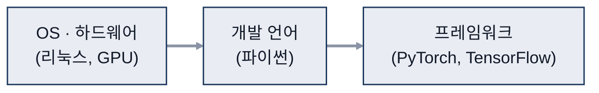
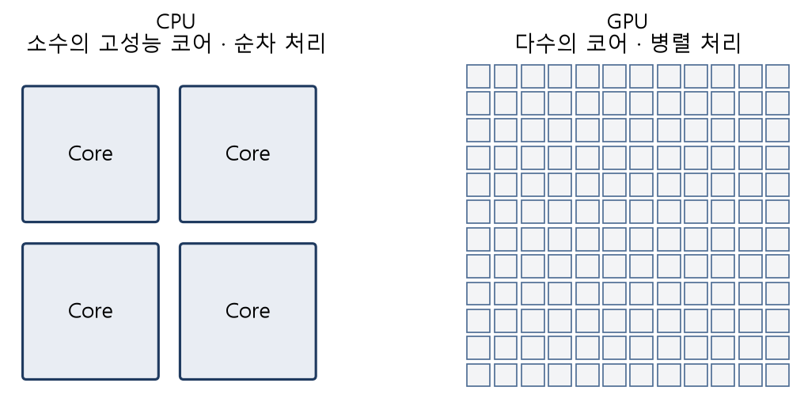
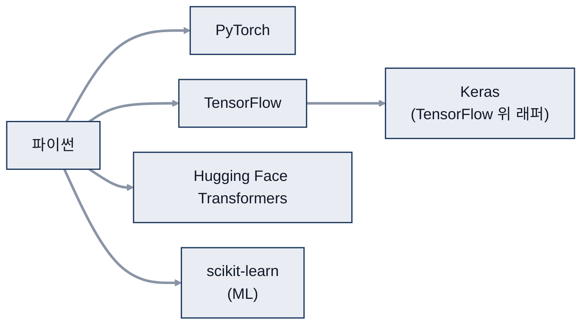

# 02. 딥러닝 환경

> 참고: 인공지능개론 강의 자료 p.36 ~ 45 + 수업 필기

## 1. 환경 구성 시 고려 사항 (p.36)
- OS(Operating System, 운영체제)·하드웨어 → 개발 언어 → 프레임워크 순서로 결정

- OS: **리눅스**(주로 사용), 윈도우, 맥
- 하드웨어
  | 장치 | 특징 |
  |---|---|
  | CPU(Central Processing Unit, 중앙 처리 장치) | 하나하나 순서대로 처리 |
  | **GPU**(Graphics Processing Unit, 그래픽 처리 장치) | 행렬 단위로 처리 → 딥러닝에 유리 |
  | TPU(Tensor Processing Unit, 텐서 처리 장치) | 구글이 만든 Tensor 연산 전용 칩 |

- 언어: **파이썬** → 텐서플로우, 파이토치, 케라스로 바로 연결

## 2. 가상환경 (p.37)
- 환경 설정(setting)을 매번 새로 할 필요가 없도록 구성
- 아나콘다, **도커**(요즘 trend), Cloud VM(Virtual Machine, 가상 머신)

## 3. IDE (p.38)
- IDE(Integrated Development Environment) = 통합 개발 환경
- 주피터 노트북, VS / VS Code, 파이참, 이클립스
- ※ 2 ~ 3가지는 익숙해지기

## 4. 프로그래밍 언어 (p.39)
| 언어 | 특징 |
|---|---|
| **파이썬** | 라이브러리 풍부 (NumPy, Pandas, scikit-learn) 대부분 프레임워크 지원 |
| 자바 계열 | 빅데이터 플랫폼 접근성 |
| **C/C++** | 속도, 안정성 |
| 자바스크립트 | TensorFlow.js |
| R | 데이터 과학 중심 |

## 5. 딥러닝 프레임워크 (p.40 ~ 45)
| 프레임워크 | 만든 곳 | 특징 |
|---|---|---|
| **텐서플로우** (주력) | 구글, 2015 | 가장 널리 사용, 정적 그래프 |
| **케라스** (주력) | 구글, 2015 | 텐서플로우 위 래퍼, 사용성 우수, 오류 원인 찾기 어려움 |
| **파이토치** | 페이스북, 2016 | 동적 그래프(유연성), 사용이 쉬움 |
| 카페 | 버클리, 2013 | 컴퓨터 비전 특화, 범용성 낮음 |
| DL4J(Deeplearning4j) | 2017 | 자바·JVM(Java Virtual Machine, 자바 가상 머신)용 |
| MXNet | 아마존 등, 2013 | 다양한 언어 지원, 백엔드 사전 지식 필요 |
- ※ 기억할 것: PyTorch, TensorFlow, MXNet, ONNX(Open Neural Network Exchange)

- 요즘 많이 쓰는 순서
  1. PyTorch
  2. TensorFlow
  3. **Hugging Face Transformers**
  4. Keras
  5. OpenVINO
  - JAX: 구글
- ※ ML(Machine Learning, 머신러닝) 프레임워크는 **scikit-learn**이 가장 많이 쓰임
  - → ML까지 학습 필요

## 참고
- 도커 컨테이너 · 클라우드 VM에 딥러닝 개발 환경 구성
- 방학 기간 중 PyTorch · TensorFlow로 예제 모델 학습
