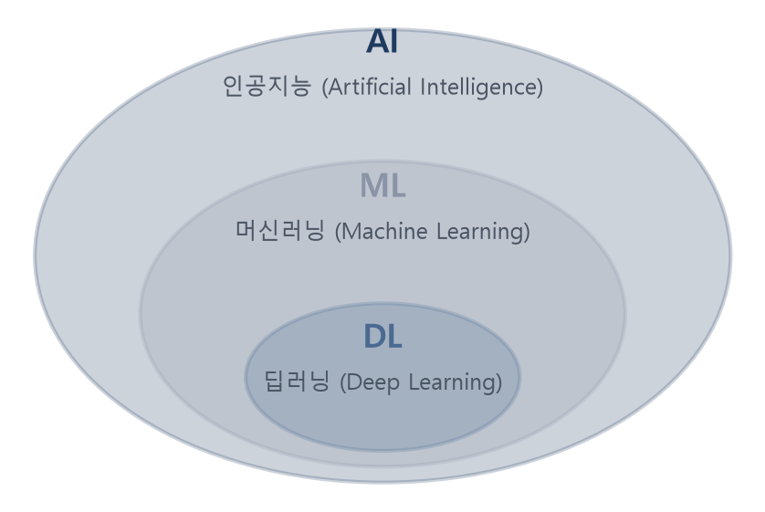
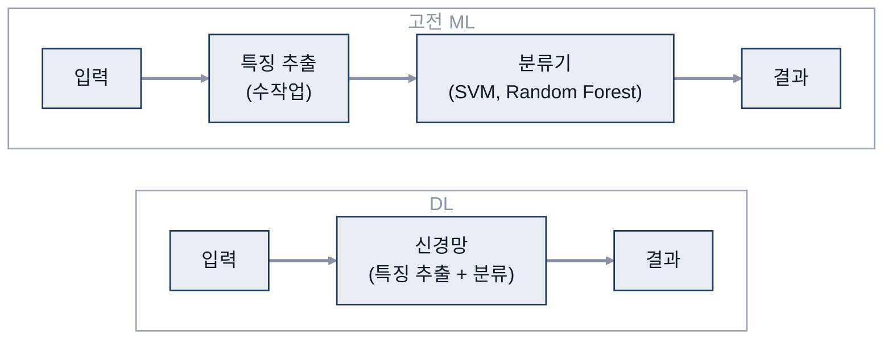
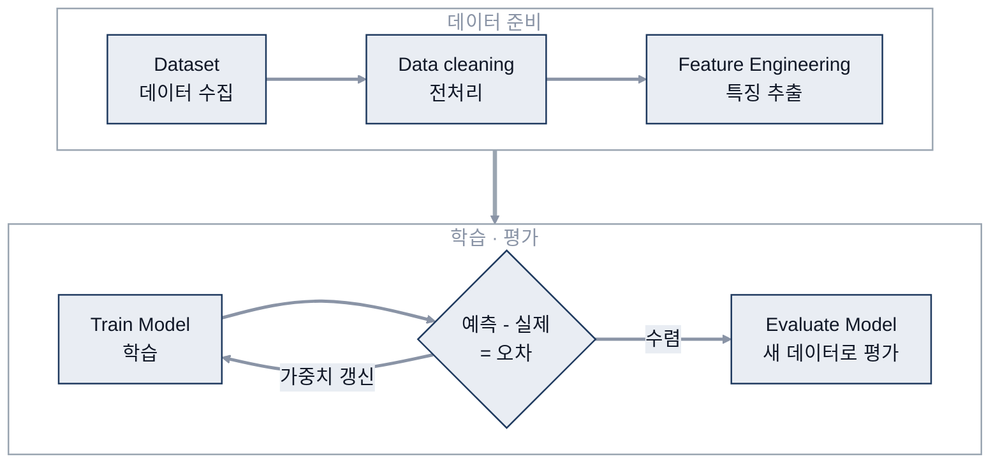
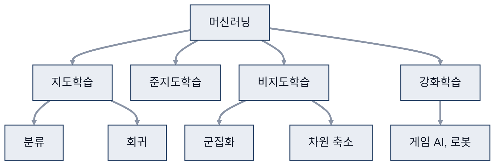
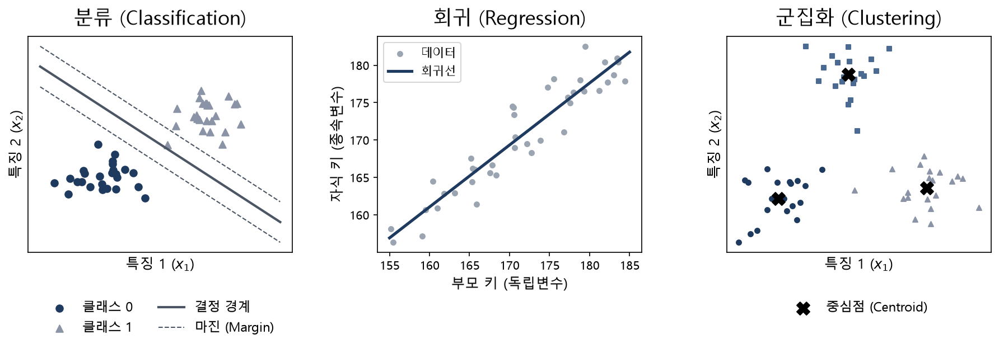
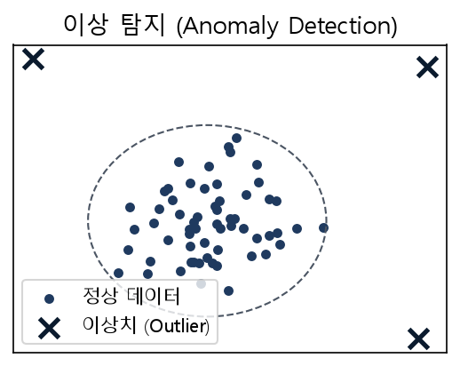
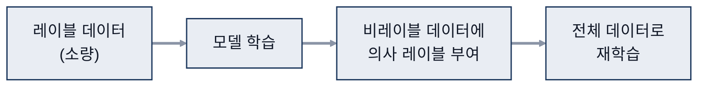
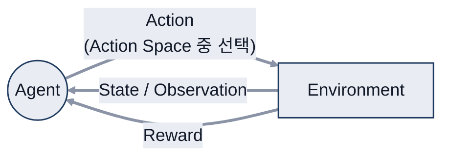

# 03. AI · ML · DL과 머신러닝

> 참고: 인공지능개론 강의 자료 p.47 ~ 58 + 수업 필기

## 1. AI, ML, DL (p.47 ~ 48)
- **AI**(Artificial Intelligence, 인공지능): 컴퓨터가 사람의 행동을 흉내 내게 하는 모든 기술
- **ML**(Machine Learning, 머신러닝): AI의 한 부분
  - **통계적 방법**으로 경험을 통해 성능 향상
  - 최적의 방식을 찾아감
- **DL**(Deep Learning, 딥러닝): ML의 한 부분, **다층 신경망** 사용

- ML vs DL
  - 고전 ML: 사람이 **특징(feature)** 지정 → **분류기(classifier)**로 분류
    - 분류기 예시: SVM, Random Forest
    - 특징을 좌표계에 표시 → 분류선으로 나눔
  - DL: 신경망이 특징까지 스스로 학습

## 2. ML의 흐름 (p.49)
- 데이터(입력) + 알고리즘("모델" 동작) + 학습
  - 학습 = 데이터 + 알고리즘으로 원하는 결과를 내도록 튜닝
- 흐름
  1. **Dataset**: 학습 데이터 확보
     - 학습 데이터 / 검증 데이터(성능 확인) / 테스트 데이터(일반화 확인)
  2. **Data cleaning**: 데이터 전처리 (예외 처리)
     - 참고
       - ETL(Extract, Transform, Load): 추출 → 변환 → 적재
       - ELT(Extract, Load, Transform): 추출 → 적재 → 변환
  3. **Feature Engineering**: 필요한 데이터 추출, 특징 생성
  4. **Train Model**: 원하는 결과가 나오는지 확인 → 학습 성능
     - Learning Algorithm = 값을 조절하기 위한 알고리즘
     - 모델 → 결과 → 예측 - 실제 = **오차** → 다시 반영
  5. **Score / Evaluate Model**: 학습에 쓰지 않은 새 데이터로 분석 → 일반화 성능

## 3. ML 분류 (p.50 ~ 52)
| 학습 | 데이터 | 종류 | 부가 설명 |
|---|---|---|---|
| **지도학습** | 데이터 O, 정답 O | 분류, 회귀 | 입력과 정답을 주고 학습 → 새 입력의 정답 예측 |
| **준지도학습** | 일부만 정답 | | 정답 있는 것으로 분류 → 다른 것을 유추 단, 오답이 섞일 가능성 있음 |
| **비지도학습** | 데이터 O, 정답 X | 군집화, 차원 축소 | 비슷한 데이터끼리 군집화 |
| **강화학습** | 보상 | | 게임 AI, 로봇 |

- **분류**: 범주가 정해져 있음 (이산적 → 0, 1, 2)
- **회귀**: 분포 예측 (연속적) → 예시: 부모 키로 자식 키 예측
- **군집화**: 데이터를 특징(기준)으로 묶어 줌 (정답 없음), 군집 개수 정하기가 어려움
- **차원 축소**: 전체 데이터 중 핵심 특징만 추출

- 예시
  - 지도: 자동차 번호판 인식(맞다/아니다), 핸드폰 사진 얼굴 분류
  - 준지도: 일부만 정답 → cluster → 평가
  - 비지도: 추천 알고리즘
- ※ 알고리즘은 scikit-learn으로 활용 가능 → 종류 파악 위주
  - K-NN(k-Nearest Neighbors, k-최근접 이웃), K-Means, Mean Shift 등

## 4. 지도학습 (p.53 ~ 54)
- (데이터, 정답)으로 학습 → 새 데이터의 정답 유추
  - 확률적으로 가장 높은 것을 정답이라고 판단
- 입력 주고 정답을 알려 줌 → 분류·회귀 문제
- **분류**: 데이터를 주어진 범주로 구분
  - '기타' 범주를 넣어 예상 못 한 입력에 대비
  - SVM(Support Vector Machine, 서포트 벡터 머신)
    - 분류선과 가장 가까운 점(support vector) 사이 margin을 최대로
    - margin = 위 그림 왼쪽 점선 사이 간격
- **회귀**: 독립변수(원인, 영향 줌)와 종속변수(결과, 영향 받음)의 관계 분석
  - 학습된 곡선 = 실제로 사용할 결과 (위 그림 가운데 회귀선)

## 5. 비지도학습 (p.55 ~ 56)
- 정답 없이 데이터만 입력 → 군집화 (특징 추출)
- **군집화**: 데이터 고유의 구조·정보 추출
  - 새 데이터 → 거리가 가장 가까운 군집에 배정
  - k-means: k개로 분류, EM(Expectation-Maximization, 기댓값 최대화) 기반 (예측 → 측정 반복)
- **이상 탐지**: 패턴에서 벗어나면 알림
  - 활용: 카드 사용 (타 지역 결제 알림)

## 6. 준지도학습 (p.57)
- (데이터, 정답) + (데이터)로 학습 → 지도학습용 데이터를 늘려 성능 개선

- 가정
  - 평활성 가정(Smoothness): 입력 공간에서 가까운 데이터는 같은 레이블일 가능성이 높음
  - 저밀도 가정(Low-density)
    - 결정 경계는 데이터가 적은 곳을 지나야 함
    - → 클래스 간 명확한 구분 필요
  - 다양체 가정(Manifold): 고차원 데이터도 저차원 다양체 위에 놓여 있어 구분 가능

## 7. 강화학습 (p.58)
- 상태 시퀀스에서 **최대의 보상**을 주는 행동 정책 학습
  - 최종 목표 기준으로 최선의 행동 선택
  - 경우의 수(에피소드)가 방대함
- 구성: Agent(Action 선택) ↔ Environment(Agent가 상호작용하는 환경)
  - Observation, State, Reward, Action Space(가능한 행동의 집합)

- 예시: 바둑(AlphaGo): 순간순간 최선의 수가 아니라 승리를 위한 최적의 수를 둠

## 참고
- AI hub 데이터로 재학습 후 활용 실습
  - 실습: [cnn-crop-classifier](https://github.com/Jenny5789/cnn-crop-classifier)
    - PyTorch CNN 작물 3종 분류, 모델 깊이 비교
