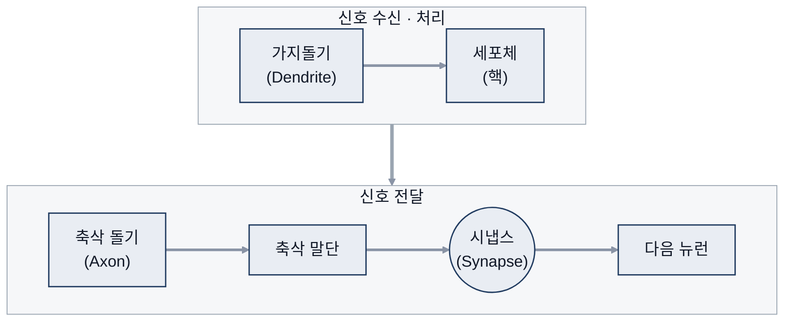
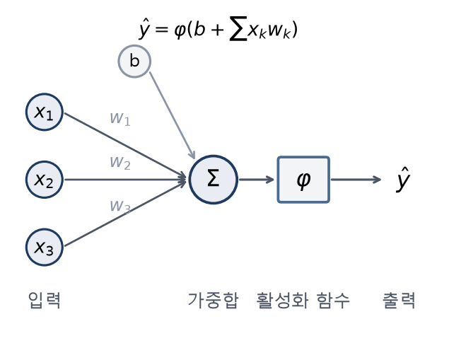
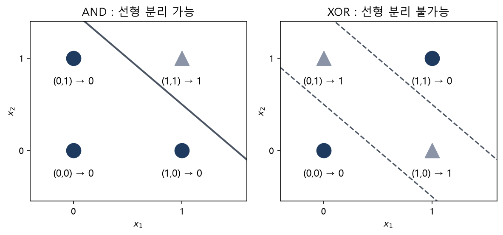
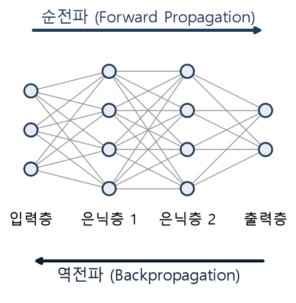
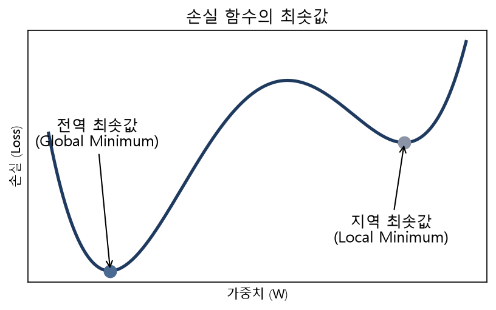
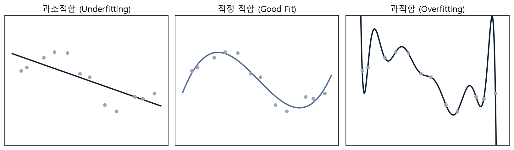

# 04. 신경망 기초

> 참고: 인공지능개론 강의 자료 p.60 ~ 72 + 수업 필기

## 1. 인간 신경계 (p.60, 73)
- 뉴런: 신경계에서 전기 신호를 전달 (감각, 운동, 연합)
- 가지돌기: 자극 받아들임 → **핵**(세포체) → 축삭 돌기 → 축삭 끝
- **시냅스**: 뉴런 사이 미세한 공간, 전기 신호를 주고받는 곳

## 2. MP 뉴런 모델 (p.61)
- 맥컬럭 · 피츠(McCulloch-Pitts, MP)가 제시한 초기 신경 모델 (가설)
  - 신경망 개념, 임계치 기반 전기 신호 전달
- 가정
  - 뉴런은 활성 / 비활성 2가지 상태 → 반응 유무 2가지뿐 (이진 상태)
  - 2개 이상 가지돌기가 일정 시간 **활성화**되어야 함 (1개는 결함일 수 있음, 2개 이상 = 유의미)
  - 시간 지연 = 가지돌기 사이 틈에서 전달하며 쌓임
  - 억제 가지돌기(-p)가 활성화를 막음 → 외부 신호 2개가 들어오면 활성화
  - 구조는 시간에 불변 → 반응 고정적

## 3. 퍼셉트론 (p.61 ~ 62)
- 로젠블라트 제시
- **학습**으로 뉴런 간 연결 강도(가중치)를 조정
  - 가중치 = 반응 강도(세기), 학습 data에 따라 가변적
- Σ: 입력 × 가중치를 더함 → 선형 표현

- 한계: **비선형 문제**에 부적합
  - 예) XOR(Exclusive OR, 배타적 논리합): (1,1), (0,0) → 0 / (1,0), (0,1) → 1 → 직선 하나로 못 나눔
- 해결: 퍼셉트론 여러 개를 연결 → 선형 여러 개가 곡선처럼 동작 → 문제 해결

## 4. 인공신경망 ANN(Artificial Neural Network) (p.62 ~ 63)
- 퍼셉트론 기반으로 인간 신경망을 모사한 모델
- 입력층 → **은닉층** → 출력층
  - 입력층은 계산하지 않음
- **초매개변수(hyper-parameter)**: 학습 전에 정해 두는 값 (동작을 위해 결정되는 모든 것)
  - 층·노드 수
  - 초기 가중치 (강도 조절)
  - 활성화 함수 (출력값 조절)
  - 오차/손실 함수 (원하는 값과 실제 출력의 간격)
  - 학습 횟수
- 대응 관계: x = 가지돌기, φ = 핵, 출력 ŷ = 다음 층의 입력값

## 5. 심층신경망 DNN(Deep Neural Network) (p.64 ~ 65)
- 은닉층 개수를 늘린 신경망
  - 처음에는 은닉층 > 2를 기준으로 했으나 요즘은 바뀜
  - 은닉층 2개 이상 → 비선형 문제 해결 가능
- **순전파**: 입력 → 출력 방향 계산
- **역전파**: 오차를 계산하며 출력 → 입력 방향으로 가중치 수정
  - 큰 가중치로 들어온 입력은 오차 책임도 크게 → 그만큼 낮춰서 계산
  - layer가 많아지면 오차 전달이 약해짐 → 활성화 함수, 초기 가중치 설정을 잘해야 함

## 6. 딥러닝 학습의 의미 (p.66 ~ 67)
- **오차/손실을 최소화하는 가중치 찾기**
  - 순전파 ↔ 역전파를 반복하며 오차를 줄이는 것이 목적
- local minimum이 아니라 **global minimum**을 찾아야 함

- Underfitting vs Overfitting
  | 구분 | 상태 |
  |---|---|
  | Underfitting | 학습 부족 |
  | Overfitting | 훈련 data에서는 성능 높음, 새 data에서는 성능 낮음 (복잡도·변수 증가, 일반화 성능 저하) |

- 학습 data로 학습, **검증 data**로 test 진행
  - 학습 data는 좋은데 검증 data에서 떨어지기 시작하면 과적합 의심
  - 바로 멈추지 말고 지켜보며 과적합인지 정상인지 판단

## 7. 딥러닝이 의미 있는 이유 (p.70 ~ 72)
- 사람이 특징을 하나하나 설명하기 어려움 (시간, 처리, 확장)
- 딥러닝은 데이터에서 **특징을 직접 학습** → CNN(Convolutional Neural Network, 합성곱 신경망)이 특징을 잘 잡음
  - 입력층 쪽: 선·모서리 → 중간: 눈·코 → 출력층 쪽: 얼굴 구조

- 지금 딥러닝에 집중하는 이유: 빅데이터, GPU(Graphics Processing Unit, 그래픽 처리 장치) 병렬 처리, 소프트웨어 발전
