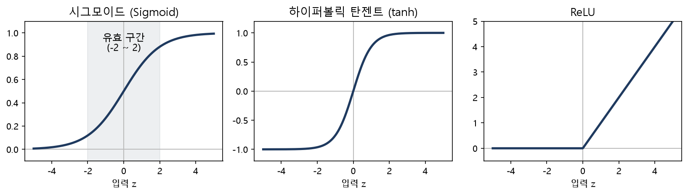
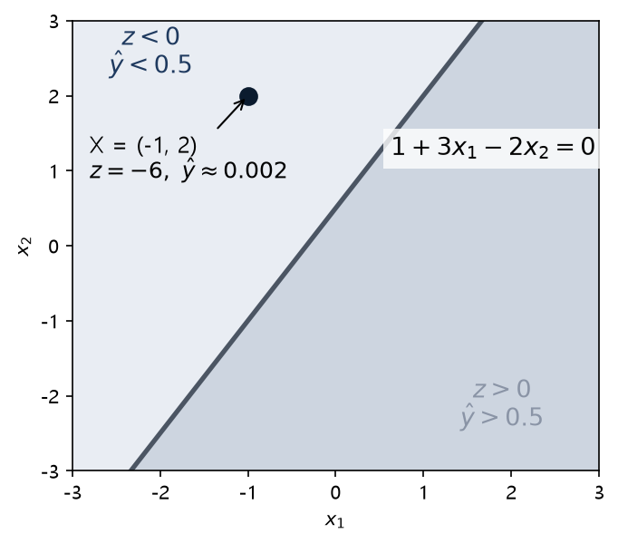
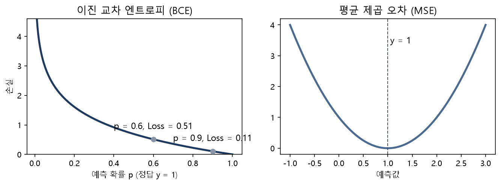
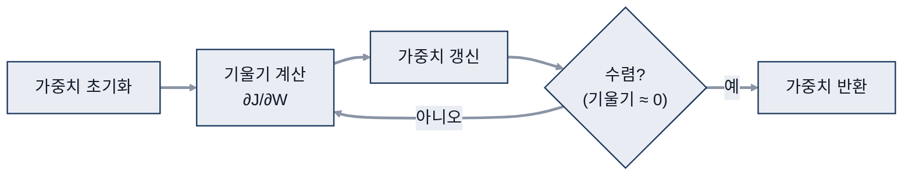
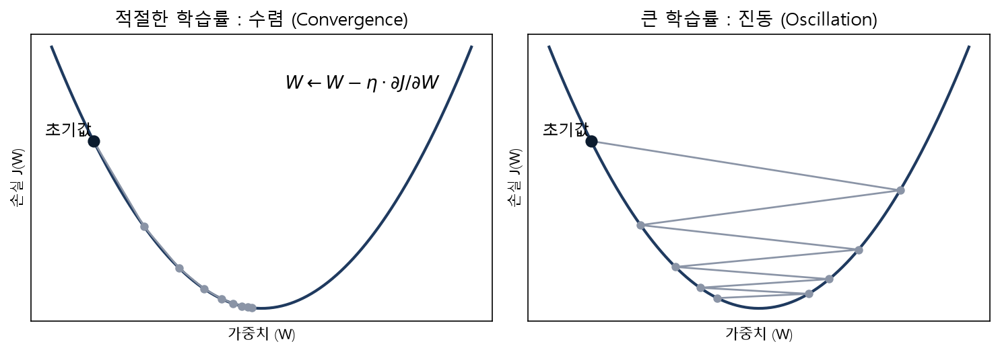
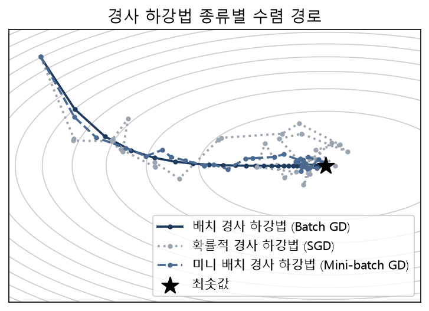
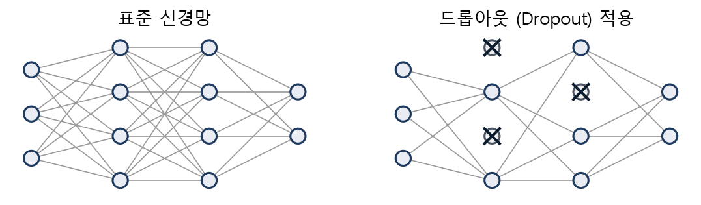
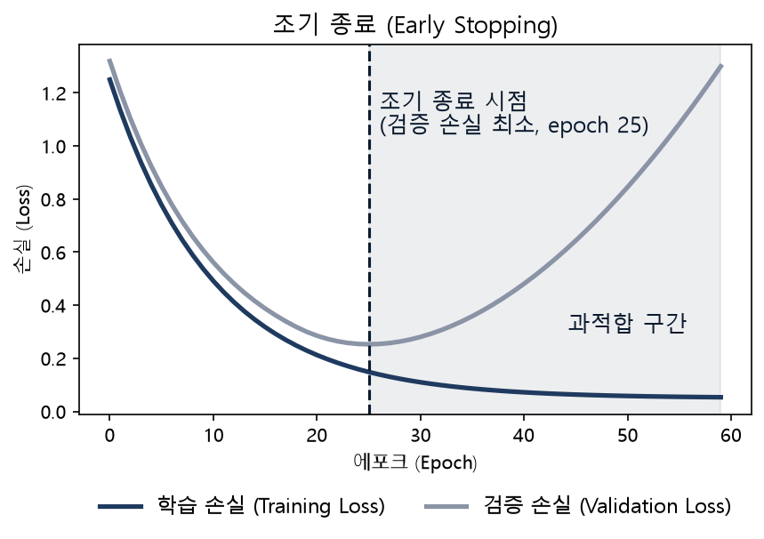
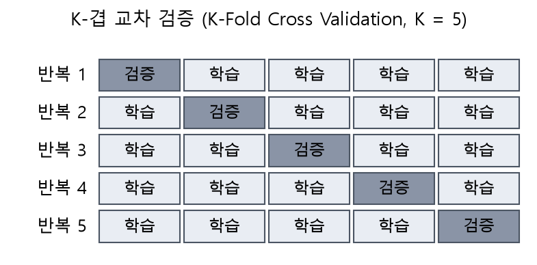

# 05. 퍼셉트론과 신경망 학습

> 참고: 인공지능개론 강의 자료 p.74 ~ 110 + 수업 필기

## 1. 순전파 (p.74 ~ 76)
- ŷ = φ(b + Σ xₖwₖ) = φ(b + XᵀW)
  - Σ: 입력이 핵에 모임
  - φ: 반응, 활성화 (정해진 것이 아니라 계속 연구 중)
  - ŷ: 뉴런의 출력
  - 행렬로 바꿔 계산
- 특성에 따라 가중치가 정해지나? → 가중치는 학습을 통해 생김
- **Bias**: 뉴런의 고유한 특징
  - 예) 큰 자극에도 반응 X → bias -10
  - 예) 작은 자극에도 반응 O → bias +10

## 2. 활성화 함수 (p.76 ~ 78)
| 함수 | 범위 | 메모 |
|---|---|---|
| **Sigmoid** | 0 ~ 1 | 반응 여부만 표현, 입력 -2 ~ 2 정도가 유의미한 구간 |
| **TanH** | -1 ~ 1 | -1 = 반응 억제, 1 = 반응 |
| **ReLU**(Rectified Linear Unit) | 0 이상 | 역전파할 때 오차가 정확히 전달됨 |
- 중요한 이유: **비선형성**
  - 없으면 선형 여러 개를 쌓아도 결국 선형
  - 비선형이 있어야 layer를 많이 쌓을수록 고차원 경계 표현 가능

## 3. 퍼셉트론 예시 (p.79 ~ 81)
- b = 1, W = [3, -2] → ŷ = φ(1 + 3x₁ - 2x₂)
- X = [-1, 2] → φ(1 - 3 - 4) = φ(-6) ≈ 0.002 (시그모이드)
- 직선 1 + 3x₁ - 2x₂ = 0 기준
  - 노트: 0보다 크면 직선 위, 작으면 직선 아래
  - 보충: 그림 기준으로는 z < 0(y < 0.5)이 직선 왼쪽 위, z > 0(y > 0.5)이 오른쪽 아래. 예시 점 (-1, 2)는 z = -6이라 왼쪽 위에 있음

- 단순화 표기: Σ와 φ를 한 원으로 합침

## 4. 다중 퍼셉트론과 신경망 (p.82 ~ 85)
- **Dense Layer**: A의 출력이 모두 B의 입력으로 들어감 (아니면 sparse?)
  - 하나의 입력을 노드마다 서로 다르게 해석 → 좋은 정보로 조합
  - 노드 수는 적절하게 (너무 많으면 비슷한 노드가 생김)
- yⱼ: layer의 j번째 퍼셉트론
- 단층 신경망: 은닉층 1개 → 복잡한 것은 다루기 어려움
- 딥 뉴럴 네트워크: 은닉층 2개 이상

## 5. 적용 예시: 시험 통과 예측 (p.86 ~ 89)
- x₁ = 수업 참여 일수, x₂ = 과제 투자 시간 → 출력 T/F
- Input & Output을 정확히 설정해야 함, 은닉층 구성도 고민
- [4, 5] 입력 → 예측 0.1, 실제 1 → 손실 발생
- 손실 함수 ℒ(예측, 실제), 예측은 순전파 결과

## 6. 손실 함수 (p.90 ~ 92)
- **Empirical Loss**: 전체 데이터셋 손실의 평균
  - 다른 이름: Objective function, Cost function, Empirical risk
- Loss vs Accuracy
  | 정답 | 예측 | 출력(0.5 기준) | 차이 = Loss |
  |---|---|---|---|
  | 1 | 0.9 | 1 | 0.1 |
  | 1 | 0.6 | 1 | 0.4 |
  - 정확도는 둘 다 맞음, 손실은 다름
- **Binary Cross Entropy**: 출력이 확률(0 ~ 1)일 때
  - 앞의 '-'는 log 값이 음수라서 오차(양수)로 바꾸려고 붙임
- **MSE**(Mean Squared Error, 평균 제곱 오차): 출력이 연속 실수일 때 (회귀)
  - 동작한다고 항상 맞는 방법은 아님 → 문제에 맞는 손실 함수 필요
  - ※ 무엇을 알고 언제 어떤 걸 써야 하는지 알아야 함
  - 보충: MSE는 (실제 - 예측)²의 평균. 자료 식 앞의 '-' 부호는 없는 것이 맞음

## 7. 경사 하강법 (p.93 ~ 98)
- 목표: 손실을 최소화하는 W 찾기 → W* = argmin J(W)
- 절차
  1. 가중치를 임의 값으로 초기화
  2. 수렴(기울기 0)할 때까지 반복
     - 기울기 계산 (오차에 대한 기울기)
     - 가중치 갱신: W ← W - η · ∂J/∂W
  3. 가중치 반환

- '-' 부호: 기울기가 +면 가중치는 -, 기울기가 -면 +로 → 반대 방향으로 가야 수렴
- **학습률 η(에타)**: 예) 0.025
  - 학습률이 너무 크면 최솟값 주변에서 진동(oscillation) → 학습률을 줄여 나감

- local minimum 문제 → 여러 초기값으로 시도 → 최적화 문제
- 실제 손실 그래프 모양은 모름, 이런 모양이라고 가정하고 진행
- **역전파**: 가중치가 수정되어 가는 과정
  - 전체 오차를 기울기 방향으로, 가중치에 따라 나눠 작게 전달

## 8. 학습이 어려운 이유 (p.100 ~ 108)
### 학습률
- W 값은 작고 기울기는 클 수 있음 → η를 곱해 W에 맞는 크기로
- 여러 학습률 시도, 또는 적응형 사용
  - SGD(Stochastic Gradient Descent, 확률적 경사 하강법): batch 개념, X장 처리 후 역전파 진행
  - Adam: Moment(경향성)를 이용해 앞 값을 미리 예상

### 가중치 계산량
- 전체 데이터 한 번에: 계산량 매우 많음
- 1개씩(SGD): 갱신 방향이 불안정 → 수렴이 어려움
- **미니 배치**: 일정 단위(32, 64, 128장)로 묶어 진행 → 계산 부담 감소 + 안정적 수렴
  - 예) 데이터 100개, 배치 10 → 10번에 1 epoch

- 학습 데이터·반복 횟수가 많을수록 성능 향상 → 연산량 증가 → 클라우드 GPU 활용으로 학습 시간 단축

### 과적합과 정규화
- 학습 data, 검증 data로 최소 3 ~ 4번 이상 계속 확인
- 정규화: 모델 복잡성 감소, 일반화 성능 향상
  - **드롭아웃**: 학습 중 각 층에서 노드를 임의로 제거
    - 예) A 노드가 너무 커서 B, C, D 변화가 안 보임 → A를 dropout → B, C, D 변화 확인

  - **조기 종료**: 검증 손실이 다시 오르는 지점에서 멈춤
    - epoch 값을 줄이거나 횟수 지정
    - 중간중간 epoch 단위로 저장

## 9. 딥러닝 데이터 (p.109 ~ 110)
| 데이터 | 용도 |
|---|---|
| 학습 (Training) | 학습 |
| 검증 (Validation) | 학습 중 test |
| 평가 (Test) | 실제 test |
- k-fold: 데이터를 k개로 나눠, 돌아가며 test fold로 바꿔 검증

- **Annotation / Labeling**: output 정답을 만드는 방식
  | 방식 | 메모 |
  |---|---|
  | 범주 (Class) | 입력과 class를 매핑 |
  | 경계 박스 (Bounding box) | 위치 + class, 배경도 학습에 영향 |
  | 영역 (Segmentation, Polygon, Line) | 딱 해당하는 부분만 |
  | 히트맵 (Heat map) | 경계가 애매할 때 진하게/연하게 |
  | 키포인트 (Key points) | 예) 관절 단위 |
