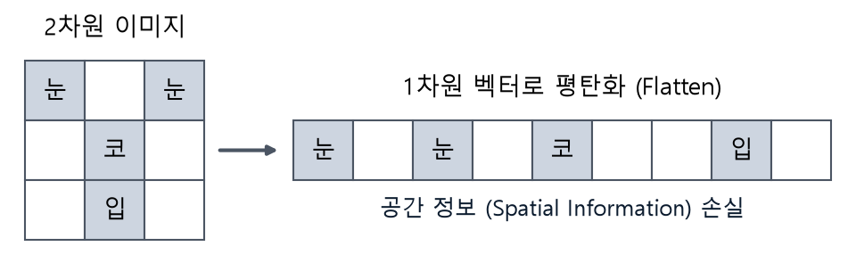
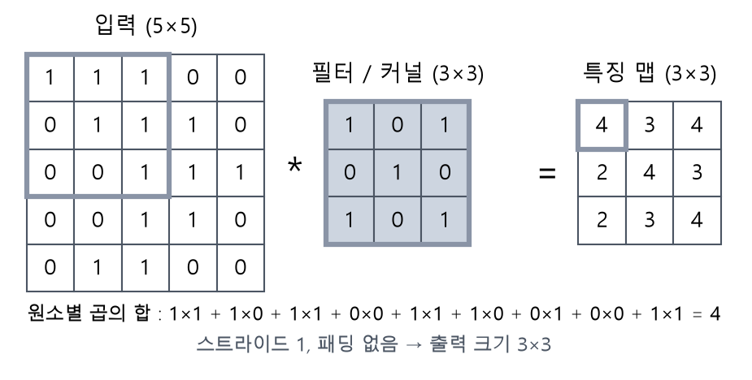
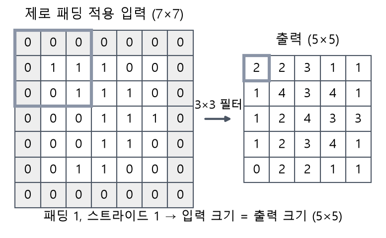
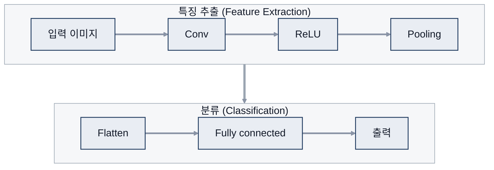
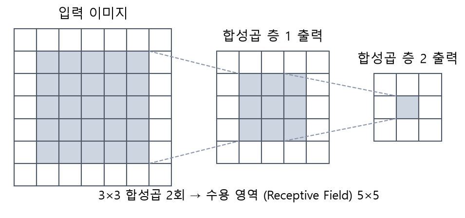
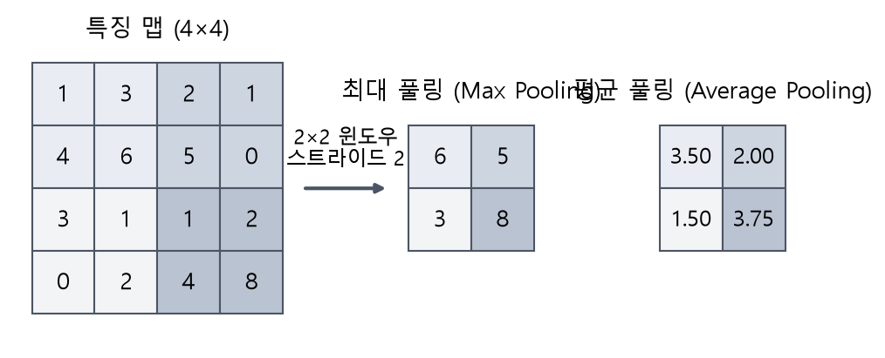
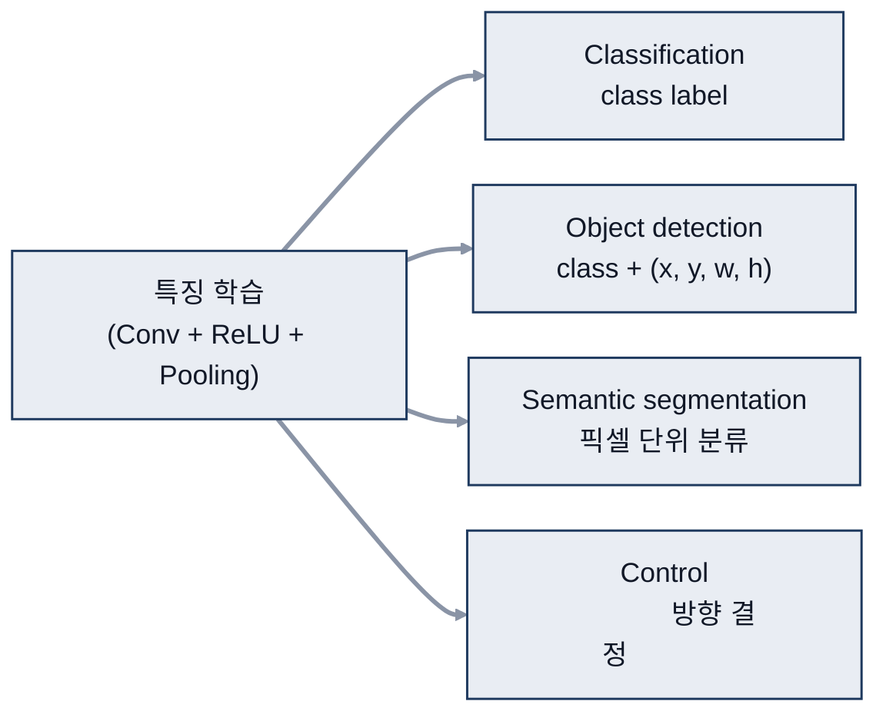
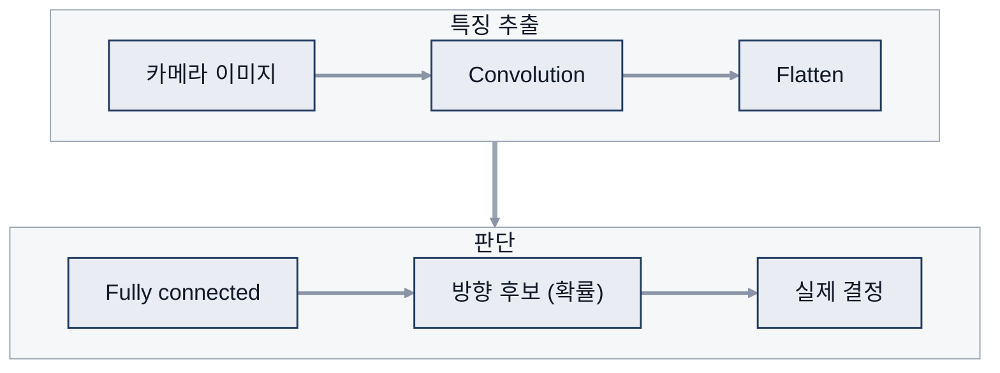

# 06. CNN

> 참고: 인공지능개론 강의 자료 p.111 ~ 138 + 수업 필기

## 1. 컴퓨터 비전 (p.111 ~ 119)
- CNN(Convolutional Neural Network, 합성곱 신경망): 영상 분야(컴퓨터 비전)에 특화
- 컴퓨터가 보는 이미지 = 숫자 배열 → 사람처럼 분석 (예: 얼굴 분류 확률)
- 고차원 특징: 범주마다 중요한 특징 (얼굴 = 코·눈·입, 자동차 = 휠·번호판)
- 전통 방식: 도메인 지식 → 사람이 특징 정의 (color, pattern) → 분류
  - 문제: 시점, 크기, 조명, 변형, 가림, 배경, 같은 범주 안의 다양성

## 2. 기존 신경망의 한계 (p.120)
- 2D 이미지를 1차원 벡터로 펼쳐 입력 (1개 데이터 → 1개 입력)
- Fully connected의 문제
  - **공간 정보 표현 안 됨** → 유의미한 정보가 없어짐
    - 예) 2차원 사진을 1차원으로 바꾸면 눈·코 위치 표현이 어려움

  - 변수 수가 매우 많음
- 해결: 이미지 안에서 filter로 sliding window 연산

## 3. 공간 정보 반영 (p.121 ~ 124)
- 아이디어: 입력의 **특정 영역만** 각 뉴런에 연결 (컨볼루션 형태)
- **컨볼루션 연산**: 픽셀(2차원) × 가중치(2차원) → 같은 위치끼리 곱해서 더함 → 특징
- CNN의 목적: 2D에서 2D 필터로 특징 뽑아내기
- 활성화 함수를 쓰지 않는 층도 있음
  - 보충: 합성곱 층 뒤에는 보통 ReLU 적용. 풀링 층, 회귀 문제의 출력층 등은 활성화 함수 없이 사용
- 특징 추출 과정
  1. 지역 특징을 위해 가중치 세트(Filter) 적용
  2. 다른 특징을 위해 필터 여러 개 사용
  3. 필터 가중치는 공간적으로 공유
- 모양이 조금 달라도(이동, 축소, 회전) 부분 패턴이 같으면 같은 특징으로 인식

## 4. 컨볼루션 연산 (p.125 ~ 127)
- filter를 sliding하며 연산
  1. 필터를 이미지 위에 적용 (sliding window)
  2. Element-wise 곱 (대응하는 위치끼리 곱)
  3. 곱한 결과를 모두 더함 → feature map

- 필터 예
  | 필터 | 메모 |
  |---|---|
  | Sharpen | 가운데 계수가 큼 → 비슷한 것끼리는 완만하게, 차이 큰 것은 sharp하게 |
  | Edge Detect | 더 어두워지는 윤곽 찾기 |
  | Strong Edge | 세로 방향 필터 |
- 필터 크기
  - 가운데 연산 결과가 저장됨 → 필터가 홀수면 가운데가 생김
  - 짝수면 원하는 위치가 달라질 수 있음
  - 컨볼루션 필터는 상하좌우 대칭으로 설정
- 필터를 거치면 크기가 줄어듦 (끝 칸 값이 사라짐)
  - **Padding**: 처리 안 되는 가장자리를 어떻게 할지 결정 → 입력 size = 출력 size

  - upsize, downsize → U-Net 특징
- 이전까지는 '퍼셉트론'이었다면 여기서는 필터
- 의문
  - 필터가 많으면 다양한 특징을 뽑나? 과적합과 연관 있나?
  - 컨볼루션은 필터가 중요한가, 원하는 데이터가 중요한가?

## 5. CNN 구조 (p.128 ~ 131)
- 학습 = 특징맵과 filter를 조절하는 것
- 구성
  1. **컨볼루션**: 필터로 특징맵 생성
  2. **비선형**: ReLU(Rectified Linear Unit) 등 (edge 중 한쪽만 살림)
  3. **풀링**: 특징맵 다운샘플링

- **receptive field** (수용 영역)
  - 노드에 연결되는 입력 이미지의 위치·영역
  - 처음에는 작음 → 작은 영역을 다룸 → 층을 지날수록 넓어짐
  - 80% 정도는 되어야 괜찮음

- 출력 볼륨: h × w × d (d = 필터 개수)
  - ※ PyTorch / TensorFlow는 (1, 32, 32, 1)처럼 차원 순서가 다름 → 순서 파악하기
  - 보충: PyTorch는 (N, C, H, W), TensorFlow는 (N, H, W, C)
- **스트라이드**: sliding window의 필터 이동 크기
- **Pooling**
  - 필터 겹침(overlap) 허용 안 함, 특징맵 크기를 줄임
  - 평균·최대·최소 필터 사용 (예: 4×4 → 2×2 필터 → 2×2 출력)
  - 공간적 불변성

## 6. 표상 학습과 활용 (p.132 ~ 138)
- Conv layer 1 → 2 → 3: 선·점 → 눈·코 → 얼굴 구조
- 특징 학습(Conv + ReLU + Pooling) 뒤 출력부를 바꾸면 여러 문제에 활용
  - Classification, Object detection, Segmentation, Probabilistic control
  - 결과(출력층)를 바꾸면 YOLO(You Only Look Once) 같은 모델이 됨

- **Classification**: 이미지 → class label
- **Object detection**: class + 위치 (x, y, w, h)
  - 단일 객체 / 다중 객체 → output에 여러 class 설정
  - Object는 범주·크기·위치가 다양하고, 가려짐(occlusion)에 영향 받음
- **Semantic segmentation**: 픽셀 단위 분류 (의료 영상 등)
- **Control** (자율주행 End-to-End)
  - 카메라 이미지 → convolution → flatten → fully connected
  - 방향 후보(확률) → 실제 결정

- ※ YOLO: 개념 정도는 알아 두기 (YOLOv1 2015, v2 2016, v3 2018)

## 참고
- YOLO 구현 실습
