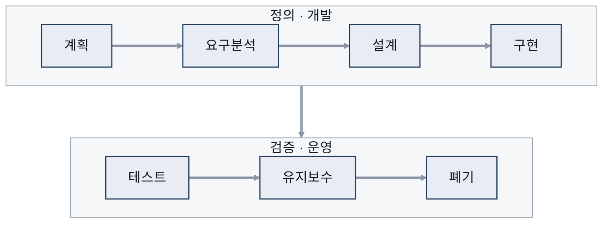
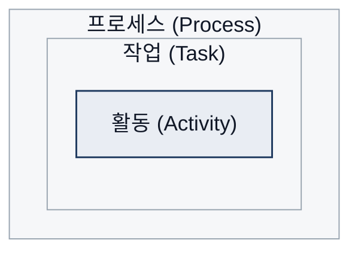
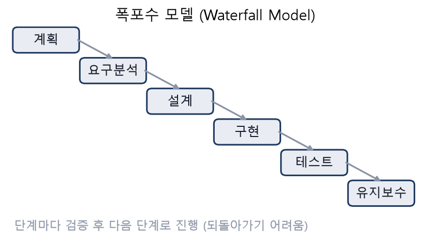
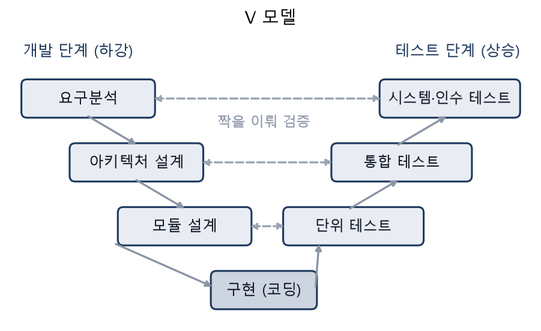
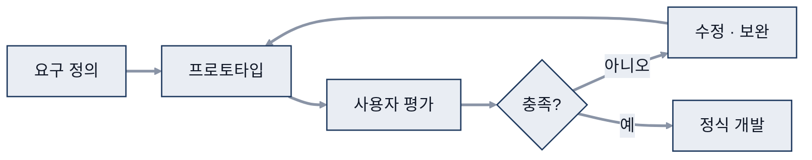
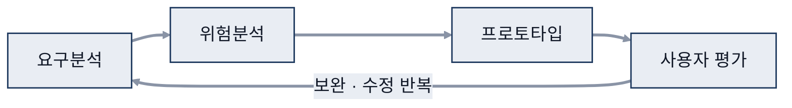
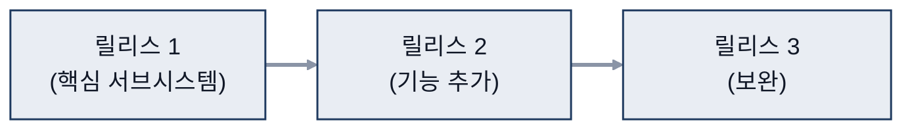
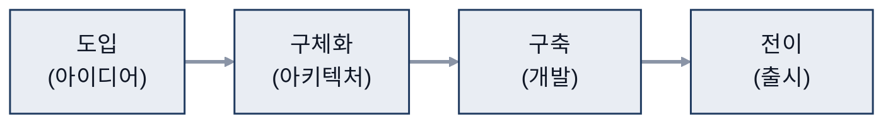
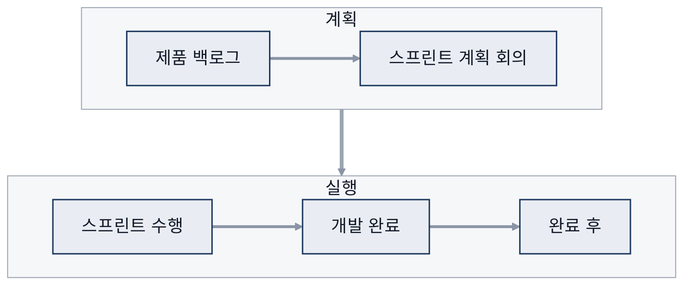
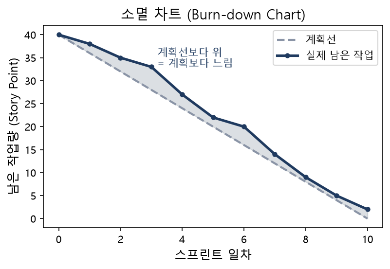

# 01. 소프트웨어공학과 개발 프로세스

> 참고: 소프트웨어공학 강의 자료 p.3 ~ 33 + 수업 필기

## 1. 프로그램과 소프트웨어 (p.3)
- 프로그램: 프로그래밍한 원시 코드(source code)
  - 대기 상태 ⇒ 실행되면 '프로세스'
- 소프트웨어: 개발 과정에서 나오는 **모든 산출물**
  - 코드, 자료구조, DB(Database, 데이터베이스) 구조, 테스트 결과, 단계별 문서, 사용자 매뉴얼

## 2. 소프트웨어 특징 (p.4)
| 구분 | 의미 | 메모 |
|---|---|---|
| 제조 | **정해진 틀에 맞춰 일정하게** 제품 생산 | HW(Hardware, 하드웨어) 관점 |
| 개발 | 목적 달성을 위해 **새로운 것을 만들거나 기존 기술 활용** | SW(Software, 소프트웨어) 관점 |
- 소모되지 않지만 기능 추가·환경 변화 대응 과정에서 품질 저하
  - 실제 SW 실패 곡선이 올라가는 이유: 환경, 기대치 등

## 3. 소프트웨어 개발의 어려움 (p.5)
- 소규모 → 대규모로 갈수록 도구, 과정, 전문 인력, 기간이 복잡해짐
  - 예) 등본 발급: 동사무소 ⇒ 행복주민센터 (정보 조회, 인증, PDF 다운로드 등 복잡) + AI

## 4. 소프트웨어공학 (p.6)
- 공학: 한정된 **시간과 비용**(자원)으로 과학적 지식을 활용해 **문제를 해결**하는 것
- 공학 원리: 각 방면의 요령, 노하우가 쌓임 ⇒ 그 집합 = SW 공학
- SDLC(Software Development Life Cycle, 소프트웨어 개발 생명주기): 계획 → … → 유지보수
  - 마지막에 **폐기** 단계까지 포함

- 목표: 개발 생산성 향상, 고품질 소프트웨어 생산

## 5. 프로세스 · 작업 · 활동 (p.7)
- **프로세스(Process)**: 목적을 위해 순서가 정해진 일련의 절차
- **작업(Task)**: 개발할 때 일을 수행하는 작은 단위
- **활동(Activity)**
- 포함 관계: 프로세스 ⊃ 작업 ⊃ 활동

- 개발 프로세스 = **사용자의 요구사항**을 시스템으로 구현하기 위한 일련의 활동

## 6. 개발 모델 비교 (p.8)
| 모델 | 핵심 | 메모 |
|---|---|---|
| 주먹구구식 (Build-and-fix) | **공식 가이드라인·프로세스 없이** 개발 | flowchart 등 없이 진행 |
| 폭포수 (Waterfall) | 단계를 순서대로 진행 | 경직됨 |
| V 모델 | 폭포수 변형, 개발 단계와 테스트 단계를 짝지음 | |
| 프로토타입 | 간이 결과물을 만들며 반복 | 한 번에 완성 X ⇒ 수정해 나감 |
| 나선형 (Spiral) | 프로토타입 + **위험 분석** | |
| 단계적 개발 | 나눠서 출시 | 출시 → 보완 → 개발 → 출시 … |
| 통합 프로세스 (UP, Unified Process) | 도입 → 구체화 → 구축 → 전이 | |
| 애자일 | 빠르게, 변경 수용 | 스크럼 등은 애자일 '컨셉'을 구현한 모델 |

## 7. 폭포수 모델 (p.10 ~ 11)
- 계획 → 분석 → 설계 → 구현 → 테스트 → 유지보수

- 단계마다 **검증 후 다음 단계 진행**, **문서 중심**
  - 구현 = 개발, 테스트 = QA(Quality Assurance, 품질 보증)·QC(Quality Control, 품질 통제)
  - 설계서 = 구조 설계 / 상세 설계
  - 구현 단계에서 code review, 모듈별 코드 review → 유지보수 전에 출시
- 장점
  - **관리 용이**: 절차가 간결하고 진행 관리가 쉬움
  - **체계적 문서화**
  - **요구사항 변화가 적은**(없는) 프로젝트에 적합
- 단점
  - 앞 단계가 끝나야 다음 단계 시작 ⇒ 장시간 걸림
  - **단계별 결과물이 완벽해야** 다음 단계 오류 예방
  - **중간에 눈에 보이는 결과 확인 어려움**

## 8. V 모델 (p.12)
| 개발 단계 (하강) | | 테스트 단계 (상승) |
|---|---|---|
| 요구분석 | ↔ | 시스템 테스트, 인수 테스트 |
| 아키텍처 설계 | ↔ | 통합 테스트 |
| 모듈 설계 | ↔ | 단위 테스트 |
- 왼쪽 = 폭포수 방식 (검증, 문서 확인) / 오른쪽 = 검증, 실행

## 9. 프로토타입 모델 (p.13 ~ 15)
- **프로토타입**(간이 결과물)을 만들고 수정·요구사항 추가를 **반복**
- 사용자 요구 반영 여부를 검토하는 도구로 활용
- **요구사항이 불분명하거나 수정이 계속 생기는 개발에 적합**
- 요구사항 = 기능 & 비기능
- 절차: 요구사항 정의 → 프로토타입 개발 → 사용자 평가 → 수정·보완

- 장점: 의사소통 원활, 점진적 개발, 요구분석 명세서 작성에 도움
  - 유지보수 감소: 요구사항을 미리 확인해 후반 수정이 줄어듦
  - 보충: 처음부터 다시 하는 것이 아니라 프로토타입 단계만 반복, 요구사항 확정 후 정식 개발로 넘어감
- 단점: 범위 불분명
  - 해결: **횟수 제한** 설정 (예: 자동차, 게임 캐릭터)

## 10. 나선형 모델 (p.16 ~ 18)
- 프로토타입 모델 + **위험 분석 단계**
- 요구분석 → 위험분석 → 프로토타입 → 사용자 평가 → 보완·수정 반복

- 장점: **위험을 고려하며 개발 진행**
- 단점: **장기화 가능성**, **프로젝트 관리 어려움**, 개발자 이직 시 타격

## 11. 단계적 개발 모델 (p.19)
- **중요한 서브시스템부터** 개발해 릴리스
  - 중요한 부분 = 필수, 메인
- 장점: 사용자가 미리 써 보며 적응할 시간 확보
- 단점: 요구사항이 바뀌면 최악의 경우 릴리스 2가 크게 커질 수 있음

## 12. 통합 프로세스 (p.20 ~ 22)
| 단계 | 핵심 | 메모 |
|---|---|---|
| 도입 | 아이디어 | 비즈니스적으로 괜찮은가? 사용자에게 무엇이 필요한가? |
| 구체화 | 아키텍처 | |
| 구축 | 개발 | 요소 구현, 단위·통합 테스트, 사용자 매뉴얼 작성 → 취업과 직결되는 부분 |
| 전이 | 창출, 출시 | |

## 13. 애자일 (p.23 ~ 25)
- 고객(요구사항) 중심, 빠른 개발·전달
- 원칙
  - 빠르고 지속적인 전달
  - 요구사항 변경 수용
  - 자주 전달, 매일 의견 교환
  - **대면 방식** 소통
  - 동작하는 소프트웨어(프로토타입)로 진척 측정
- 폭포수와 비교: 폭포수는 **경직됨**

## 14. 스크럼 (p.26 ~ 33)
- 흐름: 제품 백로그 → 스프린트 계획 회의 → 스프린트 수행 → 개발 완료 → 완료 후

  - 스프린트 계획 회의: 단기
  - 스프린트 수행: **기간 안에 못 끝내도 종료**
- 제품 백로그
  - 우선순위 높음 ⇒ 스프린트 앞쪽에 배치
  - 대화를 통해 **요구사항 도출**
- 스프린트 구현 목록
  - SP: Sprint point (중요도)
    - 보충: 보통 **Story Point**라고 함. 작업의 상대적인 크기·난이도
  - MD: Man-Day, 1일 단위
- 소멸 차트(burn-down chart)
  - 실제 선이 계획선(점선)보다 **아래 = 계획보다 빠름**, **위 = 계획보다 느림**

- 역할: **제품 책임자(Product Owner), 스크럼 마스터(Scrum Master), 개발팀(Development Team)**
  - ※ 실무에서 중요
- 단점: 작업을 효율적으로 하는지 파악 어려움 (주관적)

## 참고
- 앞으로의 개인 계획을 스크럼(Scrum) 방식으로 수립
