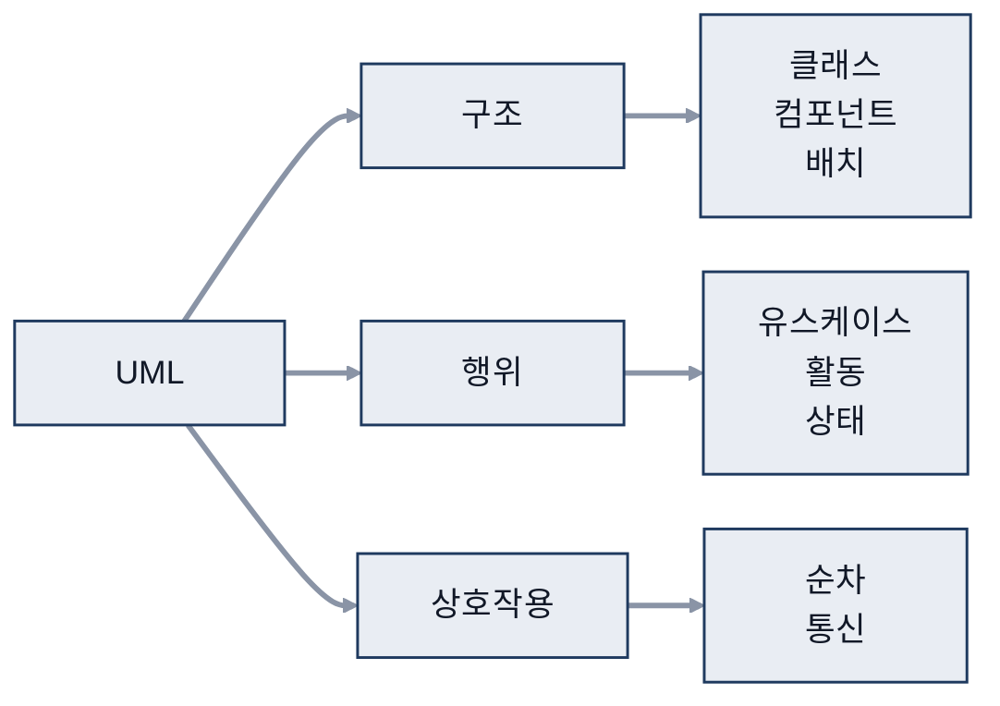
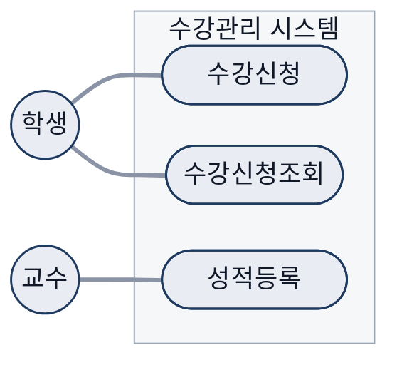
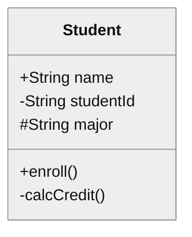
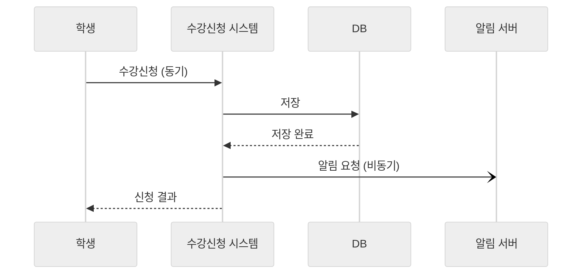
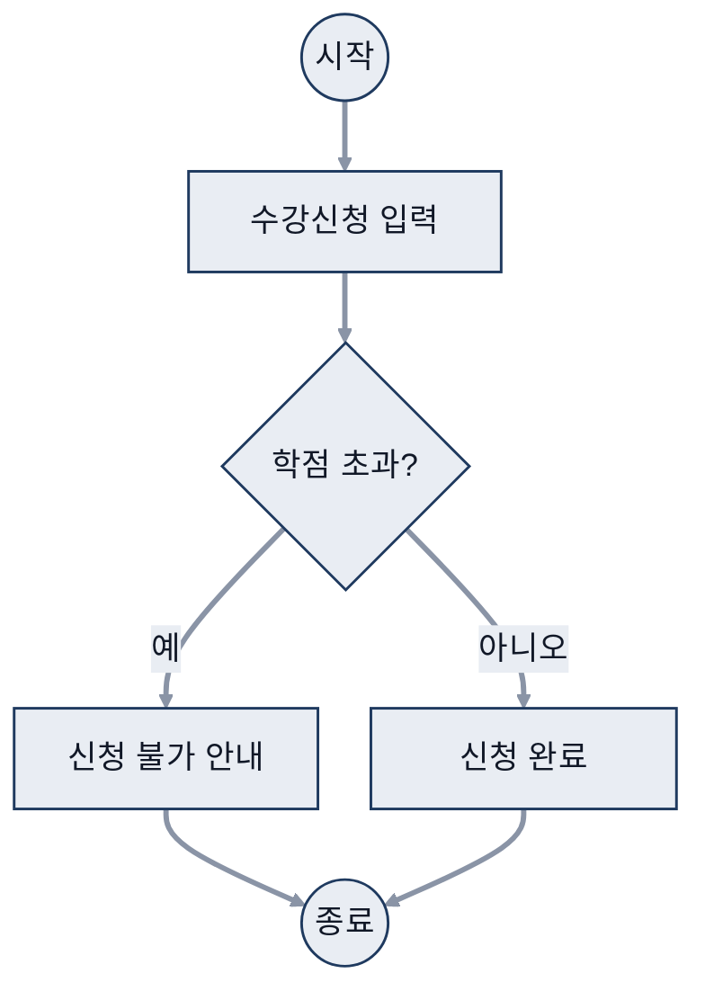
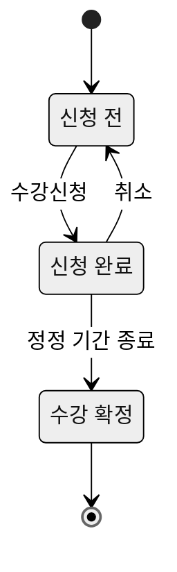

# 02. UML

> 참고: 소프트웨어공학 강의 자료 p.35 ~ 54 + 수업 필기

## 1. UML 개요 (p.35)
- UML(Unified Modeling Language, 통합 모델링 언어): 시스템을 **시각적으로 볼 수 있게 나타낸 도면**
  - 우선순위 등을 잘 뽑아내기 위함
- 종류: **구조 다이어그램 / 행위 다이어그램 / 상호작용 다이어그램**

- 그림 속 Waiter = actor

## 2. 액터 (p.36 ~ 38)
- 시스템과 상호작용하는 사람, 외부 시스템
  - actor, usecase를 어떻게 잡느냐에 따라 설계가 달라짐
  - 성적등록 = 기능 = usecase
- 액터 식별 기준: 일반적인 기준 5가지
- 액터 이름: '변수' 이름처럼 중요

## 3. 유스케이스 (p.39 ~ 44)
- **사용자가 시스템을 통해 쓰고 싶은 기능**, **작은 단위 기능**
- 절차: 식별 → 검증 → 이름 정하기 → 목록화
  - 그림 2-7 = 큰 범위 usecase, 그림 2-8 = 작은 범위 usecase

### 검증
- 수작업은 유스케이스 X
- **최종 결과만** 나타냄
  - usecase가 usecase를 호출하는 경우 주의
- 예: '수강관리' = 부적절 / '수강신청', '수강신청조회' = 적절

- 예시 (수강관리 시스템): 액터(학생 · 교수)와 유스케이스를 실선으로 연결

### 이름
- **사용자 관점**, **동사형 명사**, **최종 목적**이 드러나게
- 목록표: 이름 = 기능, 설명 = 스토리

### 액터와 유스케이스 관계
- 증명서 자동발급기 = actor (시스템 액터)
- 도서관리시스템: 빌린 것 ⇒ 알림 = 다른 시스템과의 관계
- actor ↔ usecase 관계 성립

### 일반화, include, extend
- **일반화**: usecase를 경우에 따라 묶음
  - 일반화 트리는 명시해 두는 것이 좋음
  - 일반화하지 않으면 가독성 저하 → 사용자 → 로그인으로 묶으면 단순해짐
- **include**: 여러 유스케이스에 공통으로 들어가는 기능을 분리해 포함
  - 자료 예시: 바람직하지 않은 포함(로그인)
  - 보충: 로그인은 기능이 아니라 대부분 기능의 선행 조건이라 include보다 선행 조건으로 표기하는 것이 바람직
- **extend**: 부적절한 확장 예시(신청학점 제한)
  - 임의 사용자 ⇒ 접근 제한 필요

- 예시: 수강신청은 학점 확인을 항상 포함(include), 신청학점 제한은 조건에 따라 수강신청을 확장(extend)

## 4. 클래스 다이어그램과 가시성 (p.45, 53)
| 기호 | 의미 | 접근 범위 |
|---|---|---|
| `+` | public | 모든 클래스 |
| `-` | private | 메서드를 통해서만 |
| `#` | protected | 상속받은 하위 클래스만 |

- 예시 (학생 클래스): `+` public, `-` private, `#` protected

- 의존 관계 (개설과목관리 → 교과목관리)
  - '포함되어 있다' 관계 표시, B는 A를 호출해야 함
- 메뉴별 사용자
  - 성적등록, 교과목등록 = 교수
  - 개설과목등록 = 직원
  - 수강신청 = 교수, 직원, 학생

## 5. 순차 · 통신 다이어그램 (p.46 ~ 47)
- **순차 다이어그램**: 시나리오를 시간 순서로 표현
  - 세로선 = 생명선
  - 동기: 응답을 기다림, 다음 step 진행 불가
  - 비동기: 응답을 안 기다리고 다른 작업 요청 가능

- 예시 (수강신청): 실선 화살표 = 동기 호출(응답 대기), 열린 화살표 = 비동기 호출(응답 안 기다림), 점선 = 응답

- **통신 다이어그램**: 메시지로 객체 간 상호작용 표현
  - 한 프로젝트 안에서 여러 다이어그램을 함께 사용 가능

## 6. 활동 · 상태 다이어그램 (p.48 ~ 51)
- **활동 다이어그램**: 상위 수준 업무 흐름 표현
  - **분기, 병합**
  - **동기화 막대** = 같이 시작 & 같이 끝!
  - 신호, **구획면**

- 예시 (수강신청 흐름): 마름모 = 분기, 갈라진 흐름이 다시 모이는 곳 = 병합

- **상태 다이어그램**: 처리되는 과정을 보여줌
  - 이벤트 = 작업

- 예시 (수강 상태): 이벤트(수강신청 · 취소 · 정정 기간 종료)에 따라 상태가 바뀜

## 7. 컴포넌트 · 배치 다이어그램 (p.52 ~ 54)
- **정적 모델링**: 구성 요소 사이의 의존 관계 표현
  - 컴포넌트 = 동작시키는 것들
- **배치 다이어그램**: 하드웨어(노드)와 그 위에 배치되는 소프트웨어 구성 요소, 통신 경로 표현
  - TCP/IP(Transmission Control Protocol/Internet Protocol): network, internet
