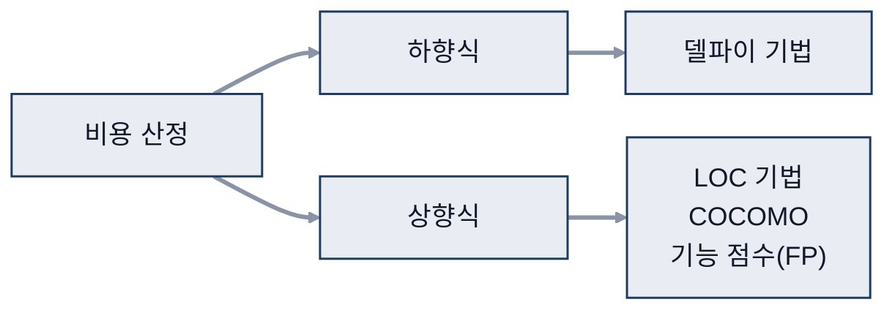
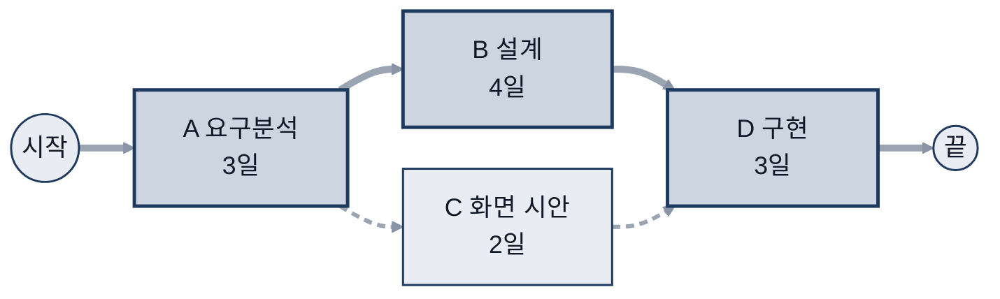
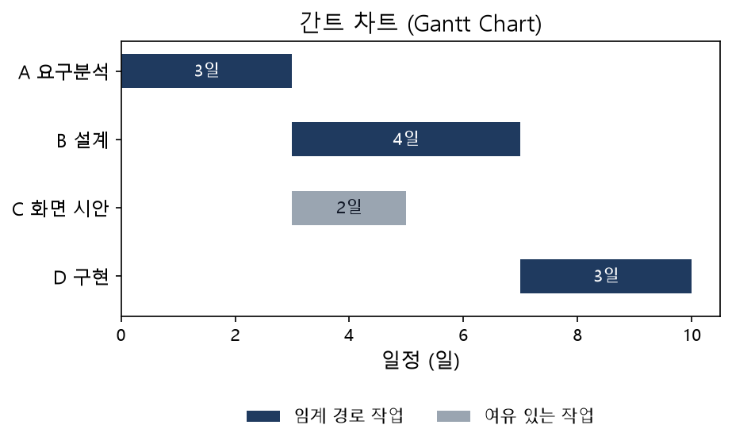
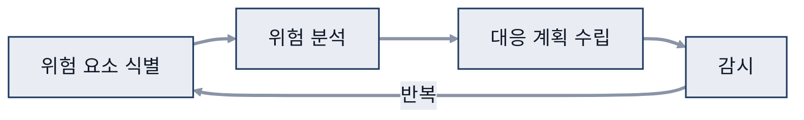
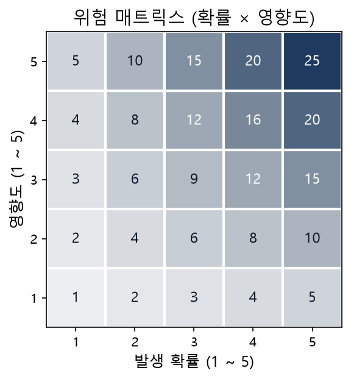

# 03. 계획

> 참고: 소프트웨어공학 강의 자료 p.56 ~ 81 + 수업 필기

## 1. 계획 수립 시 고려 사항 (p.56 ~ 59)
- 타당성 분석: 돈이 되나?
- 개발 난이도: 실제로 가능한가?
- 투자 효율성: 투자 대비 이익을 경영진이 판단
- 초급·고급 프로그래머 사이의 생산성 차이 고려

## 2. 비용 산정 (p.60 ~ 69)
| 방식 | 기법 | 핵심 |
|---|---|---|
| 하향식 | **델파이 기법** | 전문가 여러 명의 의견 종합 |
| 상향식 | **LOC(Lines of Code) 기법** | 예상 코드 라인 수로 계산 |
| | **COCOMO**(Constructive Cost Model) | LOC 추정 → 수식에 대입, **난이도 반영** |
| | **기능 점수(FP, Function Point)** | 기능 수와 복잡도로 산정 |

### COCOMO
- 유형: **단순형 / 중간형 / 내장형**
- COCOMO II 애플리케이션 합성 모델
  - '외형'을 보고 산정, 코드 라인은 보지 않음

### 기능 점수 (Function Point)
- 정규 기능 점수법: 구체화
- 간이 기능 점수법: 대략적으로 산정
- 단점: 내부 로직 위주 SW(Software, 소프트웨어)에 부적합
  - 예) 버튼은 1개인데 기능은 여러 개
- 개발 규모 측정에 적합: 복잡도 반영에 적합
- 애플리케이션 = 응용 제품
- 측정 범위·경계 설정: 활용, 개발 측면
- ILF(Internal Logical File, 내부 논리 파일): 자기 안에 존재하는 데이터

## 3. 일정 계획 (p.72 ~ 78)
### WBS (Work Breakdown Structure, 작업 분할 구조)
- 개발비 산정의 기초: 기간, 비용

### PERT / CPM
| 기법 | 소요 시간 |
|---|---|
| **PERT**(Program Evaluation and Review Technique) | **통계적인 방법**으로 추정 |
| **CPM**(Critical Path Method, 임계 경로 기법) | **확정적 소요 시간** (명확하게 정해진 경우) |
- 작업을 합쳐 나가는 방식 ○○ ⇒ ○
- 소요 기간: 개발자, 개발 환경에 따라 달라짐
- B, C 작업: 병렬 ⇒ 동시 진행

- 예시 (작업 4개 일정): 굵은 선 = 임계 경로 (A → B → D, 여유 시간 0) / 점선 = 여유 있는 작업 (C)

### ES · EF · LS · LF
- **ES(Earliest Start) / EF(Earliest Finish)**: 가장 빨리 시작 / 끝
- **LS(Latest Start) / LF(Latest Finish)**: 최대한 늦게 시작 / 끝
- 여유 시간
  - 여유 시간 0 = **임계 경로(Critical Path)**, 지연되면 전체 일정이 늦어짐
  - 여유 시간이 있는 작업 = 융통성 있게 조절

### 간트 차트
- 작업별 일정을 막대로 표현

- 예시: 위 PERT 예시와 같은 작업 A ~ D의 일정을 막대로 표현

## 4. 위험 관리 (p.79 ~ 81)
- 절차: **위험 요소 식별 → 위험 분석 → 대응 계획 수립 → 감시**

- 위험 매트릭스: 5단계 = 5척도
  - 보충: 위험 매트릭스는 보통 발생 확률 × 영향도를 각각 5단계로 나눈 5×5 표

## 참고
- 초급·고급 프로그래머 생산성 차이 기준 자료 조사
