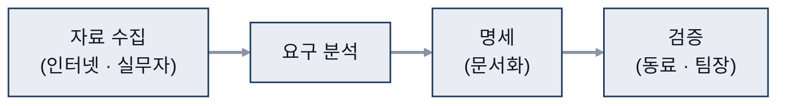
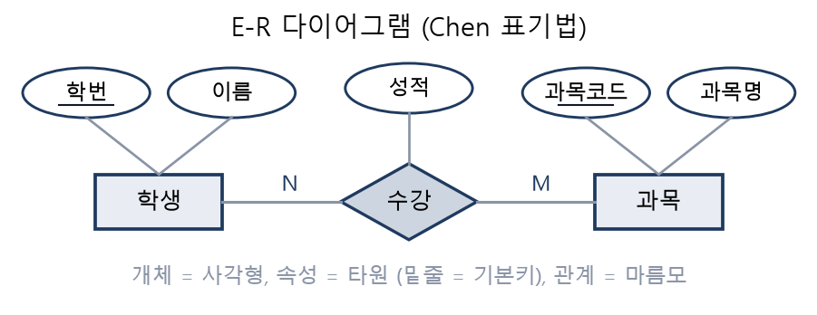
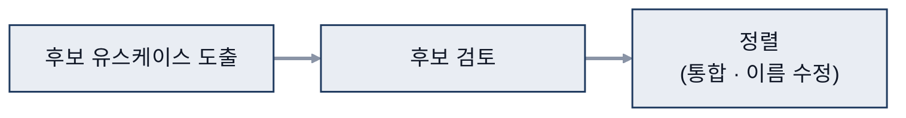

# 04. 요구분석

> 참고: 소프트웨어공학 강의 자료 p.83 ~ 102 + 수업 필기

## 1. 요구사항 (p.83 ~ 84)
| 구분 | 의미 | 예시 |
|---|---|---|
| **기능 요구** | 시스템이 해야 하는 일 | 사용자가 요구하는 기능 자체 |
| **비기능 요구** | **품질** 관련 요구 | 예시: 동시 접속자 100만 명 지원 |
- **요구분석**: 사용자 요구를 이해하고 명확히 정의하는 과정
- 요구분석이 어려운 이유 5가지 (의사소통, 잦은 변경, 모호함 등)

## 2. 요구분석 과정 (p.85 ~ 87)
- 자료 수집: 인터넷 + 실무자
- 검증: 동료, 팀장과 함께

- 요구사항이 갖춰야 할 특성
  - **완전성**: 오해 소지가 없어야 함
  - **일관성**: 항상 일정한 결과로 작동
  - **신뢰성**: **의도한 용도와 성능**을 **고장 없이** 유지
  - **가용성**: 빠른 대처 능력 ⇒ 모듈, 함수를 작게 쪼개 두면 빠른 대처 가능
- 표현 방법: 자연어 + 수식 + 모델, 주로 자연어(글)로 작성

## 3. 표현 도구 (p.90 ~ 99)
### 구조적 방법
- **자료 사전**: 데이터를 기호로 정의
  - 기호: `=` 정의, `+` 구성, `{ }` 반복, `[ | ]` 선택, `( )` 생략 가능, `* *` 주석
- **소단위 명세서(mini-spec)**: 처리 과정을 알고리즘으로 기술

### 정보공학 방법
- **E-R(Entity-Relationship, 개체-관계) 다이어그램**: 개체(네모), 속성(원), 관계(마름모)

### 객체지향 방법: 유스케이스
1. 후보 유스케이스 도출
2. 후보 유스케이스 검토: 1~2 = 요구사항 도출
3. 정렬 (통합, 이름 수정): **명확하게 / 오해 없도록**

- 유스케이스 명세서 항목
  - 개요, 관련 액터, 우선순위, 선행 조건, 후행 조건, 이벤트 흐름, 비기능 요구사항
  - **이벤트 흐름**: 처리 과정을 디테일하게 표기

## 4. 요구사항 문서화 (p.100 ~ 102)
- 문서가 갖춰야 할 특성
  - **완전성, 일관성, 명확성**
  - **추적 가능성**: 흐름 파악 가능하게
  - **변경 용이성**: 요구사항 간 **의존도가 낮게**
  - **검증 가능성**: **수치화·명료화**
- 명세 기법

  | 기법 | 방식 | 특징 |
  |---|---|---|
  | **비정형** | 자연어, 다이어그램 | 해석의 오해 소지가 많음 |
  | **정형** | 수학적 원리, 표기법 | 오해 소지가 적음(없음) |

- **요구사항 검증**: 비정형 · 정형 명세 작성 후 수행

## 참고
- 개인 프로젝트 1개를 골라 요구분석명세서 작성 (기능 · 비기능 요구사항, 유스케이스 명세)
