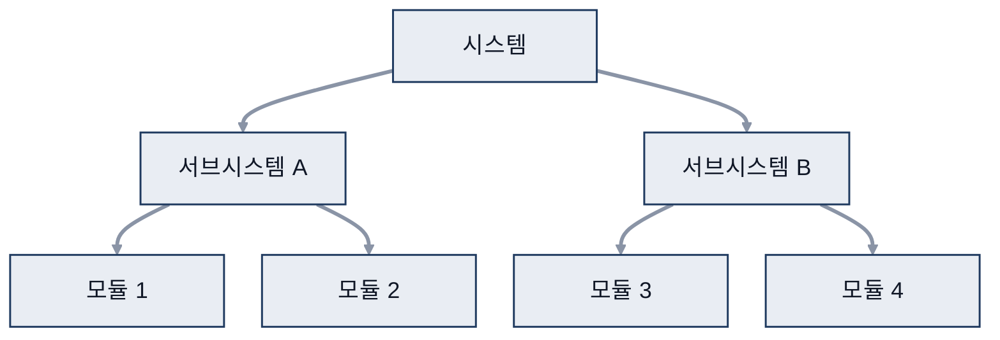
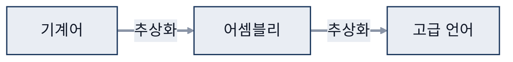
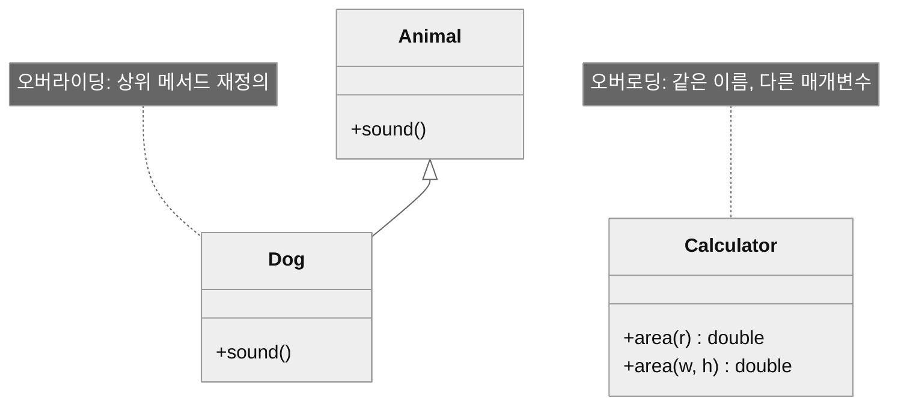
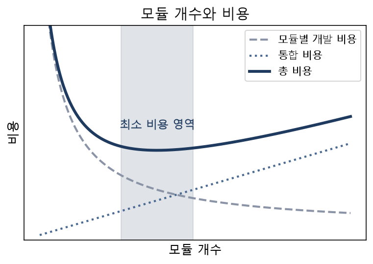
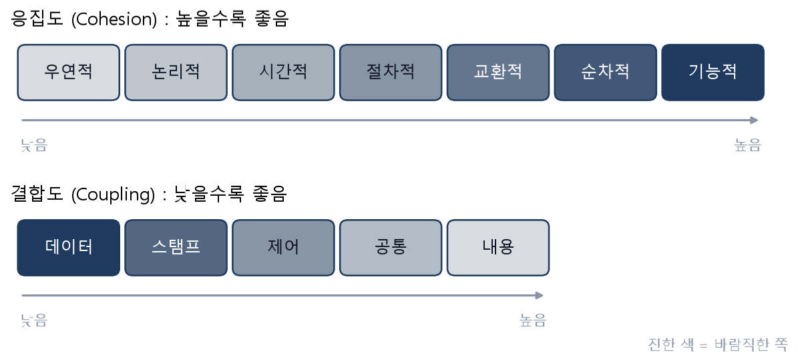

# 05. 설계

> 참고: 소프트웨어공학 강의 자료 p.104 ~ 121 + 수업 필기

## 1. 설계란 (p.104)
- 요구분석명세서를 바탕으로 **어떻게(how)** 만들지 정하는 작업
- 좋은 설계의 조건 (응집도, 결합도 고려)
  - 요구분석 내용을 모두 포함
  - 유지보수가 쉽도록 추적 가능
  - 변화에 쉽게 적응
  - **시스템 변경**으로 인한 영향 최소화 (예시: 운영체제 OS(Operating System) 교체)
  - 읽기 쉽고 이해하기 쉬운 설계서
- 요구분석 = 무엇(what), 개념적 / 설계 = 어떻게(how), 구체적
  - 설계 = 구조 설계 + 상세 설계

## 2. 설계 원리
| 원리 | 핵심 | 부가 설명 |
|---|---|---|
| 분할과 정복 (p.105) | **작은 단위로 분할** → **작은 시스템부터 개발** → **하나씩 위로 올라가며 완성** | |
| 추상화 (p.106 ~ 108) | 비슷한 것끼리 묶어 **공통점을 도출**하고 이름 붙임 | 위로 = 추상화, 아래로 = 세분화 핵심 요소 파악 |
| 캡슐화 (p.109) | **기능(서비스)과 사용법만 제공** **내부는 임의로 바꿀 수 없게 감춤** | |
| 정보 은닉 (p.110) | 외부에서 객체 내부(데이터)를 알 수 없게 함 | `+` `-` `#` |
| 상속 (p.111) | 상위 클래스의 모든 것을 하위 클래스가 물려받음 | |
| 다형성 (p.112 ~ 113) | 오버로딩 / 오버라이딩 | |

- 분할과 정복: 큰 시스템을 작은 단위로 나눠 아래(모듈)부터 개발 후 위로 통합

### 추상화
- 추상화 → 클래스 설계로 이어짐
- **과정 추상화**: 전체 흐름만 보이는 알고리즘 형태로 작성
  - → 유스케이스의 시나리오
- **데이터 추상화**: 데이터와 메서드를 클래스로 묶고 필요한 기능만 공개
  - 예시: 변수 설정
- **제어 추상화**: 제어 구조를 추상화 (고급 언어 ← 어셈블리 ← 기계어)

### 다형성
- **오버로딩 = 한 클래스 안의 중복 정의**
  - 연산자 중복 정의: 표기법은 1개, 기능은 여러 개 (`3+5` 덧셈, `"go"+"stop"` 연결)
  - 메서드 중복 정의: 매개변수 개수·자료형으로 구별
    - `area(반지름)`, `area(가로, 세로)`: 변수를 다르게 ⇒ 사용 목적에 맞춰 작성
- **오버라이딩 = 상속 구조에서의 재정의**
  - 상위 메서드를 하위 클래스에서 다시 정의해 사용

- 예시: Calculator의 area()는 오버로딩, Dog의 sound()는 Animal의 메서드를 오버라이딩

- 리스코프 교체 원칙: 상위 클래스 객체를 하위 클래스 객체로 교체 가능
  - 상위 클래스: 틀을 만듦
  - 하위 클래스: 값들을 만듦

## 3. 모듈화 (p.114 ~ 115)
- 분할·정복의 기본 컨셉
- 모듈: **큰 것을 여러 개로 나눈 조각**, 독립된 기능 단위
  - 예시: numpy, pandas, math 등
- 원칙
  - 모듈 간 **결합**은 느슨하게 → 다른 모듈끼리 연결 적게
  - 모듈 안 **응집**은 강하게 → 같은 목적의 요소끼리 모음
- 모듈 개수와 비용
  - 모듈별 개발 비용 ↓, 통합 비용 ↑ → 그 사이가 최소 비용 영역

## 4. 응집도 (p.116 ~ 118)
- 높을수록 좋음
- 우연적 < 논리적 < 시간적 < 절차적 < 교환적 < 순차적 < **기능적**

| 응집 | 의미 | 평가 |
|---|---|---|
| 기능적 | 단일 기능 요소로만 구성 | **가장 바람직**, 기능 비슷 |
| 순차적 | 한 요소의 출력이 다음 요소의 입력 | |
| 교환적 | 같은 입력·출력을 쓰는 요소끼리 구성 | |
| 절차적 | 순서가 정해진 요소끼리 구성 | |
| 시간적 | 같은 시간대에 실행되는 요소끼리 구성 | **낮은 응집** |
| 논리적 | 비슷한 성격의 기능끼리 구성 | |
| 우연적 | 관련 없는 요소끼리 구성 | |

## 5. 결합도 (p.119)
- 낮을수록 좋음, 모듈 사이에는 필요한 데이터만 전달
- **데이터** < 스탬프 < 제어 < 공통 < 내용

| 결합 | 주고받는 것 | 부가 설명 |
|---|---|---|
| 데이터 | 필요한 데이터만 | 가장 바람직 |
| 스탬프 | 배열, 레코드, 구조체 | 자료 구조 전체를 넘기지만 일부만 사용 |
| 제어 | 플래그 | |
| 공통 | 전역 변수 | |
| 내용 | 다른 모듈 내부로 직접 이동 (goto) | |
- **비슷한 것끼리 묶되, 기능 연결은 적게**

## 6. 사용자 인터페이스 설계 (p.120 ~ 121)
- 종류
  - CUI(Character User Interface)
  - CLI(Command Line Interface)
  - GUI(Graphical User Interface)
  - NUI(Natural User Interface)
- 설계 주의점: 전부 **Front-end** 영역
  - 배우기 쉽고 편리하게, 입력 최소화, 일관성 유지
  - 되돌리기 기능, 삭제·취소 시 재확인
  - 직관적으로
- **심성 모형**: 익숙한 개념 활용 (예시: 신호등 색 버튼)
- **메타포**: 은유 활용 (예시: 휴지통 아이콘)
