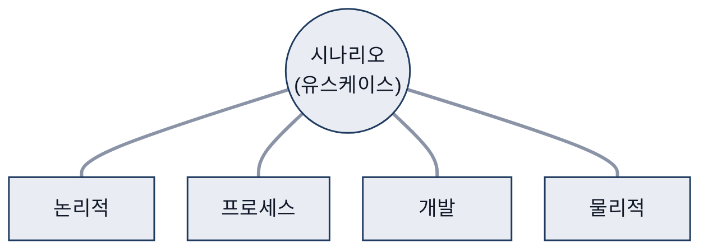
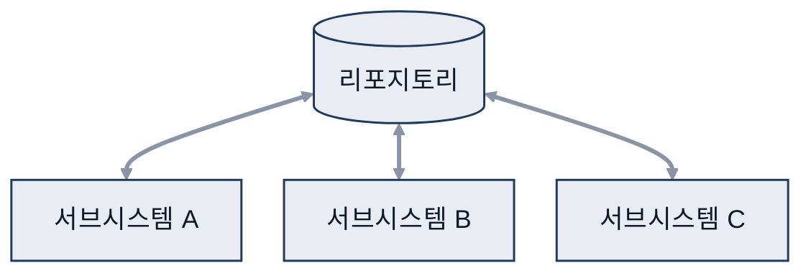
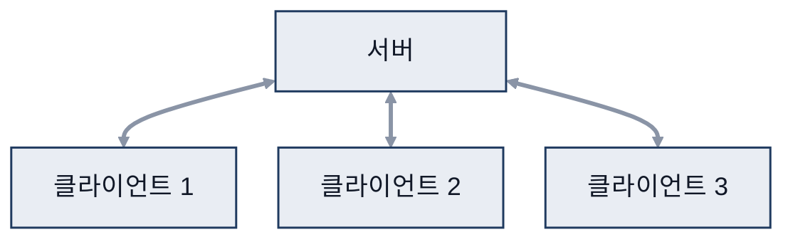
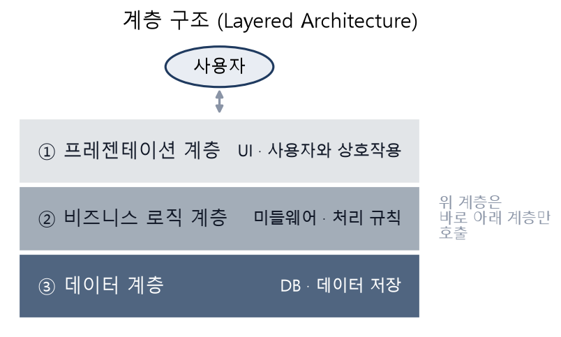
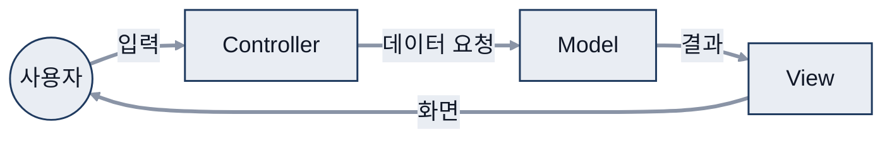
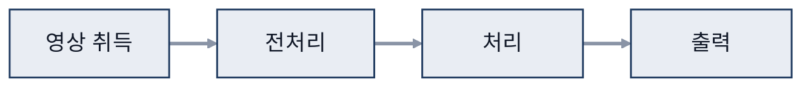
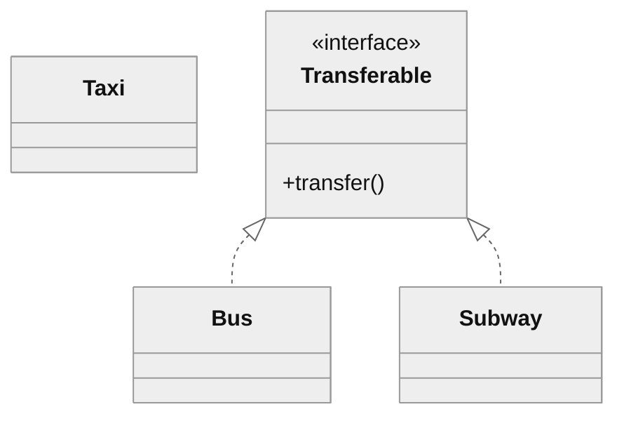
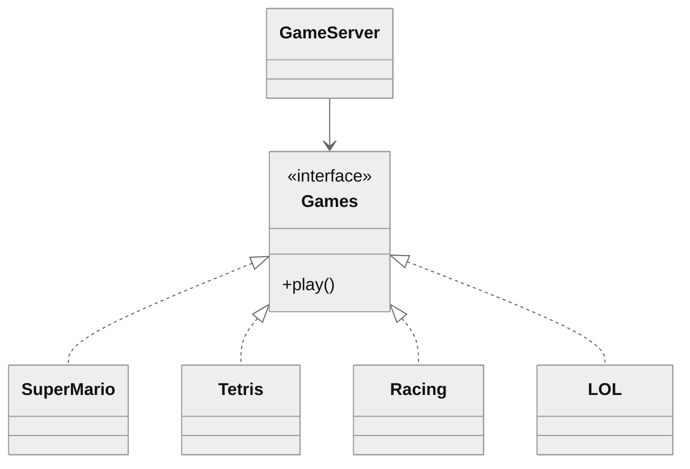

# 06. 아키텍처 설계와 클래스 설계

> 참고: 소프트웨어공학 강의 자료 p.123 ~ 149 + 수업 필기

## 1. 아키텍처 (p.123 ~ 126)
- **소프트웨어를 개발할 때 뼈대를 세우는 것**
- 특징
  - 추상화된 전체 구조 제공
  - 여러 구성 요소(서브시스템, 컴포넌트)를 다룸
  - 인터페이스로 구성 요소 간 상호작용 정의
  - 세부 내용보다 중요 내용만 다룸
- 고려 사항
  - 이해관계자 사이의 의사소통 도구
  - 구현 **제약 사항** 정의 (비용, 기간, 조직 역량)
  - **품질 요구사항을 반영해 우선순위**에 따라 품질 속성 결정
  - **표준화·패턴화**로 **재사용성** 고려
- 품질 속성: **사용성, 이식성, 유지보수 용이성** 등
  - ⇒ **우선순위에 따라 진행**
- 품질 속성 반영: 중요한 속성 결정 → 목표 설정 → 달성 방법 → 평가 방법

## 2. 품질 속성 SAiP(Software Architecture in Practice) (p.127 ~ 129)
| 구분 | 속성 | 예시 |
|---|---|---|
| 시스템 | 가용성 (예시: 하드웨어 이중화) | 실행용 · 백업용 서버 |
| | 변경 용이성, 성능, 보안성, 사용성 | |
| | 테스트 용이성 | 전체 테스트, 모듈별 테스트 |
| 비즈니스 | **시장 적시성, 비용과 이익, 예상 시스템 수명** **목표 시장, 신규 발매 일정**, 기존 시스템과의 통합 | |
| 아키텍처 | **개념적 무결성, 정확성과 완전성, 개발 용이성** | |

## 3. 4+1 관점 (p.130)
- **문제 영역 1개(시나리오) + 해법 영역 4개(논리적, 프로세스, 개발, 물리적)**
- 정적 표현(유스케이스·클래스·컴포넌트·배치) / 동적 표현(상태·순차·통신·활동)
  - 각 관점은 이 UML(Unified Modeling Language, 통합 모델링 언어) 다이어그램들로 표현

| 관점 | 주목하는 것 | 담당 |
|---|---|---|
| 시나리오(유스케이스) | 사용자가 인식하는 기능 | |
| 논리적(디자인) | 클래스, 컴포넌트와 그 관계 | 분석가·설계자 |
| 프로세스 | **동시성, 동기화** (필요한지?) | 시스템 통합자 |
| 개발(구현) | 서브시스템 모듈 구조 | 프로그래머 |
| 물리적(배치) | 하드웨어 배치 | 시스템 엔지니어 |

## 4. 아키텍처 스타일 (p.131 ~ 136)
### 데이터 중심형 (리포지토리)
- 공유 데이터를 리포지토리에서 중앙 관리 (예시: 은행 시스템)
- 장점: **데이터를 일관성 있게 관리**, 서브시스템 추가 쉬움
  - 데이터 공유 ⇒ A, B, C 모두 같은 데이터 사용
- 단점: **병목 현상**, 리포지토리 변경 시 서브시스템 영향
  - 병목 = 여러 A, B, C가 같이 사용
  - DB(Database, 데이터베이스) 구조 변경 ⇒ 전체적으로 코드 수정 필요

### 클라이언트-서버
- 네트워크 기반 분산 시스템, 서버가 서비스 제공
- 씬 클라이언트: 서버 집중형, 웹 (데이터 비밀)
- 팻 클라이언트 쪽: 최근 추세는 **엣지 디바이스** (단말기 안에서 처리 ⇒ 서버 중요도 낮음)

### 계층
- 기능을 여러 계층으로 나눠 배치
- **계층 내부 응집도 높고, 계층 간 결합도 낮음**
- 프레젠테이션(front-end, UI) / 비즈니스 로직(middleware) / 데이터(back-end)
  - 사용자 ↔ 프레젠테이션 계층
  - API(Application Programming Interface)·미들웨어 ↔ 비즈니스 로직 계층
  - 데이터베이스·하드웨어 ↔ 데이터 계층

### MVC
- MVC(Model-View-Controller): 모델(데이터) · 뷰(화면) · 컨트롤러(제어)로 나눔
- 기능별·특성별 모듈화 → 관리·유지보수·확장 쉬움
- 예시: 웹

### 데이터 흐름 (파이프 필터)
- 입력 데이터를 처리해 다음 서브시스템으로 넘기는 과정 반복
- **사용자 개입 없이 데이터 흐름이 이어지는 경우**에 사용
- 예시: CV(컴퓨터 비전): 영상 취득 → 전처리 → 처리 → 출력

## 5. 클래스 간의 관계 (p.137 ~ 142)
| 관계 | UML 표기 (예시) | 의미 | 표기 읽는 법 |
|---|---|---|---|
| 연관 | 교수 `──` 학생 | 클래스끼리 연결 (예시: 교수 4 : 학생 1..\*) | 실선 |
| 일반화 | 학생 `──▷` 사람 | 공통점을 묶어 상위 클래스로 | 실선 + 빈 삼각형 (상위 쪽) |
| 집합 | 컴퓨터 `◇──` 모니터 | 전체-부분, 부분이 독립적 | 빈 마름모 (전체 쪽) 모니터, 본체, 키보드를 **개별 교체 가능 = 집합** |
| 합성 | 집 `◆──` 방 | 전체-부분, 부분이 전체에 종속 | 채운 마름모 (전체 쪽) |
| 의존 | 프로그램 `┄┄>` 스캐너 | 필요한 순간에만 다른 클래스 사용 | 점선 + 열린 화살표 아래 참고 |
| 실체화 | 버스 `┄┄▷` Transferable | 인터페이스로 공통 메서드를 묶음 | 점선 + 빈 삼각형 아래 참고 |

- 의존 관계
  - 멤버 변수로 `new Scan()` → **불필요하게 반복됨**
  - 지역 변수로 선언 → **필요할 때만 작동**
- 실체화 관계
  - 버스·지하철 클래스만 Transferable 인터페이스를 실체화 (점선 + 빈 삼각형 ┄▷)
  - 버스·지하철끼리는 환승(transfer) 가능, 택시는 실체화하지 않아 환승 불가

- 예시 (교통수단에 실체화 적용)
  - Bus·Subway는 Transferable 인터페이스를 실체화 (점선 + 빈 삼각형) → transfer() 사용 가능
  - Taxi는 실체화하지 않아 환승 불가

## 6. 클래스 설계 원칙 SOLID (p.143 ~ 149)
| 원칙 | 핵심 | 효과 · 예시 |
|---|---|---|
| **SRP**(Single Responsibility Principle) 단일 책임 | 클래스를 바꿀 이유는 하나뿐이어야 함 | **재사용·유지보수에 유리**, 코드 단순화 |
| **OCP**(Open-Closed Principle) 개방 폐쇄 | 변경에는 닫힘 (**영향 안 받음**) 확장에는 열림 (**새 클래스 쉽게 추가**) | |
| **LSP**(Liskov Substitution Principle) 리스코프 교체 | 상위 객체를 하위 객체로 바꿔도 정상 동작 | 아래 참고 |
| **DIP**(Dependency Inversion Principle) 의존관계 역전 | 구체 클래스가 아닌 추상 클래스(인터페이스)에 의존 | 아래 참고 |
| **ISP**(Interface Segregation Principle) 인터페이스 분리 | 쓰지 않는 메서드와 의존하면 안 됨 | 사용자(교수·학생 등)별로 필요한 인터페이스만 분리 |

### LSP
- 상위 클래스 속성 `charge:int`: 모든 하위 클래스에 똑같이 들어감
- 하위 클래스는 상위 책임을 무시·재정의하지 말고 **확장만 수행**
- 상속 구조에서 추상 클래스·추상 메서드라면 **재정의 사용 권장**
  - 보충
    - 추상 메서드는 하위 클래스에서 반드시 구현(재정의)
    - LSP가 막는 것은 상위 동작의 약속을 깨는 재정의
    - 추상 메서드 구현은 해당 없음

### DIP
- 구체 클래스: 실제 구현된 class
- 추상 클래스(인터페이스): 내부는 메서드 이름 정도만 정의
- 적용 전: GameServer(client)가 게임 클래스를 직접 사용
  - **게임 추가할 때마다 설정 변경 필요**
- 적용 후: GameServer → Games(추상) ← SuperMario, Tetris, Racing, LOL
  - 하위 Racing, Tetris 등이 바뀌어도 **영향 안 받음**
  - Games는 선언만, 하위 클래스에서 구현

- 예시 (게임 서버에 DIP 적용)
  - GameServer는 Games 인터페이스에만 의존 (실선 화살표)
  - 각 게임은 Games를 실체화 (점선 + 빈 삼각형)
  - → 새 게임을 추가해도 GameServer 수정 불필요

