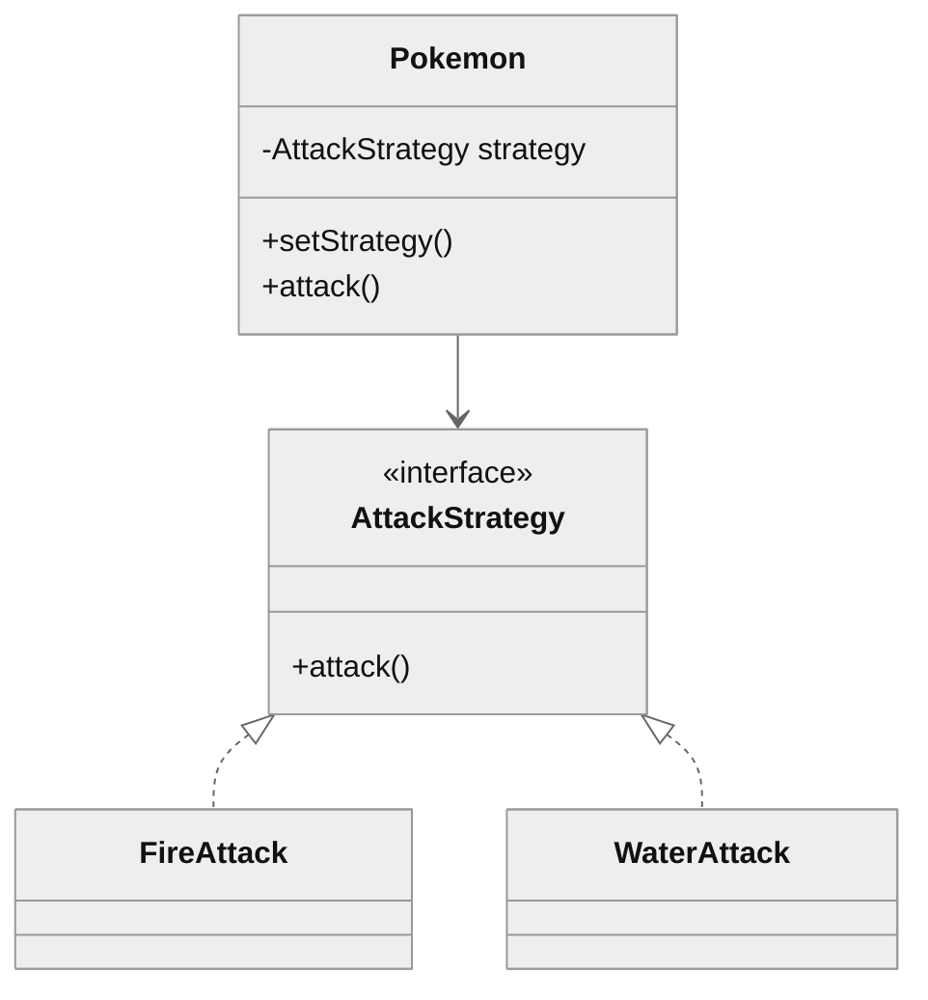
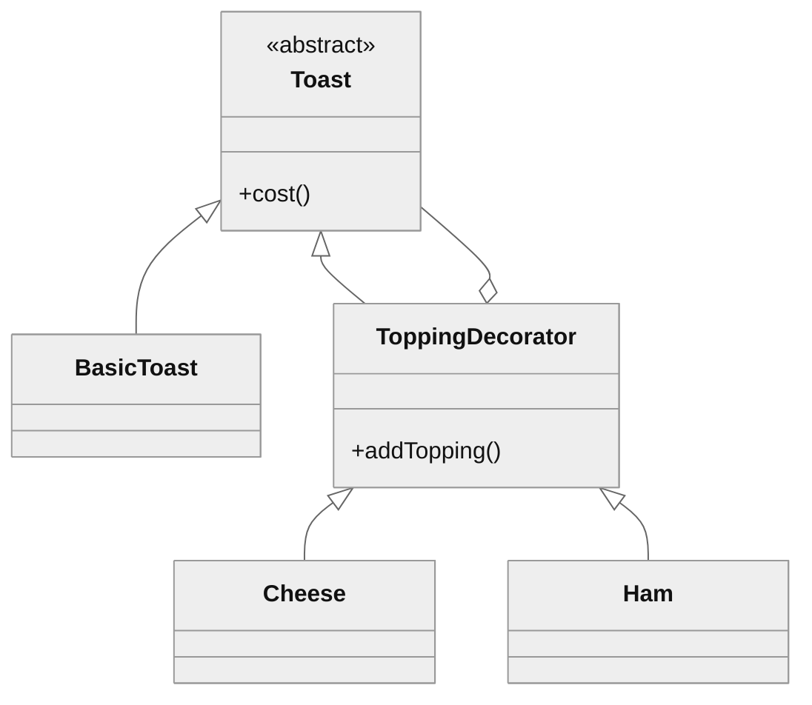
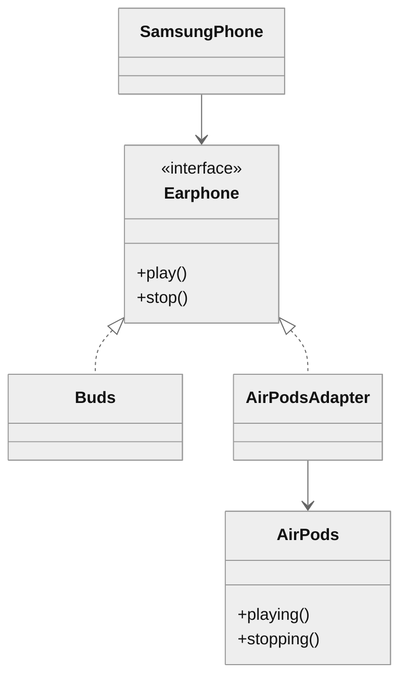
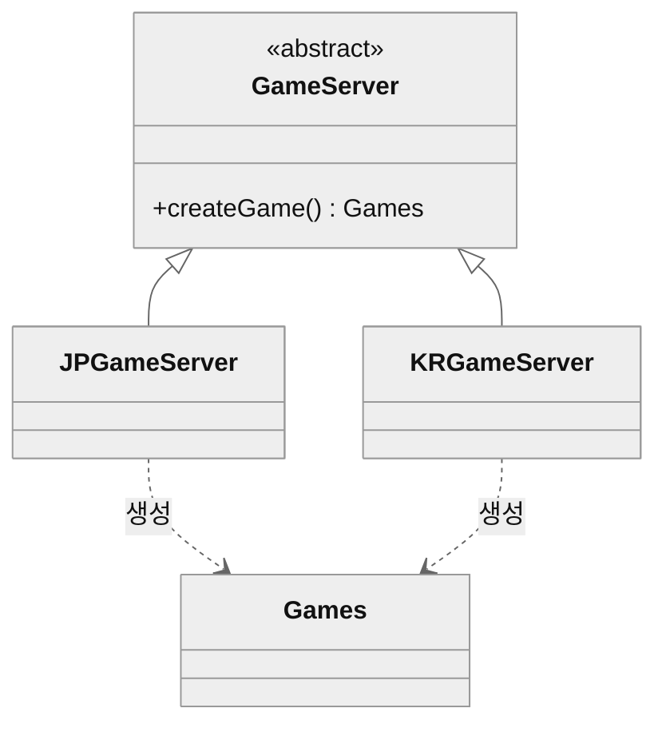
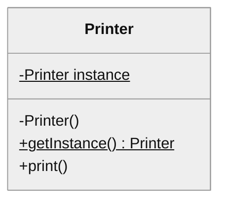

# 07. 디자인 패턴

> 참고: 소프트웨어공학 강의 자료 p.150 ~ 173 + 수업 필기

## 1. 디자인 패턴이란 (p.151 ~ 152)
- 과거 사례·경험을 바탕으로 한 설계 지식·노하우
- **너무 일반적이거나 구체적이지 않은** 형태로 **지식·노하우를 공유**하기 위한 접근법
  - 세부 구현까지 정하지는 않음
- 재사용에 유용한 객체지향 설계를 패턴으로 정립한 것
- GoF(Gang of Four): 23개 패턴, **행위 / 구조 / 생성** 패턴으로 나눔

## 2. 행위 패턴 (p.153 ~ 154)
- 객체 간 **상호작용을 패턴화**
- **변경 빈도가 높은 대상에 집중**
- 종류: strategy, state, template method, observer, iterator, command 등

### strategy
- 메서드를 클래스로 바꾸고 `<<interface>>` 상속 구조를 만듦
- 메서드(알고리즘) 변화에 집중
- 예시: 포켓몬마다 다른 공격·패시브 기능

- 예시 (포켓몬)
  - 공격 방식을 AttackStrategy 인터페이스로 분리
  - → 포켓몬마다 FireAttack · WaterAttack 등을 바꿔 끼움

## 3. 구조 패턴 (p.162 ~ 166)
### decorator
- 클래스를 계속 늘리지 않고 기능을 덧붙여 조합
- 예시: 토스트 + 토핑 조합 (치즈, 야채, 햄 등) → 조합마다 클래스를 만들면 끝이 없음
- 해결: ToppingDecorator를 두고 `addTopping()`으로 토핑을 붙여 나감
  - 선택은 사용자, 개발자는 기본 토핑만 추가 → **개발자가 관리할 것이 적음**

- 예시 (토스트)
  - ToppingDecorator가 Toast를 감싸며 Cheese · Ham 토핑을 덧붙임
  - → 조합마다 클래스를 만들 필요 없음

### adapter
- 컴포넌트가 맞지 않아 못 쓰면 adapter를 만들어 사용
- 클래스 adapter: 상속 이용 / 인스턴스 adapter: 위임 이용
- 예시: 삼성폰에서 AirPods 사용
  - 삼성폰 → AirPods: **인터페이스 안 맞음** (불가능)
  - 삼성폰 → Buds: **인터페이스 맞음**
  - AirPodsAdapter가 `play()` → `playing()`, `stop()` → `stopping()` 연결 (호환성)

- 예시 (삼성폰 + AirPods)
  - AirPodsAdapter: Earphone 인터페이스(play · stop) → AirPods 메서드(playing · stopping) 연결

## 4. 생성 패턴 (p.167 ~ 173)
- 객체 생성·참조 **과정을 추상화**해 생성 과정을 **분리**
  - 객체를 직접 생성하지 않음
- 변경이 전체 시스템에 주는 영향 최소화
- 종류: factory method, singleton, prototype, builder, abstract factory

### factory method
- 객체 생성을 직접 하지 않고 전문 클래스(메서드)에 맡김
- 예시
  - 상위 GameServer는 생성 절차만 정함
  - 실제 게임 객체 생성은 하위 JPGameServer·KRGameServer가 맡음
  - 만들어진 객체는 Games 타입으로 다룸

- 예시 (게임 서버)
  - 객체 생성은 하위 JPGameServer · KRGameServer가 맡음
  - 사용하는 쪽은 Games 타입만 앎

### singleton
- 클래스의 객체를 **하나만** 만들도록 보장
- **하나의 객체를 만들고 다른 곳에서 참조해 사용** (예시: **공유 프린터**)
  - 간접 접근 (나는 요청만 가능), 프린터 고유 방식으로 처리
- 만드는 법
  - 생성자를 `private`으로 선언
  - 객체를 `static`으로 선언, `static getInstance()`로 꺼내 씀
  - **한 번만 초기화 = 중복 생성 허용 X**

- 예시 (공유 프린터)
  - 생성자는 private
  - instance와 getInstance()는 static (밑줄 표시)
  - → 객체는 하나만 존재

## 참고
- 싱글턴(Singleton) 패턴을 Python 클래스로 구현 (공유 프린터 예시)
