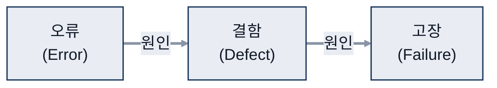
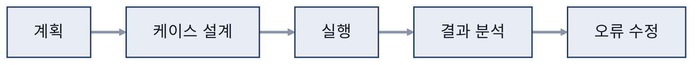
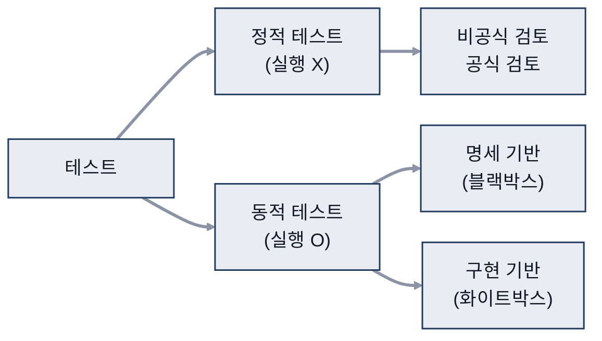
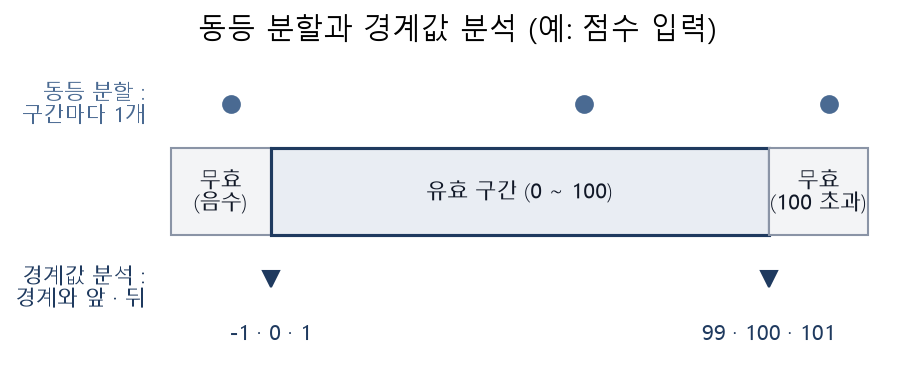
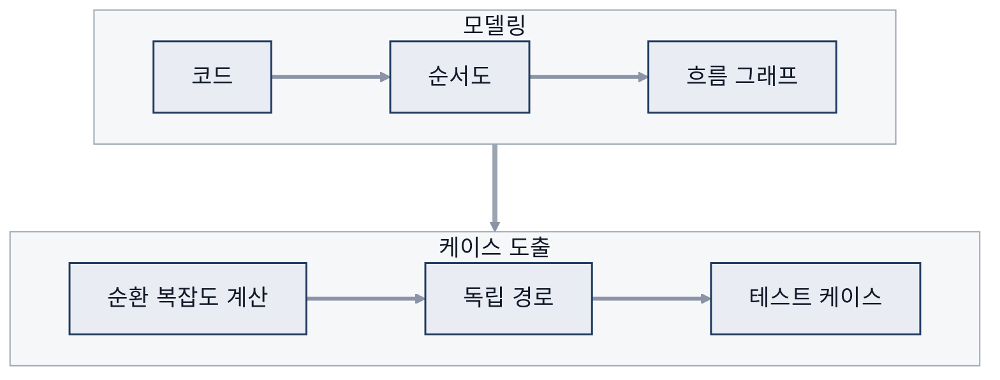
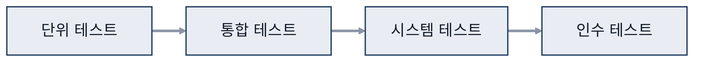
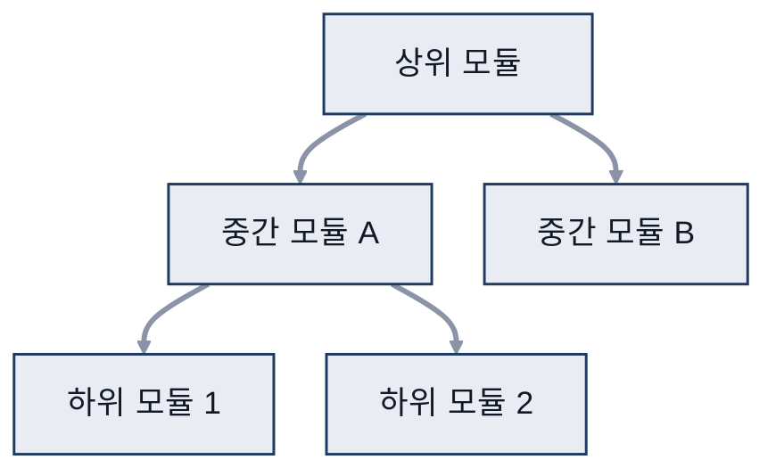

# 09. 테스트

> 참고: 소프트웨어공학 강의 자료 p.186 ~ 218 + 수업 필기

## 1. 테스트의 목적 (p.186)
- **소프트웨어 테스트의 주요 목적 = 신뢰성 향상**
- 협의: 남아 있는 오류 발견, 결함 예방
- 광의: 고객 요구를 만족하는지 확인
- 테스트는 결함이 있음을 보여 줄 뿐, 결함이 없음을 증명할 수는 없음

## 2. 테스트할 때의 문제 (p.187)
- 잘 작동하는 시나리오 / 잘못되는 시나리오 둘 다 tc(테스트 케이스)로 필요
- **테스트 케이스가 적음**, **완벽한 테스트 케이스 도출이 어려움**
- 실제 사용 환경 구축이 어려움 (코드뿐 아니라 실환경 구축도 어려움)
- 작은 실수 발견이 어려움 → 예외 처리 test가 어려움, main 위주가 됨
- 테스트 중요성에 대한 **인식 부족**
- 특징: 파레토 법칙(20/80), 완벽한 테스트는 불가능, 개발자와 다른 팀이 수행, 테스트 케이스 계속 업데이트

## 3. 관련 용어 (p.188)
- 셋이 무조건 이어지는 건 아님 (모든 오류·결함이 고장으로 이어지지는 않음)

| 용어 | 의미 | 메모 |
|---|---|---|
| **오류(error)** | 개발자의 실수, 결함의 원인 | 근본 원인 |
| **결함(defect, bug, fault)** | 오류 때문에 프로그램이 불완전한 상태, 고장의 원인 | |
| **고장·실패(failure)** | 시스템이 요구사항대로 작동하지 않음 | |

## 4. 테스트 절차 (p.189 ~ 194)
- **계획 → 테스트 케이스 설계 → 실행 및 측정 → 결과 분석 → 오류 추적 및 수정**
  - ※ 테스트 케이스 설계가 핵심

| 단계 | 하는 일 | 산출물 | 메모 |
|---|---|---|---|
| 계획 | 목표, 대상·범위 결정 | 테스트 요구사항 정의서, 계획서 | |
| **케이스 설계** | **설계 기법 정의, 테스트 케이스 도출, 원시 데이터 작성** | 케이스 명세서, 설계서, 절차서 | 케이스 도출 = 시나리오 |
| **실행 및 측정** | **환경 구축, 테스트 실시** | **테스트 결과 문서** | 환경 구축이 어려움 |
| **결과 분석** | 계획 대비 결과 비교, 보고서 작성 | 결과 분석서, 결과 보고서 | 예상 출력 ↔ 실제 출력 비교해 문제 step 찾아감 |
| **오류 추적 및 수정** | 원인 파악, 수정, 재검토 | 오류 분석 및 수정 보고서 | |

## 5. 테스트 분류
- QC(Quality Control, 품질 통제)/QA(Quality Assurance, 품질 보증), 개발자, 테스터 중 누구 관점이냐에 따라 달라짐

### 관점 (p.196)
- **Verification**: 설계서**대로** 만들었는지
- **Validation**: 사용자의 **요구사항을 만족**하게 만들었는지

### 사용 목적 (p.197)
| 테스트 | 내용 | 메모 |
|---|---|---|
| **성능** | 효율성, 시간, 부하 | 정상적인 상황 / 시간 = 동시 접속 test / 부하 = 폴더폰을 X번 접었다 폈다 가능한지 |
| **스트레스** | **비정상적이고 과도한 부하**에서도 동작하는지 | 온도, 소비·유통기간 등 |
| **보안** | 불법 침투를 막는지 | |
| **안전성** | 일정 기간 부하, 자원 정상 사용(**메모리 누수**) | A가 메모리 1MB를 잡고 반납을 잘 안 함 ⇒ 반복 ⇒ 메모리 공간 부족 |
| **복원 가능성** | 고장 후 복구가 잘 되는지 | ex) 블루스크린 |

### 실행 여부 (p.198 ~ 202)
- 정적 테스트와 동적 테스트는 **같이 진행**
- **정적 테스트**: 실행하지 않고 **코드 검토** + 문서 검토
  - **비공식 검토**: 개별 검토, 동료 검토
  - **공식 검토**: 검토 회의, **소프트웨어 검사**(추천) → **사회자·진행자가 필요**
  - 공식 검토 절차: 계획 → 착수 → 개별 준비 → 검토 회의 → 재작업·수정 → 후속 처리 확인
- **동적 테스트**: **실행하면서 오류 찾기**
  - **명세 기반 (블랙박스)**: **입력값에 대한 예상 출력과 실제 출력을 비교**
    - 사용자가 원하는 기능(요구사항) 수행 여부 테스트
  - **구현 기반 (화이트박스)**: 내부 구조를 기준으로 테스트
    - 소스 코드의 모든 라인 실행, 알고리즘 / 실제로는 어려움

## 6. 명세 기반 테스트 기법 (p.203 ~ 208)
| 기법 | 핵심 | 메모 |
|---|---|---|
| **신택스** | 문법 기반, **적합/부적합** 입력의 결과 확인 | 단순 / 적합 = 요구사항 |
| **동등 분할** | **구간마다 임의의 값 하나씩 골라** 확인 | 올바른 case뿐 아니라 **잘못된 case(음수, 100 이상)도 test** |
| **경계값 분석** | **경계값, 경계 바로 앞·뒤 값**으로 확인 | 결과가 '오류'면 **예외 처리 필요** ex) '재입력하세요' |
| **원인-결과 그래프** | 입력 조건 조합 → 의사결정 테이블 → 테스트 케이스 | 아래 참고 |

- 원인-결과 그래프
  - ex) `if (a and B and C) or D` → T/F 조합이 여러 가지
  - 출력: 원인 조합별 결과를 정리한 의사결정 테이블 → 테이블의 각 열이 하나의 테스트 케이스
  - 원인: 과제 제출(T), 97점 → 결과: A+
  - 의사결정 테이블의 결과 값 = 우리가 보는 결과

## 7. 구현 기반 테스트 기법 (p.209 ~ 215)
- (화이트박스) 실제로는 어려움
- 절차: 테스트 데이터 적합성 기준 선정 → 테스트 데이터 생성 → 실행

| 기준 | 핵심 | 메모 |
|---|---|---|
| **문장 검증** | **모든 문장이 최소 한 번 실행** | 커버리지 80% = 전체 문장 중 80% 실행 / 경로 = python의 if, while, for |
| **분기(결정) 검증** | **조건문의 모든 경우가 실행** | 분기에 따라 테스트 |
| **조건 검증** | **개별 조건식마다 최소 한 번씩** | 커버리지(분기점…) |
| 분기/조건 검증 | 개별 조건식 + 전체 조건식 모두 만족 | |
| **다중 조건 검증** | **마스크 문제 해결** | and로 묶인 식에서 하나가 F면 전체가 항상 F → 나머지 조건은 검증되지 않음 |
| **기본 경로** | **독립적인 경로를 모두 수행** | 아래 참고 |

- 문장 검증
  - 예시는 이상적인 test라 경로 1만 진행 → 실제로는 ②③④도 하는 것이 좋음
  - 복잡해지면 예상 출력값 뽑는 것도 어려움
- 기본 경로 테스트
  - 코드 → 순서도 → 흐름 그래프 → 순환 복잡도 계산 → 독립 경로 → 테스트 케이스

  - 순서도 묶기 = 모듈화 ⇒ section이 생김
  - 순환 복잡도가 높은 구역일수록 독립 경로가 많음 → 테스트 케이스를 더 많이 배정

## 8. 개발 단계별 테스트 (p.216 ~ 218)
- 단위 → 통합 → 시스템 → 인수, 그리고 **회귀**
  - V 모델 오른쪽으로 올라갈수록 **필터링됨**

- **회귀 테스트**: 재실험 test
  - **수정·변경 때문에 다른 영역이 영향을 받지 않았는지 확인**
  - 문제 → Feedback → 원래 data로 다시 test
- **단위(모듈) 테스트**
  - 모듈이 정해진 기능을 정확히 하는지
  - 테스트 드라이버, 스텁 필요
- **통합 테스트**: 모듈을 합칠 때 생기는 오류 확인
  - **빅뱅**: 한꺼번에 결합, 오류 원인 찾기 어려움
  - **점진적**: **하향식**(넓이 우선, 깊이 우선), **상향식**

- 하향식: 상위 → 하위 순서로 통합, 아직 없는 하위 모듈은 스텁(Stub)으로 대신
- 상향식: 하위 → 상위 순서로 통합, 아직 없는 상위 모듈은 드라이버(Driver)로 대신

## 참고
- 조건 검증 커버리지 표 직접 작성
