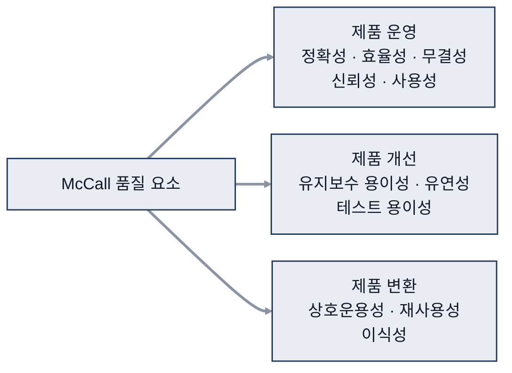
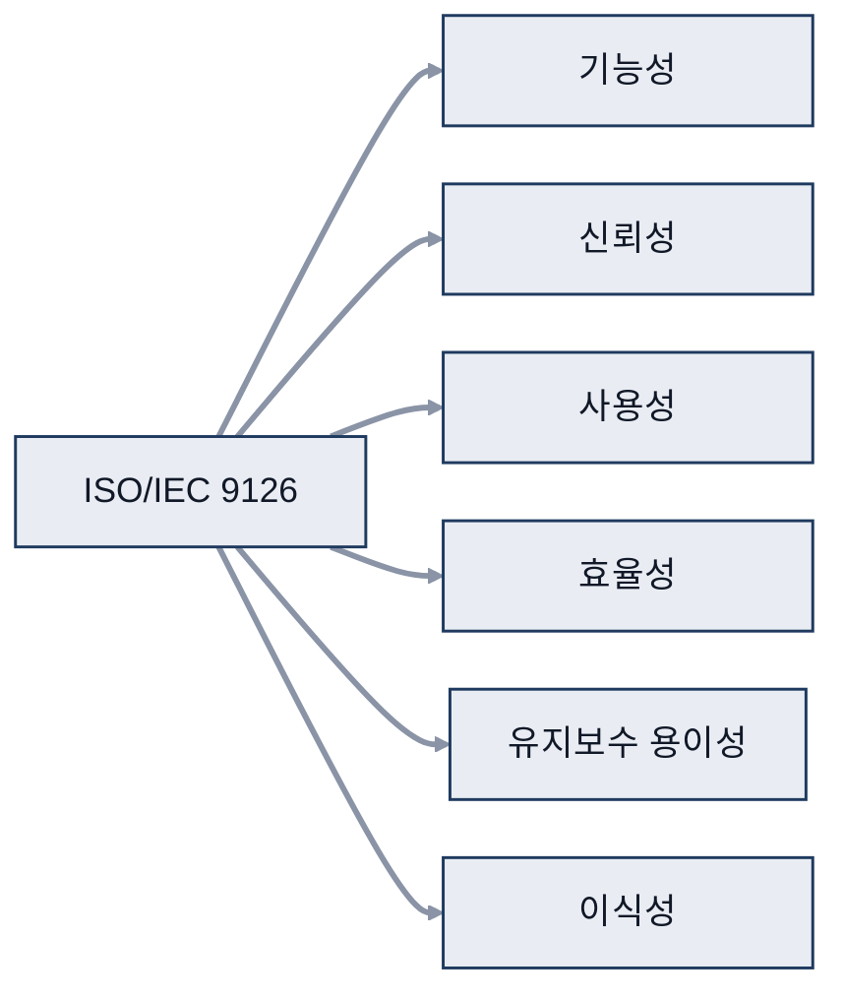
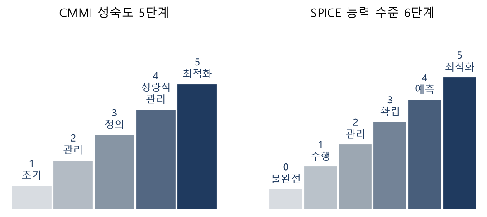

# 10. 품질

> 참고: 소프트웨어공학 강의 자료 p.221 ~ 250 + 수업 필기

## 1. 품질이란 (p.221 ~ 222)
- 품질 = **신뢰도**
- SW(Software, 소프트웨어) 품질 측정이 어려운 이유
  - 요구사항을 구체적인 수치로 정하기 어려움
    - 예시: 얼굴 인식: 인형도 인식 대상인지, 외국인 얼굴도 포함인지
  - 직접 사용해 봐야 만족 여부 판단 가능
- **IEEE(Institute of Electrical and Electronics Engineers, 국제 전기전자공학회) 품질 정의**
  - SW가 **필요한 속성을 갖춘 정도**
  - **사용자의 기대 수준을 만족하는 정도**
- 관점별 품질
  | 관점 | 좋은 품질 |
  |---|---|
  | 프로젝트 관리자 | 계획한 비용·기간 안에 완료 |
  | **개발자** | 코딩 표준 준수, 수정·추가 쉬움 |
  | **유지보수자** | 가독성, 코딩 규칙, 주석 |
  | 구매 담당자 | 요구를 만족하면서 가격이 낮음 |
  | **사용자** | 쉬운 사용법, 빠른 속도, 직관적 |
  - ※ 개발자·유지보수자·사용자 관점에서 테스트를 많이 수행

## 2. 품질 목표와 요소 (p.223 ~ 226)
- W.E.Perry의 11가지 품질 목표
  - 정확성, 신뢰성, 효율성, 무결성, 사용성
  - 유지보수 용이성, 테스트 용이성, 유연성
  - 이식성, 재사용성, 상호운용성
- **McCall 품질 요소**

| 분류 | 요소 | 부가 설명 |
|---|---|---|
| 제품 운영 | **정확성, 효율성, 무결성**, 신뢰성, 사용성 | |
| 제품 개선 | **유지보수 용이성, 유연성, 테스트 용이성** | 테스트 용이성: 함수 · 클래스로 묶인 코드가 테스트에 유리 |
| 제품 변환 | 상호운용성, **재사용성**, 이식성 | 재사용성: 함수 · 클래스 단위 재사용 |

## 3. ISO/IEC 9126 (p.228 ~ 236)
- ISO/IEC: 두 기관이 함께 만든 국제 표준
  - ISO(International Organization for Standardization): 국제표준화기구
  - IEC(International Electrotechnical Commission): 국제전기기술위원회
- 용도: 품질 판단의 **'근거'**
- 구성: 9126-1 품질 모델 / 9126-2 외부 품질 / 9126-3 내부 품질 / 9126-4 사용 품질
- 수업 설명: 내부 품질 = 개발자 쪽, 외부 품질 = 구매자 쪽
  - 보충: 표준 기준
    - **내부 품질 = 설계·구현 단계에서 코드·문서로 측정**
    - **외부 품질 = 실행해 보고 측정**
    - 시험에서는 이 기준으로 구분

### 6가지 품질 특성
| 특성 | 하위 특성 | 하위 특성 설명 |
|---|---|---|
| **기능성** | 적합성, 정확성, 상호운용성, 보안성, 준수성 | 상호운용성 예시: 리눅스 환경, 윈도우 환경 |
| **신뢰성** | 성숙성, **결함 수용성**, 회복성, 준수성 | 성숙성 = 문제가 생겨도 정상 작동 가능한지 결함 수용성 = **일부가 고장 나도 요구 기능 유지** |
| **사용성** | 이해성, 학습성, 운용성, 친밀성, 준수성 | 사용법을 **쉽게 이해** **평소 생각하던 방식대로** 사용 **쉽게 운용·제어**, **호감** |
| **효율성** | 시간 효율성, 자원 활용성, 준수성 | **응답 속도** **자원 사용의 적절성** |
| **유지보수 용이성** | 분석성, 변경성, 안정성, 테스트 용이성, 준수성 | 변경성 = 높은 응집도 · 낮은 결합도 필요 |
| **이식성** | 적응성, 설치성, 대체성, 공존성, 준수성 | |

- 사용 품질: 효과성, 생산성, 안정성, 만족도

## 4. 그 밖의 제품 품질 평가 모델 (p.238 ~ 240)
- **ISO/IEC 14598**: 품질 평가 절차
  - 평가 요구사항 정의 → 평가 명세 → 평가 설계 → 평가 수행

  - 평가 척도 = 항목, 등급·평가 기준 = 세부 사항
  - 우리나라 → 'Good Software'
    - 보충: 국내 **GS(Good Software) 인증**이 이 표준을 바탕으로 함
- **ISO/IEC 12119**: **패키지 소프트웨어**의 **품질 요구사항과 테스트** 표준
  - 대상: 제품 설명서, 사용자 문서, 실행 프로그램
  - **실제 코드를 실행하는 구조적 테스트는 제외** = 화이트박스 테스트 제외
- **ISO/IEC 25000**: 여러 평가 표준을 **통합**해 다시 구성
  - SQuaRE(Software product Quality Requirements and Evaluation)
  - ISO/IEC 9126의 품질 특성을 이어받아 ISO/IEC 25010 품질 모델로 정리

## 5. 프로세스 품질 평가 모델 (p.241 ~ 249)
- 최종 품질에 영향을 주는 **개발 과정**의 품질

### ISO 9000
- 품질 관리·보증 모델 ('환경')
- 설계, 생산, 검사 전반의 **규격 준수 여부를 확인해 인증**
- SW 개발 전용으로 구체화된 표준은 아님 (특정 분야 전용 X)
- SW에 적용 가능한 **일반 원리**만 규정
- **제조업부터 서비스업까지** 여러 조직에 적용 (wide: 학교, 병원 등)

### ISO 12207
- 소프트웨어 생명주기 프로세스 표준
- 기본(계약·공학·운영 관점) / 지원(품질 경영 관점) / 조직(관리 관점) 생명주기 프로세스
  - 공학 관점 = 개발 절차, system → HW(Hardware, 하드웨어) / SW
  - 품질 경영 관점
    - 조직 체계 정비 여부
    - **SOP(Standard Operating Procedure, 표준 운영 절차) 정비 여부**

### CMMI
- CMMI(Capability Maturity Model Integration, 능력 성숙도 모델 통합)
- 출발: **소프트웨어 역량 성숙도** 모델(CMM, Capability Maturity Model)
- 뜻
  - **C**(능력): 주어진 기간·비용으로 목표를 이루는 힘
  - **M**(성숙도): 프로세스가 조직에 정착된 정도
  - **M**(모델): 프로세스 감사·검사
  - **I**(통합): 생명주기 전체를 통합
- 성숙도 높은 조직 vs 낮은 조직: 차이 = 절차
- 5단계
  | 단계 | 프로세스 | 특징 |
  |---|---|---|
  | 1 초기 | 없음 | |
  | 2 관리 | 규칙화 | 임시방편 수준 |
  | 3 정의 | 표준화 | |
  | 4 정량적 관리 | 예측 가능 | 정량 데이터로 판단 |
  | 5 최적화 | 지속적 개선 | |
  - 프로세스 영역 옆 `L2` 등 = Level
- 목표와 수행 지침
  - **일반(공통) 목표**: 모든 프로세스 영역에 공통으로 적용
  - **세부 목표**: **특정 프로세스 영역에만** 적용
- 평가 방법
  - **단계적 표현**: **가장 낮은 점수가 등급을 결정**
  - **연속적 표현**: **항목마다 레벨을 따로 매김**

### SPICE (ISO 15504)
- SPICE(Software Process Improvement and Capability dEtermination): 프로세스 평가 국제 표준
| 단계 | 특징 |
|---|---|
| 0 불완전 | |
| 1 수행 | 산출물 생성 |
| 2 관리 | 관리 |
| 3 확립 | 표준화 |
| 4 예측 | 정량적 측정으로 프로세스 결과 예측 |
| 5 최적화 | 지속적 개선 |

## 6. 품질 관리 (p.250)
| 구분 | 의미 |
|---|---|
| **품질 통제(QC)** | 개발자가 품질 절차·표준을 지키도록 **프로세스 정의 · 규정 수립** |
| **품질 보증(QA)** | **결함을 줄여** 좋은 SW를 만들기 위해 **요구 품질 수준 파악** · 달성 방법 결정 |
- 개발 단계별 활동
  - 개발 전: 표준 지침서
  - 개발 중: 명세서·설계서 검토, 테스트
  - 개발 후: 유지보수·변경 관리 계획 검토
- IEEE 품질 보증 계획서 중 **관리, 문서화, 표준, 검토·검사** 항목이 핵심
