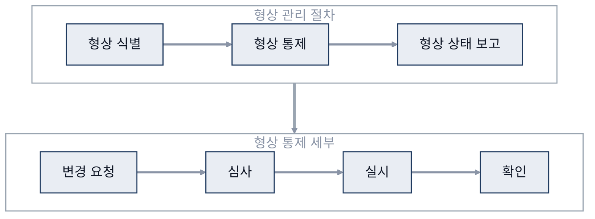

# 11. 프로젝트 관리

> 참고: 소프트웨어공학 강의 자료 p.252 ~ 260 + 수업 필기

## 1. 프로젝트 (p.252)
- PMI(Project Management Institute, 미국 프로젝트관리협회) 정의
  - 유일한 제품·서비스를 만들기 위해 **일정한 기간**을 정해 수행하는 작업
- 특징
  - 한시성: 기간이 정해짐
  - 유일성: 결과물이 유일
  - 참여자의 일시성: 인력이 일시적으로 소속
  - 한정된 자원
- **프로젝트 매니저(PM, Project Manager) 역할**
  - 시작부터 기획·설계
  - 팀원을 적재적소에 배치
  - 고객과 의견 조율
  - 진척 관리, 문제 해결 주도(책임감)
  - 인력 관리 (중도 이탈 방지)
  - 기간 안에 결과물 인도

## 2. PMBOK 5가지 프로세스 그룹 (p.253 ~ 254)
- PMBOK(Project Management Body of Knowledge): PMI가 정리한 프로젝트 관리 지식 체계
- 흐름: 시작 → 기획 → 실행 ⇄ 통제 → 종료

| 그룹 | 하는 일 | 요약 |
|---|---|---|
| **시작** | 범위 관리 착수, 프로젝트 정의·승인 | 시작, 방향 제시 |
| **기획** | 범위·작업·일정·위험·자원·비용 계획, 프로젝트 계획 문서화 | 구체적 정의, 문서화 |
| **실행** | 계획 실행 (품질 보증, 팀 개발, 정보 배포, 계약 관리) | |
| **통제** | 진척 감시·성과 측정, 변경 통제 | 관리 |
| **종료** | 계약 종료, 관리 종료 (완료 보고, 참조 사항 정리) | |

## 3. PMBOK 9가지 관점 (p.255)
- **통합, 범위, 일정, 비용, 품질, 인적 자원, 의사소통, 위험, 조달** 관리
- ※ 인적 자원 관리, 조달 관리는 수업 범위에서 제외

## 4. 형상 관리 (p.256 ~ 259)
- 형상 = **프로젝트 산출물**
- 개발 중 계속 바뀌는 산출물(형상)을 체계적으로 관리·유지하는 기법
- 누가, 무엇을, 언제, 왜 바꿨는지 가시성 확보
- 변경 관리: 업무 환경 변화(고객 요구, 시장, 예산·일정), 기술 환경 변화(하드웨어, OS)
- 버전 관리: 버전별 정보를 DB(Database, 데이터베이스)로 관리

| 절차 | 하는 일 | 부가 설명 |
|---|---|---|
| **형상 식별** | 형상 항목·식별자 규칙·베이스라인 선정 | 변경 대상 식별 |
| **형상 통제** | 변경 요청 → 심사 → 실시 → 확인 | 팀원 작업이 서로 연결되어 있음 → 변경은 요청 → 승인 절차를 거침 |
| **형상 상태 보고** | 감사 일정·절차 정의, 감사, 보고서 작성 | 변경 내용 보고 · 공유 |

- 역할
  - **형상 관리 담당자**(보고 체계): 계획서 작성, 저장소 생성, 베이스라인 설정, 상태 보고
  - **형상통제위원회**: 변경 수락·거절, 필요성·비용·일정·유지보수 영향 검증

## 5. 유지보수 (p.260)
| 종류 | 내용 |
|---|---|
| **수정** | 보고된 오류 수정 |
| **적응** | 환경 변화(OS, 주변 장치, 네트워크) 대응 |
| **기능 보강** | 새 기능 추가, 기존 기능 개선 |
| **예방** | 예상되는 오류를 미리 찾아 수정 |
